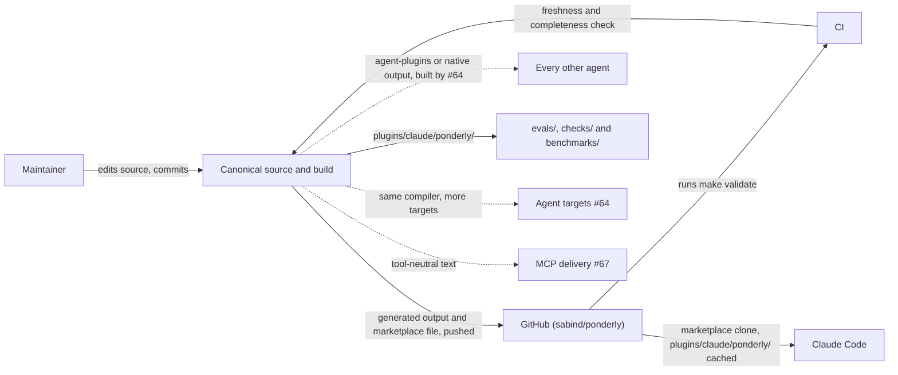
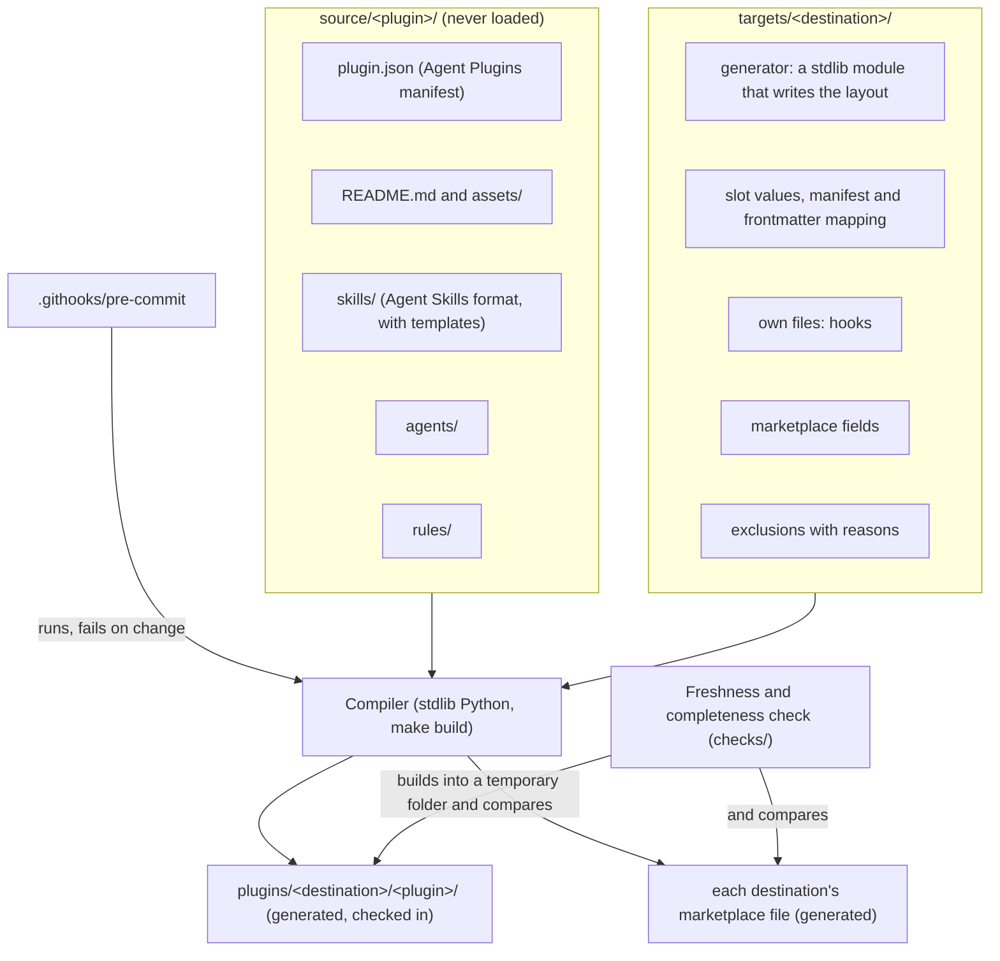

# Canonical source

Parent: .ponderly/strategies/multi-tool-plugin.md

## Scope

This design takes the strategy's first stream, canonical source and the Claude Code target, which is issue #63. It serves goals 1, 2 and 3.

It covers five things:
- the canonical folder, which holds every plugin the repository ships, each laid out in the open formats;
- the neutral markers where destinations differ;
- the compiler, with the pre-commit hook that runs it and the freshness and completeness check that backs it in CI;
- the layout every destination's output follows, one folder per destination and plugin, so more plugins and more destinations need no change of shape;
- the first target, Claude Code, whose output must match today's `plugins/ponderly/` byte for byte, moved to `plugins/claude/ponderly/`, with one exception: the version, bumped once when the move ships.

Every other destination is the agent targets stream, #64. The eval harness is the cross-agent evals stream, #65.

## Context

The maintainer edits only `source/` and the target folders under `targets/`. Committing runs the pre-commit hook, which builds what is staged and fails the commit when the staged output is out of date, so the maintainer stages the rebuilt output and commits again. The build writes `plugins/claude/ponderly/` and the marketplace file that points at it. Claude Code installs that folder and nothing else. Inside the repository, `evals/`, the checks under `checks/` and the benchmark scripts under `benchmarks/` read it too. CI runs the same build through `make validate` and fails when the checked-in output differs. The agent targets stream adds targets to the same compiler, and the MCP delivery stream reads the same canonical text.

Claude Code is the only agent this stream ships to. Every other agent installs either the shared `agent-plugins` destination or a native destination of its own, both built by the agent targets stream, and is never pointed at the Claude Code output.

A marketplace install clones the whole repository, but Claude Code copies only the plugin's folder into its cache and loads only that. The headless install of 2026-11-02 showed this: the marketplace clone held `evals/`, `checks/` and `benchmarks/`, and the cache held only the plugin.

## Architecture

- **`source/<plugin>/`**: one folder per plugin, in the open formats. Today it holds one plugin, `ponderly`, with its eleven skills, six rules and four agents.
  - `plugin.json` is the plugin's [Agent Plugins](https://agent-plugins.org/) manifest: its name, version, description, author, homepage, repository, licence and keywords, once for every destination. A field only one destination reads, such as Claude Code's `displayName`, and the path to the icon, which depends on each destination's layout, come from that target's manifest mapping.
  - `skills/<name>/` follows the [Agent Skills](https://agentskills.io/specification) format. Frontmatter holds only the format's own fields. A field only Claude Code reads, such as `argument-hint` or `arguments`, sits under `metadata` as a string holding the field's YAML text as it is written today, since `metadata` maps strings to strings and `arguments` is a list.
  - `agents/` and `rules/` hold the agents and rules in the shape the plugin writes them today. The Agent Plugins core defines neither; its specification leaves them to each client.
  - `README.md` and `assets/` hold the plugin's README and its two icon files, `icon.png` and `icon.svg`. The README moves in as Claude Code's listing has it today, with no blocks; a passage another destination's listing needs differently gets a block only when #64 finds the difference.
  - Where destinations differ, the text holds a marker in place of destination-specific syntax.
- **Markers**:
  - **Named slots** for the four differences the spike in #61 measured, as the strategy records them: the skill's arguments, a prefetch command, the skill's own folder, and the question tool.
  - **Per-destination blocks,** a rare escape hatch, to include or leave out a passage for one destination.
  - Expanded with stdlib Python only, with no template engine.
- **`targets/<destination>/`**: everything specific to one destination. This stream builds `targets/claude/`.
  - Its generator, a small stdlib Python module the compiler calls with the expanded text of each plugin, which writes the destination's layout: where each file goes and what the manifest is called.
  - The value of each slot. For Claude Code, the arguments slot becomes the argument placeholder today's skills use, the skill-folder slot becomes `${CLAUDE_SKILL_DIR}`, a prefetch slot becomes a `` !`…` `` line, and the question slot names AskUserQuestion.
  - The mapping from the canonical manifest and frontmatter to the destination's own. It also covers fields whose values are written in one agent's terms, such as a skill's `allowed-tools` and an agent's `model` and `effort`. For Claude Code, the manifest becomes `.claude-plugin/plugin.json`, and fields under a skill's `metadata` that Claude Code reads are written back at the top level, in the place and with the quoting they have today, so the frontmatter matches byte for byte.
  - Its own files, copied into each plugin's output. For Claude Code these are `hooks/hooks.json`, `hooks/load-rules.sh` and `hooks/load-rules-subagent.sh`.
  - Its exclusions, each with a reason. Claude Code has none.
  - Its marketplace file's own fields, such as the marketplace's name, `sabind`, and its owner.
- **Compiler:** a stdlib Python script behind `make build`. For every plugin in `source/` and every target, it expands the slots and blocks with that target's values, maps the manifest and frontmatter, and hands the result to the target's generator, which writes `plugins/<destination>/<plugin>/` and copies the target's own files into it. It also writes each destination's marketplace file, listing every plugin built for it. For Claude Code that file stays at `.claude-plugin/marketplace.json`, its entry pointing at `./plugins/claude/ponderly`.
- **Pre-commit hook:** `.githooks/pre-commit`, switched on once per clone by a `make` target that sets git's hooks path. It builds from what is staged, not from the working tree: it writes the staged files to a temporary folder, builds there and compares the result with the staged output. When they differ, it copies the output of that staged build into the working tree's generated folders, deletes any generated file that build no longer produces, such as a removed skill's, fails the commit and names every file to stage, the deleted ones included. Staging them makes the next commit pass, whatever else is unstaged; the next `make build` brings any unstaged edit to `source/` back into the working tree's output. It never stages files itself, and an unstaged edit to `source/` never reaches the output being committed.
- **Freshness and completeness check:** a stdlib `unittest` file under `checks/`, run by `make validate` in CI.
  - It builds every target into a temporary folder and fails when the result differs from the checked-in output, the marketplace files included.
  - It fails when a destination's output for a plugin leaves out any canonical file, a skill's templates, the README and the icon included, that is not in that target's exclusions. Each canonical file is looked for at the path the target's mapping gives it, so the manifest is found at `.claude-plugin/plugin.json` and both icon files wherever the Claude Code layout puts them.
- **`.gitattributes`** marks `plugins/` and every generated marketplace file as generated, so GitHub collapses them in a pull request's diff.

A change moves through it like this. The maintainer edits a skill in `source/ponderly/` and commits. The hook builds, finds `plugins/claude/ponderly/` changed and fails the commit. The maintainer stages the output and commits again, and both land together. If the hook was not switched on, CI fails instead.

Adding a plugin means adding a folder under `source/`; every target builds it, and each marketplace file lists it. Adding a destination means adding a folder under `targets/`; it builds every plugin.

## Key decisions

**Key decision: the canonical source is written in the open formats.** Each plugin's folder is an Agent Plugins package whose skills follow Agent Skills. Codex, Cursor, GitHub Copilot and Kiro already read Agent Plugins, so its destination is close to a copy of the source, and the source does not follow any one vendor's format changes.

The trade-off is that fields only Claude Code reads sit under `metadata` in the source, and the Claude Code target must lift them back to the top level.

Rejected:
- A canonical format of the repository's own, which every destination, the open one included, would have to translate.
- Shipping the canonical package itself to every agent, with no build. Claude-only syntax would reach every agent as literal text, or Claude Code would lose its question tool, folder variable and prefetch lines.

**Key decision: each destination's output goes to `plugins/<destination>/<plugin>/`.** Every installed folder is named after its plugin. Most agents take a plugin's name from its manifest, by the format docs read on 2026-11-02, but where one falls back to the folder name, it still reads `ponderly`. Only that folder ships, so the canonical source, the evals and the checks are never loaded. A destination is named for the layout it writes: `agent-plugins` for the open layout several agents read, and an agent's name, such as `claude` or `cursor`, for that agent's native layout. An agent may have both built, and the agent targets stream, #64, chooses which one it installs by what its evals show. An agent's native format can carry more than the open one: Cursor's carries rules, agents and hooks, while from an Agent Plugins package it reads only skills and MCP servers, according to its plugin reference. No agent is pointed at another agent's native output.

The trade-off is that Claude Code's installed folder moves once, from `plugins/ponderly/` to `plugins/claude/ponderly/`, and the move needs a version bump to reach existing installs. An agent that cannot install from a subfolder needs a fallback, given under Risks.

Rejected:
- `plugins/<plugin>/<destination>/`, which names every installed folder after its destination.
- Settling now on one kind of destination for every agent: the shared one alone, which would cost Cursor its rules, agents and hooks, or a native one for each, which may copy what the shared one already serves before any eval shows the need.

**Key decision: generated at commit time by a pre-commit hook, checked in, with CI as the backstop.** The hook runs the build and fails the commit when output changed, so a forgotten build is caught before it is committed. Checked-in output means an agent installs straight from the repository, or from a subfolder of it, with no build of its own; the agents the strategy names all install from git.

The trade-off is generated files in every commit, a commit that fails once whenever output changes, and a hook each clone switches on once.

Rejected:
- Building at install time. Every agent clones or copies the repository and runs no build.
- A hook that stages its own output, which can commit output built from edits the maintainer did not stage.
- The pre-commit framework, which would be the repository's first dependency outside the stdlib.

**Key decision: named slots for measured differences, with per-destination blocks only as an escape hatch.** Slots keep the canonical text readable and the markers few. That answers the strategy's risk of the markers growing into a programming language.

The trade-off is that a difference no slot covers needs either a new slot, decided deliberately, or a block, which is noisier.

Rejected:
- Blocks everywhere, which turn each skill into one copy per destination inside a single file.
- A template engine such as Jinja, which would be the repository's first dependency outside the stdlib.

**Key decision: skills, rules, agents, the manifest, the README and the icon are canonical; hooks belong to each target.** The canonical folder holds every file a destination ships except the hooks that deliver its rules, so no destination keeps a hand-kept copy of shared text. A hook is not text a destination shares but the mechanism that delivers the shared rules, and its format is the agent's own.

The trade-off is that a README passage one listing needs differently will need a per-destination block once #64 finds one, and each target writes its own hook scripts.

Rejected: canonical hooks with markers. The hooks differ in everything but their purpose: the file that declares them, the events they bind to, and what they print. The spike found the rules reach Cursor's sessions and sub-agents only when the hook prints them as JSON. A canonical hook would be one per-destination block per target, which is a target's own file with extra steps.

**Key decision: the Claude Code target reproduces today's plugin byte for byte before anything else changes.** The migration copies `plugins/ponderly/` into `source/ponderly/` and `targets/claude/`, moving the manifest, the README, the icon and the Claude-only frontmatter into their canonical places and changing no other file. It then replaces Claude-only syntax with slots one kind at a time, and after each kind the build must leave `plugins/claude/ponderly/` identical to today's `plugins/ponderly/`. The one exception is the version in `.claude-plugin/plugin.json`, bumped once when the move ships so that installs follow it. Claude Code, the benchmark, reads exactly what it reads today, and every step can be checked mechanically.

The trade-off is a slower migration, done in several small steps rather than one rewrite.

Rejected: rewriting the canonical text in a neutral voice first and accepting a Claude Code diff. That would change the benchmark while building the thing meant to measure against it.

## Cross-cutting concerns

- **The benchmark.** The byte-for-byte requirement means no Claude Code eval needs to run during the migration itself. If a step of the migration does change the Claude Code output, which the byte-for-byte rule is there to prevent, the eval targets for the skills, rules or agents that step touches run before and after it, by hand and one at a time, as the strategy's constraints on evals require. Edits after the migration follow the repository's existing practice for evals.
- **Validation.** `plugins/claude/ponderly/` and the repository's marketplace must keep passing `claude plugin validate --strict`, which they did after the move in the headless install of 2026-11-02. That install had no `source/` or `targets/` folder beside `plugins/`, so the migration checks the repository-wide validation with both present before anything else. Every working file that names `plugins/ponderly/`, found by a search when the migration runs, moves to the new path. Today these include the Makefile's `PLUGIN` variable, the checks under `checks/`, the benchmark scripts and Dockerfile under `benchmarks/`, `.dockerignore`, `llms.txt`, `evals/README.md`, `docs/reference.md`, `.github/CONTRIBUTING.md` and the guides; where one says where edits go, it points at `source/` instead. Records keep the old path: the merged specs under `.ponderly/specs/`, the strategies and designs, and the recorded captures, images and evidence under `docs/`.
- **Installs.** An installed plugin keeps its cached copy until its version changes. In the headless install of 2026-11-02, from a local git copy of the repository served over HTTP, an update without a version bump left the old copy in place and working. An update after a bump installed the new version from `plugins/claude/ponderly/`, identical to that folder. The test did not go through GitHub itself.
- **Size.** Rules still reach Claude Code through hook output capped at 10,000 characters, which `checks/test_rules_size.py` guards. Both rule hooks print 9,997 characters, measured in the headless install and in the repository on 2026-11-02. The check requires fewer than 10,000, so two characters of room are left. The Claude Code target expands every slot to today's text, so the migration adds nothing to that count; the next rule edit that adds words will need words cut first, as Risks says.
- **No checks on prompt text.** The freshness check compares built files, and the completeness check compares which canonical files are present. Neither reads a skill's wording.

## Risks

- **A construct resists a slot.** Some Claude-only text may not fit any named slot. Likely for one or two passages; it would cost a block or a new slot. A slot is added only for a difference the spike or the weekly report has measured, as the strategy sets. A Claude-only passage that is not one stays as it is in the canonical text until a destination's evals measure the difference; the migration adds no slot or block for it. `canonical-layout-and-slots` sets the slots and the few uses of blocks.
- **Generated output is edited by hand.** Likely at first, since `plugins/ponderly/` is where every edit happens today. It costs the hand edit. The pre-commit hook's build overwrites it and fails the commit, so the maintainer sees it reverted before it lands and redoes it in `source/`; CI catches it where the hook is off. The repository's root README says where edits go; the plugin's own README keeps today's text until the migration is done.
- **The hook is not switched on.** Likely in a fresh clone; worktrees share their clone's setting. Certain for an edit made on GitHub's website. It costs a failed pull request and a rebuild. CI's freshness check fails the pull request, and the check's message names the command to run.
- **Byte-for-byte parity hides a slot bug.** A slot that expands correctly for Claude Code could still be wrong for another destination. Possible. It would cost a wrong text in that destination, found only by its evals. The agent targets stream, #64, proves each target with the cross-agent evals, #65.
- **Another agent picks up the Claude Code output.** Codex reads `.claude-plugin/marketplace.json` when it finds no marketplace file of its own, by OpenAI's plugin docs, and so does Copilot, by the Copilot CLI plugin reference; the spike found Cursor loads the `.claude-plugin` layout too. An operator who adds this repository in any of them before #64 lands would get the Claude Code output, which works only in part, as the spike found. Likely if anyone tries it. It costs that operator a partial plugin. No agent is pointed there: until #64 writes each agent's marketplace file where that agent looks first, the repository's root README names Claude Code as the only supported install.
- **An agent cannot install a plugin from a subfolder.** Sources disagree on whether Kiro installs a power from a subfolder of a repository, Kiro's install docs against community repositories, and some agents that may gain a format do not document it. Possible. It would cost that agent the layout rule. The fallback keeps the rule: the build also publishes that destination's output as a branch or a release archive whose root is the plugin's folder. The agent targets stream, #64, settles which agents need it.
- **A mapping cannot reproduce today's frontmatter or manifest.** A field may not survive the round trip through the open formats with its order and quoting intact. Possible for one or two fields. It costs the byte-for-byte proof for that file. The freshness check shows the diff, and `claude-target-migration`, which designs the Claude Code target's mapping, restores the field. If it cannot, the author decides whether to amend the strategy's byte-for-byte requirement for that file before the migration goes on.
- **The rules outgrow the hook's cap.** Certain at the next rule edit that adds words, since two characters are left. It costs a failed `make validate`. `checks/test_rules_size.py` fails before merge, and cutting words is the author's call; this design adds no text to the rules.

## Out of scope

- Every target other than Claude Code, the `agent-plugins` destination and every other native destination included, and the choice between them for each agent: the agent targets stream, #64.
- The eval harness and its scenarios: the cross-agent evals stream, #65.
- The weekly format watch, #66, and the MCP server, #67.
- The IDEs, as the strategy sets.
- Moving any other plugin into this repository. The layout allows it; no stream of the strategy plans it this quarter.

## Low level designs

- `canonical-layout-and-slots`: the `source/<plugin>/` layout, its Agent Plugins manifest and Agent Skills frontmatter with the fields kept under `metadata`, the README and icon, the list of named slots with each one's Claude Code value, and the per-destination block syntax.
- `compiler-and-check`: the stdlib compiler and `make build`, the contract every target folder meets (its generator module, slot values, manifest and frontmatter mapping, own files, exclusions, marketplace fields), without any one target's contents, marketplace generation, the pre-commit hook and the `make` target that switches it on, `.gitattributes`, and the freshness and completeness check under `checks/`.
- `claude-target-migration`: the contents of `targets/claude/`, its generator, manifest and frontmatter mapping, hooks and marketplace fields; moving today's plugin into `source/ponderly/` and `targets/claude/` with no diff, moving the output to `plugins/claude/ponderly/` with a version bump, repointing every working file that names `plugins/ponderly/` and leaving the records the Validation concern names, converting Claude-only syntax kind by kind, and how contributors learn that edits now go to `source/`, including the root README's line that names Claude Code as the only supported install until #64 lands. Its last step rewords the rules hook's opening line, which names "the rules/ folder of the handbook repository", once the byte-for-byte steps are done; that step changes the Claude Code output and the rules count, so it fits the line inside the hook's limit and runs the rule evals before and after.
