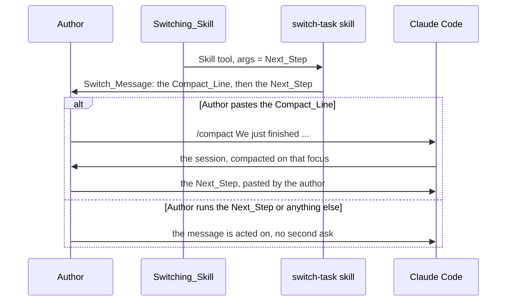

# Design Document

## Overview

A new skill, `switch-task`, is the one place that holds the Task_Switch. Each Switching_Skill's final step invokes it with the Next_Step in place of telling the author the next command itself. `switch-task` writes the Compact_Focus, one line saying what the next task needs, and ends the turn with the Switch_Message: the Compact_Line to copy, then the Next_Step. The author pastes the first, Claude Code compacts on it, and the author pastes the second. Nothing is saved and nothing types for the author. One hook, `hooks/switch-size.sh`, runs before the session invokes `switch-task`: it reads the session's size from the transcript and declines the switch when the session is too small for a compaction to pay.

What this rests on in the Claude Code documentation, read on 19 November 2026: `/compact [instructions]` is the author's command, and it takes optional focus instructions for the summary (https://code.claude.com/docs/en/commands, the `/compact` row). No documented event lets a skill or hook start a compaction.

A first design saved the summary to a file under the plugin's `state/` folder with a shipped script, gave it to the compaction through a PreCompact hook and restored it through a SessionStart hook. Its build showed the cost: a skill's command does not get `CLAUDE_PLUGIN_ROOT` in its environment, a plugin path with a space broke the command, the script needed two `awk` branches to count characters, and every compaction left empty files. The Author dropped it on 19 November 2026 for this design, which gets the same steer from the text after `/compact`.

## Architecture



**Key decision: the Task_Switch is a skill of its own, `switch-task`, invoked the way skills invoke `report`** (Requirements 3.1, 3.2). The Switching_Skills already end by invoking `ponderly:report` with the Skill tool, so the pattern exists and each closing step changes by a sentence. The author can also run `/ponderly:switch-task` by hand before starting something new after a long unrelated chat. The trade-off is one more skill in the list and one more Skill call at each hand-off. Rejected: a shared file each skill is told to read, because a file read is skipped more easily than a skill call and gives the author nothing to run by hand; and repeating the procedure in six skills, which Requirement 3.2 rules out.

**Key decision: the focus says what was finished, what comes next and what to keep, in that order** (Requirements 2.1, 2.5). What is published on compaction points the same way. Anthropic's context engineering post says a compaction prompt should first capture everything relevant and then cut what is superfluous, and names decisions, unresolved bugs and implementation details as what Claude Code keeps (https://www.anthropic.com/engineering/effective-context-engineering-for-ai-agents). Factory's comparison of three summarizers found that named sections, "session intent, file modifications, decisions made, and next steps", keep more than free prose, because each section must be filled or left empty on purpose, and that file tracking is the weakest part of every method (https://factory.com/news/evaluating-compression; a vendor's own study). Amp's hand-off started from the goal of the next piece of work and a list of the files it needs (https://ampcode.com/news/handoff). Claude Code's own example is a plain instruction, `/compact Focus on code samples and API usage` (https://code.claude.com/docs/en/costs). So the line names its parts, leads with the work ahead, and names files by path because paths are what summaries lose. The trade-off is a longer line. Rejected: a bare list of things to keep, which gives the summary no reason for the choice.

**Key decision: the offer is for Substantial_Work, judged from the conversation** (Requirements 4.3, 4.7). A trial in a real session on 19 November 2026 showed the offer made after a two-sentence answer about one file, which in daily use is noise. The model cannot go by a number: the API documentation says Sonnet 5 and Sonnet 4.6 are sent their token budget, and that Opus 4.7 and later, Sonnet 5.5, the Fable models and Haiku 5.5 "don't receive these injected tags" (https://platform.claude.com/docs/en/build-with-claude/context-windows, Context awareness). So the description names what the model can see: a skill run to its end, several files read or changed, sub-agents or long command output, a long exchange, and says a short exchange gets no offer. The six Switching_Skills switch at their end without this test, since a skill run to its end is Substantial_Work. The trade-off is a threshold in words, which will sometimes land on the wrong side; a missed offer costs what today costs. Rejected: a hook that counts the transcript's size, which is the machinery the Author dropped.

**Key decision: a hook declines the switch below a size limit** (Requirement 6). The trials priced one switch at about $0.40 at list prices: one more request to write the message, the summarising call, and a first request after it that rewrites 46,000 to 71,000 tokens of cache. Each later turn then re-reads fewer tokens at a tenth of the input price, so a switch pays once the tokens it removes, times the turns that follow, pass about 800,000. After a compaction roughly 100,000 tokens come back whatever the line says, counting the next skill's own text. So the size at which a switch breaks even is 100,000 plus 800,000 divided by the requests that follow. The Author's last 400 transcripts, counted on 23 November 2026, give the requests one run of each skill makes in the main conversation, median and lower quarter: `implement-spec` 152 and 127 over 58 runs, `pr` 51 and 19 over 37, `start-task` 20 and 14 over 10, `hld` 30 and 17 over 2, `lld` 19 over 1. At the lower quarter the break-even is about 106,000 before `implement-spec` and 142,000 to 157,000 before the others, so the limit is 110,000 before `implement-spec` and 150,000 otherwise. A first version set 200,000 before `pr` on a guess of 8 requests, which the count showed to be 51; a session of 176,000 tokens was declined there that should have switched. The model is shown no token count, so it cannot make this call itself. A PreToolUse hook can: the hooks documentation gives every hook the `transcript_path`, lets a PreToolUse hook return `permissionDecision` `deny` with a reason "shown to Claude", and lets it add `additionalContext` beside an allowed call (https://code.claude.com/docs/en/hooks, PreToolUse decision control). A scratch trial on 22 November 2026 confirmed all three on a Skill call, and that the hook input carries `tool_input.skill` and `tool_input.args`. The Size_Hook reads the last main-conversation request's `usage` from the transcript with `awk`. The trade-offs: the `usage` fields inside the transcript are not a documented format, and the transcript is written with a delay, so in the trial a new session read as zero; zero therefore means unknown and the switch runs as before. A trial on 23 November 2026 found one more: a switch invoked as the first thing after a compaction read the request before it, 182,000 tokens in a session then at about 90,000, and was let through. The transcript marks each compaction with a `compact_boundary` line whose `compactMetadata.postTokens` is the size it left, 33,049 in that trial, so when such a line follows the last request the hook takes that figure. It leaves out Claude Code's own fixed prompt and tools, so it reads low, which only makes a decline more certain. A declined call still costs its one request. The hook does not run when the author types the command, which is right, since the author asked. Rejected: the transcript file's size on disk, which keeps growing after a compaction; a shell line run as the skill loads, which would have to guess the transcript's path; and three outcomes with an optional middle, for one limit that is easier to correct.

**Key decision: `/compact` at the hand-offs, `/clear` only for unrelated work with nothing to carry** (Requirement 1.6). Three chained trials on 20 November 2026 (`lld` to `start-task` to `implement-spec` to `pr`, on a small fixture project) measured the total input of the last turn before each compaction and the first turn after: 84,800 to 78,000, 97,500 to 97,000, and 159,200 to 102,400 tokens. Claude Code's fixed prompt, the text of every skill already used, which it restores after a compaction, and recently read files fill much of the space back, and the first turn after writes 46,000 to 71,000 tokens to the cache. Claude Code's cost page recommends `/clear` "when switching to unrelated work" (https://code.claude.com/docs/en/costs). The Author kept `/compact` at the hand-offs: the tasks of one piece of work are related, the next skill gains from a summary of the last, and real designs hold far more context than the fixture did, which is where the third trial's saving of about a third comes from. `/clear` is shown only at a Natural_Switch to work that is unrelated and needs nothing carried; when that is in doubt the message shows the Compact_Line, the safer of the two. The trade-off is one more judgement for the model. Rejected: `/clear` with a carried sentence at every hand-off, which starts the next skill smaller but drops the context the Author wants kept.

**Key decision: the line always ends by dropping the finished work** (Requirements 2.1, 2.5). In the same trial the summary kept every detail of the finished task, because "the rest can go" sat in the keep sentence, and that sentence is left out when there is nothing to keep. The drop instruction is now a sentence of its own that is never left out. The trial also showed that Claude Code's summary keeps its own sections whatever the line says, so the line steers what fills them and does not shorten the template.

**Key decision: one switch, however many next steps, and no question before it** (Requirements 1.2, 3.3). A strategy ends with several candidate designs, a design with several components, a low level design with several tasks. The compaction is the same whichever the author picks, since the next skill reads the document itself, so the Switch_Message lists every candidate command under the Compact_Line and the author runs one. The trade-off is that the Compact_Focus cannot name the one next step; it names the kind of work and the document. Rejected: asking which comes next before the switch, which adds a stop at every design hand-off.

**Key decision: `readable-code` and `tighten-tests` are not wired, and the offer covers them** (Requirement 4.9). Neither ends by asking which skill comes next, and wiring them would add a question. A skill the author starts by hand in a session that already holds a task's work is a Task_Switch like any other, so the offer in `switch-task`'s description is made once before that skill's first step. The trade-off is that this rests on the model's judgement, as every offer does.

**Key decision: the focus travels in the command the author pastes** (Requirements 2.1 to 2.4, 3.4). `/compact` already takes instructions, so the skill's judgement of what the next task needs reaches the compaction as the text of the Compact_Line, with no file, script or hook. The trade-off is that the focus steers the summary Claude Code writes and does not replace it, so the exact words are not guaranteed to survive; the Next_Step does not depend on that, because the author pastes it after the compaction, and the next skill reads its own files. A second trade-off is that the author copies a longer line than a bare `/compact`; the 600-character limit keeps it to a few lines of a terminal. Rejected: the saved file with two hooks, for the reasons in the Overview; and a bare `/compact`, which gives a general summary of the finished task with nothing aimed at the next one.

**Key decision: `switch-task` takes its own parameters and its description carries the offer at a Natural_Switch** (Requirements 4.1 to 4.8). Its arguments are `[next step] [carry: what to keep]`, both optional: with no Next_Step it takes the request the author just made, which after a yes to the offer is the unrelated request made before it, and it asks only when there is none. Its description says to offer it, once and in one sentence, when the author asks for work unrelated to what the session holds, before that work starts, and not inside another skill's steps or in a session that holds nothing yet. This plugin routes requests through skill descriptions, and the rules have 53 characters of room left under the hooks' limit, so no rule sentence is added. The trade-off is that an offer made from a description is the model's judgement: it will sometimes be missed and sometimes be made for a follow-up that was related. A missed offer costs what today costs; a wrong one costs the author one "no". An eval case measures both. Rejected: a rule sentence, for the size limit and because a rule would fire in sub-agents too; and a UserPromptSubmit hook that guesses a topic change, which a shell script cannot judge.

**Key decision: the session does not go on by itself after the compaction** (Requirement 1.2). No hook can start a turn in an interactive session, so the Switch_Message shows two lines to run, the Compact_Line and then the Next_Step.

## Components and Interfaces

| Component | Responsibility | Operation | Requirements |
| --- | --- | --- | --- |
| `skills/switch-task/SKILL.md` | Make one Task_Switch | Take the Next_Step from its first argument, or the request the author just made, asking only when there is neither; take what to carry from `carry:`; write the Compact_Focus; end the turn with the Switch_Message. No `allowed-tools`, no Bash, no file | 1.1 to 1.4, 2.1 to 2.5, 3.1, 3.4, 4.1, 4.2, 4.4 |
| `switch-task`'s `description` | Carry the offer at a Natural_Switch | Say when to offer the skill, once, and when not to: only when the session holds Substantial_Work, named by its visible signs; a skill started by hand in such a session counts | 4.3, 4.5 to 4.9 |
| `hooks/switch-size.sh` on PreToolUse, matcher `Skill` | Size_Hook | Act only when `tool_input.skill` is `ponderly:switch-task`. Read `transcript_path` from the input and, from the last line of it that is an assistant message of the main conversation with a `usage`, add `input_tokens`, `cache_read_input_tokens` and `cache_creation_input_tokens`; when a line with `"subtype":"compact_boundary"` comes after that line, take its `postTokens` instead. Zero: print nothing. Below the Switch_Limit: print a `deny` decision whose reason gives the size, says not to retry, and says to tell the author in one line and name each next step. Otherwise: print an `allow` decision with the size as `additionalContext`. The limit is 110,000 when `tool_input.args` holds one Next_Step and it starts `/ponderly:implement-spec`, else 150,000 | 6.1, 6.3 to 6.5 |
| `hooks/hooks.json` | Register the Size_Hook | Add a `PreToolUse` entry with matcher `Skill`; every existing entry unchanged | 6.5 |
| The six Switching_Skills | Use the one place | Final step: invoke the Skill tool with `skill: ponderly:switch-task` and `args:` the Next_Step, or every candidate Next_Step when there are several, with no question first; when the skill is missing, name the Next_Step as today. `bugfix` does this on the answer that today opens the pull request, in place of invoking `pr` | 1.1, 1.5, 3.2, 3.3 |
| `README.md`, `docs/reference.md`, `llms.txt`, the issue forms, a guide page | List the skill, say what happens at a switch and cite the documentation | One reference section with the citation above; the listings the repository's checks require for every skill | 5.4 |

A Switching_Skill invokes `switch-task` only on the path that names a next skill. Where the author stops, declines the hand-off or the skill fails, the closing step is unchanged (Requirement 1.5). `switch-task` asks nothing when it is given a Next_Step, and it never checks afterwards whether the author compacted (Requirement 1.4).

## Data Models

**Compact_Focus**, plain sentences on one line, the third left out when it has nothing to hold and the fourth never (Requirements 2.1 to 2.3, 2.5):

```
We just finished <the work, in a few words>. Next we <what the next task does>, which reads <paths>. Keep <the decisions the next task must follow, and the problems still open>. Drop the detail of the finished work.
```

**Compact_Line**: `/compact <Compact_Focus>`, at most 600 characters, no line break. When it would run past the limit, what to keep is shortened first, then paths a named folder already covers are dropped; what comes next is never cut.

**Switch_Message** (Requirements 1.2, 1.3):

```
This task is done and the next one is a different task. Compact first, so the next task does not re-read this one on every turn:

/compact <Compact_Focus>

Then run:

<Next_Step>

You can skip the compaction and run the next step as it is.
```

With several Next_Steps, "Then run:" reads "Then run one of:" and each command has a line of its own.

When the Size_Hook gave the Session_Size, the first paragraph states it as its second sentence, before the sentence that introduces the line: "This session holds about <Session_Size> tokens." The Size_Hook rounds the figure down to the thousand below, so that a size just under a limit never reads as equal to it.

**The decline** (Requirement 6.2), written by the session and not by the skill, one line and then each Next_Step on a line of its own:

```
This session holds about <Session_Size> tokens, under the <Switch_Limit> at which compacting pays before this step, so it is not worth it yet. Next:

<Next_Step>

To switch anyway, type /ponderly:switch-task first in your message.
```

The last line is there because the hook cannot tell a command the author typed after other text from the session's own call; a command that opens the message never reaches the hook.

At a Natural_Switch to unrelated work with nothing to carry (Requirement 1.6), the first paragraph and the line read:

```
This task is done and the next one is unrelated to it. Start fresh, so the next task carries none of this one; /resume brings this conversation back if you need it:

/clear
```

and the rest of the message is unchanged.

## Correctness Properties

### Property 1: The switch touches nothing

*For any* run of `switch-task`, the working tree and the plugin's folders hold the same files after it as before.

**Validates: Requirements 2.4, 3.4**

### Property 3: The hook never blocks anything but a small switch

*For any* input, the Size_Hook exits 0, and it prints a `deny` decision only when the tool is `Skill`, the skill is `ponderly:switch-task`, and the Session_Size is above zero and below the Switch_Limit.

**Validates: Requirements 6.1, 6.4, 6.5**

### Property 2: The line can be pasted

*For any* Switch_Message, the Compact_Line starts with `/compact `, holds no line break and is at most 600 characters.

**Validates: Requirements 1.2, 2.2**

## Error Handling

| Condition | Category | Behavior | Requirements |
| --- | --- | --- | --- |
| No Next_Step in the argument and no request to take it from | Missing input | `switch-task` asks what the next step is, once, in prose | 4.1 |
| No decision and no open problem the next task needs | Short focus | The Compact_Focus says what was finished and what comes next, leaves out the keep sentence, and still ends with the drop sentence | 2.5 |
| The line runs past 600 characters | Oversize | Shorten what to keep, then drop paths a named folder covers; never cut what comes next | 2.2 |
| The author types a bare `/compact`, their own instructions, or nothing | The author's choice | Claude Code does what the author typed; nothing in the plugin reacts | 1.4 |
| Session_Size above zero and below the Switch_Limit | Small session | The Size_Hook declines; the session writes the decline, with no Switch_Message | 6.1, 6.2 |
| No `usage` found in the transcript, no transcript, or input that is not JSON | Size unknown | The Size_Hook prints nothing and exits 0; the switch runs as without it | 6.4, 6.5 |
| A Skill call for any other skill, or any other tool | Not the switch | The Size_Hook prints nothing | 6.5 |
| `ponderly:switch-task` not found | Missing skill | The Switching_Skill names the Next_Step as it does today | 3.2 |

## Testing Strategy

- **Free checks of the Size_Hook**, in a new `checks/test_switch_size.py` on the existing `reminder_harness`, each one recorded hook input against a temporary transcript: one per row of the Size_Hook's operation and one per Error Handling row it owns. They call no model.
- **Free checks**: `make validate`, whose existing checks require the new skill in the plugin README, `docs/reference.md`, `llms.txt` and the issue forms' component lists, and hold its description under 1,024 characters. No new check file: the feature ships no script, and behaviour of a prompt is proved by an eval case, not by a check that reads the skill's text.
- **Eval cases**, written by a task and run only with the author's yes: `evals/skills/switch-task/writes-the-compact-line` (given a Next_Step, the reply is the Switch_Message, its Compact_Line is one line that names the Next_Step, and no file is written), `evals/skills/lld/switches-at-the-hand-off` for a wired skill, and two for the offer: `offers-at-an-unrelated-request` and `no-offer-for-a-follow-up`. The sandbox cannot compact, so no eval covers the compaction itself; the trials do. The cases are run one at a time first, the one judged most likely to fail, and the skill or the case is corrected from that sample before the full set is run, so the full set is paid for once.
- **Trials by the author** (Requirements 5.1 to 5.3): four real sessions run with `claude --plugin-dir plugins/claude/ponderly`, one at each named switch and one Natural_Switch. For each, the record gives the Switch_Message, the first lines of the compacted session, whether the next skill asked for anything the Compact_Focus should have carried, and the cache-read tokens of the last turn before and the first turn after the compaction, read from the transcript.
- Requirement 3.4 is checked by reading the diff: no hook, no script, and no shipped file names a terminal or session manager.
