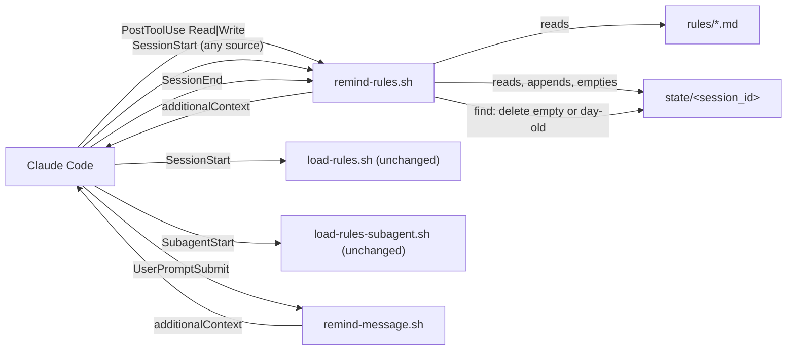
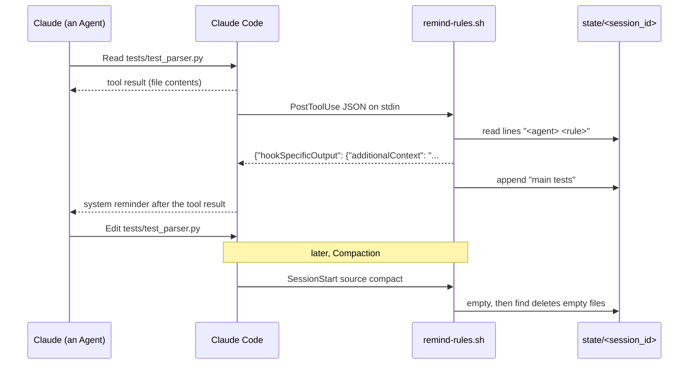

# Design Document

## Overview

Two new hook scripts sit beside `load-rules.sh` and `load-rules-subagent.sh`, both registered in `plugins/ponderly/hooks/hooks.json`. `remind-rules.sh` is one `sh` script around one `awk` program that answers three events by the `hook_event_name` in its input: on `PostToolUse` for `Read` or `Write` it sorts the file into a File_Kind, reads the session's Reminder_Record, and prints a File_Reminder holding the Rules that Agent has not been sent yet; on `SessionStart` with `source` `compact` and on `SessionEnd` it empties the session's Reminder_Record; and on both it sweeps record files that are empty or more than a day old. `remind-message.sh` answers `UserPromptSubmit` with the fixed Message_Pointer. Both stay in Validator_Shape, both always exit 0, neither reaches the network (Requirement 9.3), and neither changes what the two existing hooks print.

Two facts were checked by running Claude Code 2.1.317 headless on 2026-11-03 with a throwaway plugin that logged every hook input. A sub-agent's `PostToolUse` input carries the parent's `session_id` plus its own `agent_id` and `agent_type`; the main conversation's input carries no `agent_id`. A `/compact` sent to a resumed session fires `SessionStart` with `source` `compact` and the same `session_id`, and every headless run ends with `SessionEnd`, `reason` `other`.

## Architecture

Key decision, taken by the Owner before this spec: `PostToolUse` on `Read` is the trigger, `Write` the fallback, `additionalContext` the channel, and there is no `PreToolUse` hook; a deny-once `PreToolUse` on `Write` is held in reserve, unbuilt (Requirements 1, 3). The trade-off is that a file Claude edits without a fresh Read in this context, because it read it before a Compaction, gets its Rules only through the session-start copy, which `load-rules.sh` reloads on `compact` anyway.

Key decision, one script for the three record events and a second for the message. `remind-rules.sh` holds the only JSON field reader and the only record logic, and branches on `hook_event_name` inside `awk`, because the Validator_Shape forbids one hook script calling another file, so every script that reads hook input must carry its own reader (Requirements 4, 7, 9.1). The trade-off is one larger `awk` program; it is split into named functions, one per job. Rejected alternative, a separate script per event: three copies of the JSON reader to keep in step. Rejected alternative, folding the reset into `load-rules.sh`: it would have to read stdin, and its output is pinned byte for byte by `checks/test_hook_encoder.py` and Requirement 9.2.

Key decision, the Reminder_Record is one flat file per session, `${CLAUDE_PLUGIN_ROOT}/state/<session_id>`, holding one line `<agent> <rule>` per Rule sent, with `<agent>` the `agent_id` or `main`. This changes the approved Requirement 7.1 and the Reminder_Record glossary entry, which say one folder per session and one file per Agent, and changes how Requirement 7.2's deletion is done; the Requirements stay true in substance, since each Agent keeps its own record (Requirement 6.2) and the session's record is gone when the session ends. The reason is the Validator_Shape: `awk` can create and empty a file but cannot make a folder or delete a file without `system()`, and the shell cannot name a session's path without a variable. With a flat file, the shell makes only `mkdir -p "${CLAUDE_PLUGIN_ROOT}/state"`, a literal path; `awk` empties the session's file on `compact` and `SessionEnd`; and one `find "${CLAUDE_PLUGIN_ROOT}/state" -type f \( -size 0 -o -mtime +0 \) -exec rm -f {} +`, also a literal path, deletes every empty or day-old file. The trade-off is that a session's file is deleted by a sweep keyed on emptiness rather than by name, so a compacted session's emptied file is deleted too, which is the same as empty. Rejected alternative, `system("mkdir -p ...")` and `system("rm -rf ...")` inside `awk`: whether the directory's scanner follows a command built inside an `awk` string is unknown, and the existing hooks avoid it. Rejected alternative, `CLAUDE_PLUGIN_DATA`: a second variable, outside the Validator_Shape.

Key decision, the sweep runs on every `SessionStart` and every `SessionEnd`, not only on `startup`. That covers Requirement 7.3 and more, and saves a branch the shell could only take through `awk`'s exit status. The trade-off is one `find` over a folder of small files per session start and end.

Key decision, the JSON input is never decoded. `awk` walks the one-line object with a regular expression for a JSON string, `"([^"\\]|\\.)*"`, so a large `tool_response` is skipped as one token, and keeps the raw escaped text of `session_id`, `agent_id`, `cwd`, `hook_event_name`, `source` and `tool_input.file_path`. Claude Code writes non-ASCII as raw UTF-8 and leaves `/` unescaped, so `cwd` and `file_path` compare and split correctly in their escaped form, and every pattern a File_Kind needs is ASCII (Requirements 2.1, 2.5, 8.2). Rejected alternative, decoding `\u` escapes: `awk`'s handling of code points past 255 depends on the locale.

Key decision, the File_Reminder is printed and flushed before the record is written, and the script ends with `exit 0` whatever `awk` returned. Claude Code reads a hook's JSON only on exit 0, and an `awk` write to an unwritable file is a fatal error, so this order means an unwritable record costs a repeated Rule, never a lost one (Requirements 8.3, 8.4). The trade-off is that a hook that really failed shows nothing in the transcript; the free checks cover each failure path instead.

Key decision, the Message_Pointer is fixed text in `remind-message.sh`, not read from `communication.md`, so the per-message hook reads no file and stays a single `printf` (Requirement 5). A free check fails when the Pointer_Quote no longer appears verbatim in `rules/communication.md` (Requirement 5.5). The trade-off is a copy of one line, guarded by that check.

Key decision, Compaction cannot be staged in an eval case, so Requirement 11.3's case is not built. `claude plugin eval` runs one prompt per case in a fresh session, and its only extra turn, `context.history_file`, replays a transcript without firing `SessionStart` `compact`. The reset is proved by a free check that feeds `remind-rules.sh` a `PostToolUse`, a `SessionStart` `compact` and a second `PostToolUse`, and by one scripted headless run recorded in the pull request: `claude -p` reads a test file, `claude -p --resume <id>` sends `/compact`, and a third resumed run reads a test file again and reports the reminder.

## Components and Interfaces

### remind-rules.sh

Sorts the file a `Read` or `Write` touched, attaches the Rules its Agent has not had, and keeps and clears the Reminder_Record. Registered on `PostToolUse` with matcher `Read|Write`, on `SessionStart` with no matcher, and on `SessionEnd` with no matcher. Shell part: `[ -d "${CLAUDE_PLUGIN_ROOT:-}/rules" ] || exit 0`, then `mkdir -p "${CLAUDE_PLUGIN_ROOT}/state" 2>/dev/null`, then `awk -v state="${CLAUDE_PLUGIN_ROOT}/state" '<program>' - "${CLAUDE_PLUGIN_ROOT}"/rules/*.md`, then the `find` sweep, then `exit 0`.

| Operation (an `awk` function) | Input | Output | Requirements |
|-------------------------------|-------|--------|--------------|
| `read_input` | the stdin JSON | the six raw fields, or a flag that the input is not an object | 2.5, 8.2 |
| `valid_id(s)` | a `session_id` or `agent_id` | true when non-empty and only `[A-Za-z0-9_-]` | 7.4 |
| `file_kind(path, cwd)` | `tool_input.file_path`, `cwd` | `outside`, `spec`, `skipped`, `test` or `code`, tested in that order | 2.1–2.4 |
| `kind_rules(kind)` | a File_Kind | the Rule names it brings, in name order | 1.1, 1.2 |
| `sent_rules(file, agent)` | the session's record file, the Agent | the Rules already recorded for that Agent | 4.1, 4.4, 6.2 |
| `print_reminder(rules)` | the Rules still to send | the `PostToolUse` JSON with the opening sentence and each Rule's text, JSON-escaped, flushed | 1.1–1.3, 1.6, 3.1 |
| `record(file, agent, rules)` | the Rules just sent | one appended line per Rule | 4.1 |
| `clear(file)` | the session's record file | the file emptied, on `SessionStart` `compact` and on `SessionEnd`; untouched on any other `source` | 4.2, 4.3, 7.2 |
| `find` sweep (shell) | `${CLAUDE_PLUGIN_ROOT}/state` | every empty or day-old file deleted | 7.2, 7.3 |

### remind-message.sh

Attaches the Message_Pointer to every message. Registered on `UserPromptSubmit` with no matcher. Shell part: `[ -d "${CLAUDE_PLUGIN_ROOT:-}/rules" ] || exit 0`, then one `printf` of the JSON, then `exit 0`. It reads no stdin and no record (Requirements 5.1–5.4, 8.1).

### hooks.json

Gains `remind-rules.sh` as a second hook on `SessionStart` beside `load-rules.sh`, and new `PostToolUse` (matcher `Read|Write`), `SessionEnd` and `UserPromptSubmit` entries. Claude Code runs the hooks of one event in parallel and joins their output; `remind-rules.sh` prints nothing on `SessionStart`, so the session context is what `load-rules.sh` prints (Requirement 9.2).

### Docs, forms, ignore file and version

`docs/reference.md` gains a section per script under Hooks and a paragraph in "What the plugin runs and sends" on the `state/` folder (Requirements 10.1, 10.2). Every issue form's `component` dropdown gains `PostToolUse hook`, `SessionEnd hook` and `UserPromptSubmit hook`, the names `checks/test_issue_forms.py` derives from the events in `hooks.json` (Requirement 10.3). `.gitignore` gains `plugins/ponderly/state/`, since a session that loads the plugin from this repository with `--plugin-dir` writes its record there. The version goes from 1.6.0 to 1.7.0 in `plugins/ponderly/.claude-plugin/plugin.json` (Requirement 10.4); the session on branch `rule-evals-llm-judges` also bumps it, so the two conflict and the later merge takes the next minor.

## Data Models

**Hook input (read, never decoded).**

| Field | Events | Use |
|-------|--------|-----|
| `hook_event_name` | all | picks the branch |
| `session_id` | all | names the record file; must pass `valid_id` (7.4) |
| `agent_id` | `PostToolUse` in a sub-agent | the Agent key; absent means `main` (6.2) |
| `cwd` | all | the Working_Directory (2.1) |
| `source` | `SessionStart` | `compact` empties the record (4.2, 4.3) |
| `tool_input.file_path` | `PostToolUse` | the file to sort; always absolute (2.1) |

**Reminder_Record file**, `${CLAUDE_PLUGIN_ROOT}/state/<session_id>`: plain text, one line per Rule sent since the last Compaction, `<agent> <rule>`, where `<agent>` passes `valid_id` or is `main` and `<rule>` is a Rule name. At most six lines per Agent; Requirement 8.5's 50 Agents is at most 300 short lines. Emptied on `compact` and `SessionEnd`; deleted by the sweep when empty or last changed more than a day ago (7.1–7.3).

**File_Kind tests**, on the path relative to the Working_Directory, which is `file_path` after the prefix `cwd` + `/`:

| Kind | Test | Rules |
|------|------|-------|
| `outside` | `file_path` does not start with `cwd` + `/` | none |
| `spec` | relative path starts with `.ponderly/specs/` | `communication`, `workflow` |
| `skipped` | lower-cased extension is one of `md mdx rst txt adoc csv tsv lock png jpg jpeg gif svg ico webp pdf`, or the name is `package-lock.json`, `pnpm-lock.yaml` or `go.sum` | none |
| `test` | a folder segment, lower-cased, is `test`, `tests`, `__tests__` or `spec`, or the name matches `^test_`, `_test\.`, `\.test\.`, `\.spec\.`, `Test\.[^.]*$` or `Tests\.[^.]*$` | `tests` |
| `code` | anything else | `code-changes`, `comments` |

The extension is the text after the last `.` of the name, when that `.` is not the name's first character, so `.gitignore` and `Dockerfile` have none and count as code.

**File_Reminder text**: the sentence "Ponderly rules for the file just read or written. They are the same rules loaded at session start; follow them for this change." then a blank line, then each Rule's file in name order separated by a blank line, as `load-rules.sh` joins them. The largest, `code-changes` plus `comments`, is about 3,800 characters (1.6).

**Message_Pointer text**: "Ponderly reminder: the rules \"Writing to the author\" and \"Working with the author\", loaded at session start, are already in your context and apply to your reply. The one most often missed: \"Lay out a problem, an explanation or a decision as the person it changes will live it.\"" About 290 characters (5.2, 5.3).

## Correctness Properties

### Property 1: Each Rule once per Agent between Compactions

*For any* sequence of `PostToolUse` inputs for one session and any mix of Agents, with no `compact` between them and none running at the same time, each Rule appears in at most one File_Reminder per Agent, and every Rule a touched file's File_Kind brings has appeared once for that Agent by the end.

**Validates: Requirements 1.1, 1.4, 3.1, 4.1, 4.4, 6.1, 6.2**

### Property 2: Compaction brings every Rule back

*For any* session whose Agents have been sent Rules, after a `SessionStart` with `source` `compact` the next matching `PostToolUse` for each Agent attaches each Rule its file brings again.

**Validates: Requirements 4.2**

### Property 3: The reminder is the rule files, intact

*For any* rules folder content, the decoded `additionalContext` of a File_Reminder is the opening sentence, a blank line, then the exact bytes of each Rule file it names, in name order, as `load-rules.sh` joins them.

**Validates: Requirements 1.2, 1.3**

### Property 4: A reminder hook never fails a tool call

*For any* stdin and any state of `CLAUDE_PLUGIN_ROOT`, both reminder scripts exit 0, and their stdout is empty or one JSON object with `hookSpecificOutput`.

**Validates: Requirements 7.4, 8.1, 8.2, 8.4**

## Error Handling

| Condition | Category | Behaviour | Requirements |
|-----------|----------|-----------|--------------|
| `CLAUDE_PLUGIN_ROOT` unset, or no `rules/` under it | CONFIG | exit 0, no output, no record | 8.1 |
| stdin empty or not a JSON object | INPUT | exit 0, no output, no record | 8.2 |
| no `tool_input.file_path` or no `cwd` | INPUT | exit 0, no output | 2.5 |
| `session_id` or `agent_id` empty or with a character outside `[A-Za-z0-9_-]` | INPUT | exit 0, no output; read, write and empty nothing | 7.4 |
| file is an Outside_File or a Skipped_File | NO_MATCH | exit 0, no output | 1.5 |
| every Rule of the kind already sent to the Agent | NO_MATCH | exit 0, no output | 1.4 |
| `state/` cannot be made, or the record cannot be read or written | STATE | the File_Reminder is printed and flushed first; `awk`'s failure is ignored and the script exits 0, so the Rule repeats next time | 8.3 |
| `find` fails on the sweep | STATE | ignored; exit 0 | 7.2, 7.3 |
| `SessionStart` with `source` `startup`, `resume`, `clear` or `fork` | NO_MATCH | record left as it is; sweep only | 4.3 |
| a sub-agent's own Compaction, if it fires no `SessionStart` | LIMIT | that sub-agent's Rules do not come back until the session's next `compact`; accepted, since a sub-agent starts with the full rules | 4.2, 6.1 |

## Testing Strategy

- Four check files in the style of `checks/test_hook_encoder.py`, one concern each, sharing `checks/reminder_harness.py`: `test_reminder_file_kinds.py`, `test_reminder_record.py`, `test_reminder_properties.py` and `test_reminder_message.py`. Each test builds a temporary plugin folder with a `rules/` copy and runs the script with a JSON input on stdin, one test per path. Paths: each File_Kind (an Outside_File, a Spec_File, a Skipped_File, `tests/data.csv`, a test folder, each test name shape, a `Dockerfile`, a `.gitignore`, an upper-case extension); a second Read of the same kind attaches nothing; a sub-agent and `main` each get the Rule; a Write after a Read of the same kind attaches nothing; `compact` brings the Rule back (Property 2); `resume` does not; `SessionEnd` empties and deletes the record; a day-old file is swept; an invalid `session_id` and an invalid `agent_id` write nothing; unset `CLAUDE_PLUGIN_ROOT`, a missing `rules/`, empty stdin and a non-object stdin give exit 0 and no output; a read-only `state/` still attaches the Rule. Property 1 runs as one seeded sequence of 200 random inputs over three Agents, the one loop the tests rule allows when the spec names it. Property 3 is one test on awkward rule text (quotes, backslashes, control characters, non-ASCII) and one on the real rules.
- `checks/test_rules_size.py` gains one test per File_Kind that brings Rules: the decoded File_Reminder for the real rules stays under 10,000 characters (1.6).
- `checks/test_reminder_message.py` pins the Message_Pointer: it is at most 500 characters, names both headings, and its Pointer_Quote appears verbatim in `rules/communication.md`, named in the failure message (5.2, 5.3, 5.5). `checks/test_reminder_record.py` also times the hook on a 50-Agent record against the two-second bound (8.5).
- `checks/test_issue_forms.py` already fails until the three new dropdown entries are added.
- Eval cases under `evals/hook/`, tagged `hook`, run with `make eval-hook`, which gains `--scaffold` in the Makefile's per-target block: `file-reminder-on-read`, where a scaffold writes `tests/test_parser.py`, Claude reads it and quotes the system reminder that followed the tool result, graded on the opening sentence and the `Tests` heading; and `file-reminder-once`, where Claude reads two test files and the grader fails if the opening sentence appears twice. `message-pointer` has Claude quote the reminder beside the prompt, graded on the Pointer_Quote. Compaction gets the scripted headless run of the key decision above, recorded in the pull request, not an eval case. Eval and headless spend is tallied as it goes and stops for the Owner before it passes $15 on the branch (11.4); the probe runs for this design spent $0.82.
