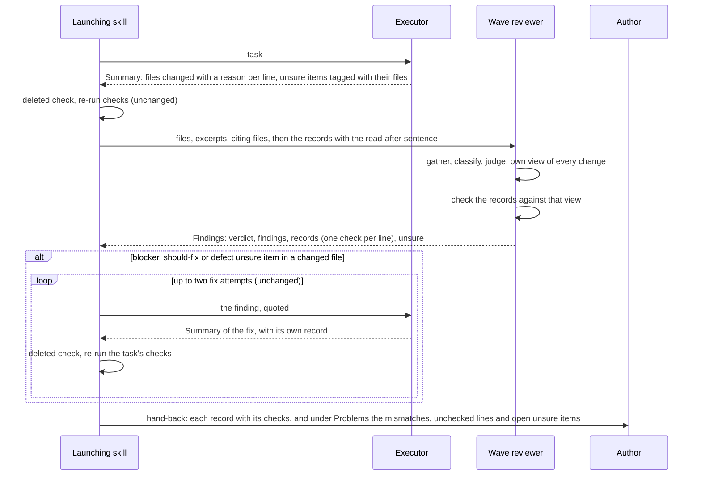

# Design Document

## Overview

The executor's Summary keeps its fields and its process; two of them change format. Each line under `files changed` gains the reason the file was touched, and may name several files given the same change. Each `unsure` item about one change begins with that change's files. The wave reviewer's procedure gains one step after its judgment, in which it reads the executors' records for the first time and checks each line against the change it has already judged; its Findings gain a `records:` section with one check per line. The three skills that launch both agents quote the records into the reviewer's launch and show each record with its checks in the hand-back. `start-task` shows the Summary verbatim already, so it changes nothing. The pages and evals that show the Summary follow.

Two sibling branches edit `agents/task-executor.md` and `skills/implement-spec/SKILL.md` at the same time. In those two files the design changes only the sentences named below, adding sentences or bullets rather than rewriting paragraphs, so the branches can be merged.

## Architecture



### Key decisions

**`files changed` carries the reason on each line.** Each line reads `` - `<path>`: <why> ``, or `` - `<path>`, `<path>`: <why> `` for files given the same change, with the paths in backticks so a path holding a colon or a comma still reads as one. The field stays the one list of every changed path, which the launchers' `git status`, `git diff` and `deleted:` checks and the existing eval graders read. A reason says what changed; it adds why the change was made that way only when the code does not make it plain or the executor chose one way over another, since a reason is a lossy summary and a why on a plain change adds words without adding sense. Serves Requirement 1.1 to 1.4, 1.7 to 1.10. Trade-off: a launcher taking the paths must take the backticked names before the colon, a step it does by reading today and keeps doing by reading. Rejected: a separate `record:` field beside `files changed`, which names every path twice, lets the two lists disagree, and changes what every launcher and grader reads; and a new skill, or a mode of the `report` skill, which you set aside for the Summary block, which would need the Skill tool the executor does not have, and whose output would then be the author-facing Message the `report` skill writes rather than a block the launcher reads.

**`unsure` stays, and an item about one change names its files.** An item about the change of one `files changed` line begins with that line's backticked paths and a colon; any other item stays as it is. Every launcher's handling of `unsure` items is unchanged. Serves Requirement 1.5, 1.6 and 3.6. Trade-off: what the executor did not know sits in a separate list from the reason, tied to it by the path, not nested under it. Rejected: a per-line field for what the executor did not know, which would move those items out of the handling every launcher gives `unsure` today, which you asked to keep.

**The reviewer reads the records in a step of their own, after its judgment.** The procedure's current steps 1 to 3 (gather, classify, judge) form its own view and never use the records; a new step 4, "Check the records", is the first step that reads them, and the current step 4 becomes step 5. A sentence in step 3 says a record never withdraws or softens a finding. The reads step 4 makes to settle `unsure` items, where they do not depend on each other, go in one message, not one read per turn, since each turn re-reads the whole growing context. Serves Requirement 2.1, 2.2, 2.3, 2.8 and 2.9. Trade-off: the records are in the launch prompt, so the reviewer has them in its context from the start, and the order rests on its instructions, not on the records being out of reach. Rejected: sending the records in a second message to the same reviewer after its first Findings, which would make the order a fact rather than an instruction, but which no skill in the plugin does today, which is unverified in the eval sandbox, and which adds a turn to the heaviest launch of a run.

**A record check is its own section, and the verdict stays tied to findings.** The Findings gain `records:` between `findings:` and `unsure:`, with one entry per `files changed` line quoted: the line's paths, `matches` or `does not match` with the line and the change quoted, and what the code shows for each `unsure` item of that line the reviewer settled. A file the diff changed that no line names gets an entry of its own, `not in any record`. When the change itself is wrong, it is a finding as well, at the severity the Findings section already gives. `verdict` still says only whether `findings:` has an entry. Serves Requirement 2.3 to 2.8. Trade-off: a wrong account of a correct change does not turn the verdict to `findings`; the launcher reports it as a problem instead, so it reaches the author but sends no fix. Rejected: making every mismatch a finding, which would send fixes to executors for code that is right and leave the verdict unable to tell you whether the code holds.

**The three launchers add one launch bullet and one hand-back instruction each.** `implement-spec` (wave review and final review), `readable-code` and `tighten-tests` each add to the reviewer's launch the records, quoted, each headed by its task or group, after the sentence, verbatim, "These are the executors' records of their work. Read them only at the record step of your procedure, after you have judged every change on its own." Each adds to its hand-back that every record is shown under the report's done work with its checks beside it, and that a line that does not match, a line with no check and a file in no record go under its problems. A fix sent back to an executor after the review returns a Summary of its own; there is no second review, so its record is shown beside the record it amends, marked as not reviewed, and is not listed as a problem, since Requirement 3.5 covers only the lines the reviewer was given. The `report` skill's templates do not change: the launcher's own text says what the Message carries, as it does today. Serves Requirement 3.1 to 3.5 and 4.4.

**`implement-spec` reads the records of earlier tasks from the earlier report.** Its hand-back report shows each task's record, so a resumed run takes the records of tasks ticked at an earlier hand-back from that report, as it takes their files and problems today. Serves Requirement 3.8.

**`start-task` changes nothing.** It shows the Summary verbatim on its executor route, so the reasons and the tagged `unsure` items reach you as they are, and its `git status` and `git diff` commands take the paths the Summary lists under `files changed`, which the field still lists. Serves Requirement 3.9 and 1.9.

## Components and Interfaces

### Task executor (`plugins/claude/ponderly/agents/task-executor.md`)

Builds one change and returns the Summary. Edits: the `files changed` and `unsure` lines of the Summary block, and one sentence each, appended to the paragraph after the block, saying how a line is written and grouped and how an `unsure` item names its files. The procedure, the modes and the Never list are not touched.

### Wave reviewer (`plugins/claude/ponderly/agents/wave-reviewer.md`)

Reviews one set of changes. Edits: one sentence at the end of step 3; a new step 4; the old step 4 renumbered 5; the `records:` section in the Findings block, and one sentence in the paragraph after it saying what an entry holds and that the verdict ignores it.

### Launching skills

`implement-spec`: the reviewer launch bullets of step 5 and step 8, the collection paragraph after the wave review, the resume sentence that reads earlier reports, and the hand-back of step 6. `readable-code`: the reviewer launch of step 6 and the hand-back of step 7. `tighten-tests`: the reviewer launch of step 9 and the hand-back of step 10.

### Documentation and evals

`docs/reference.md` (task-executor and wave-reviewer sections), `docs/guides/make-a-small-change.md` (the Summary fields and its sequence diagram), `docs/guides/build-a-feature.md` (its sequence diagram). Two new eval cases: one for the executor, one for the reviewer.

| Operation | Component | Requirements |
|---|---|---|
| Write each `files changed` line with its reason, grouping only like changes | Task executor | 1.1, 1.2, 1.3, 1.4, 1.7, 1.8, 1.9, 1.10 |
| Begin an `unsure` item about one change with its paths | Task executor | 1.5, 1.6 |
| Judge every change before reading any record; no finding withdrawn for a record | Wave reviewer | 2.1, 2.2 |
| Check each quoted line, name files in no record, settle `unsure` items | Wave reviewer | 2.3, 2.4, 2.5, 2.6, 2.9 |
| Report a wrong change found by the check as a finding | Wave reviewer | 2.7 |
| Give no `records:` entries when the launch quotes none | Wave reviewer | 2.8 |
| Quote the records with the read-after sentence | implement-spec, readable-code, tighten-tests | 3.1, 3.2 |
| Show each record with its checks; mismatches and unchecked lines under problems | implement-spec, readable-code, tighten-tests | 3.3, 3.4, 3.5 |
| Handle `unsure` items as today; show a settled one as settled, with what the code showed | implement-spec, readable-code, tighten-tests | 3.6, 3.7 |
| Take earlier records from the earlier report on resume | implement-spec | 3.8 |
| Show the Summary verbatim | start-task (unchanged) | 3.9 |
| Describe the new shapes | docs | 4.1, 4.2 |
| Keep existing graders passing; add cases for the new behaviour | evals | 4.3 |
| Leave review, review-arm and the report templates alone | none | 4.4 |

## Data Models

The Summary, with only its changed lines shown:

```
files changed:
- `<path>`: <what changed; why, only when the code does not make it plain or a choice was made>
- `<path>`, `<path>`: <the same, for the same change made in each>
unsure:
- `<path>`: <a point about that line's change, inferred or unverified>
- <anything else, as today, or "nothing">
```

- A path appears on exactly one line (Requirement 1.2). A line names several paths only when the same change for the same reason was made in each (1.3). A stopped Summary's partial edit says `partial:` at the start of its reason (1.7). No change: `files changed: none` on one line (1.8).
- The paths in an `unsure` item are those of one `files changed` line, verbatim (1.6).

The Findings, with only the new section shown:

```
records:
- files: `<path>`[, `<path>`]
  check: matches | does not match | not in any record
  quote: <the line, then the change, quoted; omitted when it matches>
  settled: <each unsure item of this line the code settles, quoted, then what the code shows, quoted; or "none">
```

- One entry per quoted `files changed` line, plus one per changed file no line names (2.3, 2.5). With no records in the launch, `records: none given` on one line (2.8).

## Correctness Properties

### Property 1: Every changed path is listed once

*For any* `done` or `stopped` Summary, each path the diff shows changed by the executor appears on exactly one `files changed` line, and every path a line names was changed.

**Validates: Requirements 1.1, 1.2, 1.9**

### Property 2: Records never weaken a review

*For any* set of changes, every finding the reviewer returns when the launch quotes no records it also returns when the launch quotes them, at the same severity.

**Validates: Requirements 2.1, 2.2, 2.8**

### Property 3: Every quoted line gets one check

*For any* launch that quotes records, the Findings' `records:` section has exactly one entry for each quoted `files changed` line, and the hand-back shows each line with its check or lists it under problems as not checked.

**Validates: Requirements 2.3, 3.3, 3.5**

### Property 4: No unsure item is lost

*For any* run, every `unsure` item of every Summary reaches the hand-back as fixed, as settled with what the code showed, or under the problems.

**Validates: Requirements 1.5, 3.6, 3.7**

## Error Handling

| Condition | Category | Behaviour | Requirement |
|---|---|---|---|
| A `files changed` line gives no reason | Executor protocol | The reviewer marks it `does not match`, quoting the bare line; the launcher lists it under problems | 1.4, 2.4, 3.4 |
| A file the diff changed is on no line | Executor protocol | The reviewer gives it a `not in any record` entry; the launcher lists it under problems | 2.5, 3.4 |
| A line names a file the diff does not show changed | Executor protocol | `does not match`, naming the file; under problems | 2.5, 3.4 |
| A line groups files whose changes differ | Executor protocol | `does not match`, quoting the differing changes; under problems | 1.3, 2.4 |
| The reason is wrong and so is the change | Defect | A finding as well as the check, fixed by the launcher's existing rules | 2.7 |
| The Findings have no `records:` section, or miss a line | Reviewer protocol | The launcher lists each unchecked line under problems as not checked | 3.5 |
| An `unsure` item names paths on no line | Executor protocol | The launcher handles the item as any `unsure` item and lists the mismatch under problems | 1.6, 3.6 |
| A launch quotes no records (review skill, direct use) | Expected | `records: none given`; review as today | 2.8 |

## Testing Strategy

This change is instruction text, so the proof is eval cases run by the agents, never a check that searches the text. Two new cases:

- `evals/agents/task-executor/records-each-change`: a two-file change in which the same edit goes into two files and a different one into a third. An LLM grader passes when `files changed` groups the two like files on one line with a reason, gives the third its own line with its reason, and names no file twice. This is the example test for Property 1.
- `evals/agents/wave-reviewer/checks-a-wrong-record`: the `finds-the-contradiction` scaffold, with a correct change and a quoted record whose reason describes something else, plus a second correct file the record leaves out. An LLM grader passes when the Findings mark the first line `does not match` with both quotes, give the second file a `not in any record` entry, and keep the verdict `holds`. This is the example test for Property 3 and the error rows on mismatches.

Property 2 would need the same review run twice, with and without records, and compared; it costs two reviewer runs per sample, so it is left as a manual comparison the author can choose to run, not a case. Property 4 holds by the launchers' existing `unsure` handling, which this change does not touch; the wave-reviewer case's grader checks that the settled field is present.

The existing executor and reviewer cases keep passing as they are: their graders match `status:`, `unsure:`, `deleted:` and the verdict line, none of which changes form. `make validate` checks the new cases' shape, the docs' links and paths, and the agents' frontmatter. Running any `make eval-*` target costs money and waits for the author's yes. A headless session started with `claude --plugin-dir plugins/claude/ponderly` confirms the worktree's copy loads, and runs the executor once on a small change to show the new Summary.
