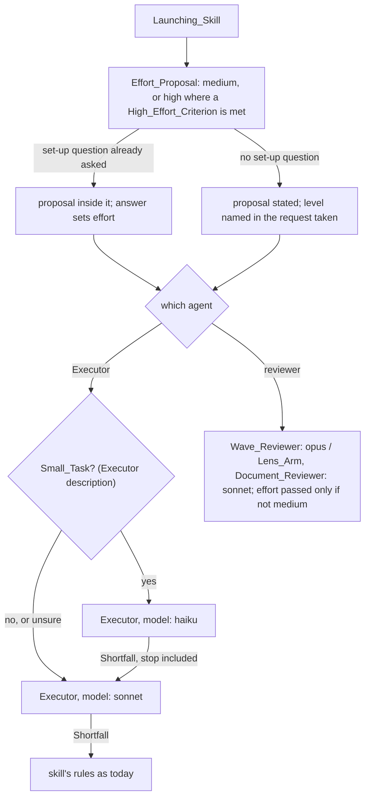

# Design Document

## Overview

The change has four parts, in three kinds of file.

- **Agent_File frontmatter.** Every agent's `effort` becomes `medium`. The Wave_Reviewer stays on `opus`, and the other three agents on `sonnet` (Requirement 1).
- **The Executor's model per launch.** The Small_Task test is written once, in the Executor's `description`. Each Executor_Skill passes `model: haiku` for a Small_Task and `model: sonnet` otherwise (Requirement 2). On a Shortfall after a Haiku launch, it makes one Escalation to a new Sonnet executor without asking, a stop included (Requirement 3).
- **The Effort_Proposal.** Each Launching_Skill tells the author, before its first launch, the effort it proposes and what high would cost against medium. It puts the proposal inside a set-up question it already asks, or states it before launching where it asks none. It passes `effort` only on a launch whose chosen level is not the Agent_File's `medium` (Requirement 5).
- **The Gathering_Step.** The first procedure step of the Wave_Reviewer and the Lens_Arm asks for every diff in one command and for independent reads in one message (Requirement 6).

Requirement 4 is met by the Testing Strategy, which records the Token_Baseline and the comparisons.

## Architecture

The docs for Claude Code 2.1.322, read on 11 November 2026, give the order in which a sub-agent's model and effort are resolved:
- **Model.** The launch's `model` parameter, which takes only `sonnet`, `opus`, `haiku` or `fable`; then the Agent_File's `model`; then `CLAUDE_CODE_SUBAGENT_MODEL`; then the session's model. `CLAUDE_CODE_SUBAGENT_MODEL_FORCE=1` overrides every source and stops a launch from passing a model.
- **Effort.** The launch's `effort` parameter, from v2.1.292; then the Agent_File's `effort`. `CLAUDE_CODE_EFFORT_LEVEL` overrides both.
- **Follow-ups.** A model or effort passed on a launch stays in force when that sub-agent is resumed or sent a follow-up message.

**Key decision: one Executor, its model chosen per launch.** The Executor_Skill passes `model: haiku` or `model: sonnet` on each Executor_Launch (Requirements 2.1, 2.2). The procedure stays in one Agent_File, so the two sibling branches that change `task-executor.md` change it once, and an Escalation is the same agent launched on another model (Requirement 3.1). The trade-off: the model a launch ran on does not show in its `subagent_type`. The author sees it only where the skill names it (Requirement 2.4) or in `/tasks`.

**Rejected alternative: a second agent, `task-executor-small`, pinned to Haiku.** The model would show in the agent's name. It lost because its body would be a second copy of the Executor's whole procedure. Every later change to the Executor would have to be made twice, those of the two sibling branches included, or the copies would drift apart.

**Key decision: the Small_Task test lives in the Executor's `description`.** The Agent tool shows every agent's description to the launching session. So the four Executor_Skills, and an author launching the Executor by name, read one test at the point of choosing (Requirement 2). Each Executor_Skill names the test and does not restate it. The trade-off: the description grows by about 250 characters, to about 670 of its 1,024-character limit. That line may also meet an edit from a sibling branch.

**Rejected alternative: the test written out in each of the four Executor_Skills.** It would leave `task-executor.md` alone. It lost because four copies of one test drift apart, and an author launching the Executor directly would never see it.

**Key decision: an Escalation is a new launch, never a follow-up, and needs no question.** A fix sent as a follow-up to a Haiku executor would run on Haiku again, since the launch's model stays in force. So work that falls short on Haiku goes to a new Executor launched on `sonnet` (Requirement 3.1). That executor gets the earlier Summary, the failing output or finding, and for a stop the `stopped because` text and the files holding partial edits (Requirement 3.2). It overrides the rules that forbid an unprompted relaunch after a stop:
- `implement-spec`'s "do not relaunch or retry the task unprompted";
- `readable-code`'s "Do not relaunch it or work around it";
- `start-task`'s `Relaunch` question.

For a Haiku launch only, each of these is preceded by one Escalation. Where a skill allows two fix attempts, the Escalation is the first of the two. The trade-off: a stop that is a real question for the author, such as an unclear task, costs one Sonnet launch before it reaches them. Dan accepted that on 12 November: "If the haiku review is atrocious then we can automatically sonnet it".

**Rejected alternative: the Wave_Reviewer chooses the relaunch model.** The Wave_Reviewer only reads and launches nothing. Its Findings already go back to the launching skill, which owns every relaunch.

**Key decision: the Effort_Proposal rides on a question the skill already asks.** Dan's point is that the author learns the cost before it is spent (Requirement 5). Where a skill already stops before its first launch, the proposal joins that stop, and no new stop is added (Requirement 5.4). Where it does not stop, the proposal is stated and the run goes on (Requirement 5.5). The trade-off: in `review`, and in a skill run with nothing to ask, the author can change the level only by naming it in the request or by interrupting. A stop added to every review would break headless runs such as the benchmark harnesses.

| Launching_Skill | Where the Effort_Proposal appears | Launches it covers |
|-----------------|-----------------------------------|--------------------|
| `implement-spec` | as an `Effort` question in step 4's set-up AskUserQuestion call; stated in step 4's "where things stand" when no set-up question is asked | every executor and Wave_Reviewer launch of the run |
| `start-task` | in the route statement, before the `Route` question, on Executor_Route only; the free-text answer can change it | the Executor launch and any relaunch |
| `readable-code` | in the step 3 message that shows the File_Groups, before the `Groups` question; the free-text answer can change it | the executors and the Wave_Reviewer |
| `tighten-tests` | in the step 5 message, before the `Approve` question; the free-text answer can change it | the executors and the Wave_Reviewer |
| `review` | stated at step 3, before the arms launch; a level the author named in the request is taken | the Lens_Arms and the Wave_Reviewer |
| `strategy`, `hld`, `lld` | inside step 3's prose round; stated in step 3 when nothing is left to ask | the Document_Reviewer launches |

**Key decision: `effort` is passed only when it is not the Agent_File's.** Medium is set in every Agent_File, so a launch at medium passes nothing (Requirement 5.6). The default path then works on any Claude Code version. Only a launch the author or a criterion raised needs 2.1.292. On an older version, an Agent tool error that names `effort` makes the skill launch again without it and tell the author the level was not applied (Requirement 5.8). What an older version does with the parameter has not been tried; this handling assumes it is refused with an error, not ignored. The trade-off: when a launch is raised, its file and its launch disagree, and only the proposal records why.

**Key decision: the High_Effort_Criteria are a starting judgement.** Nothing yet shows that high finds more than medium. The criteria below are a guess, which the comparison in Requirement 4 is meant to correct (Requirement 5.7). Dan's view on 12 November sets their direction: "for well documented tasks with clear information thinking isn't critical and medium is prolly sufficient". So high is proposed where the written intent is thin or the cost of a missed defect is high. It is proposed only for reviewer launches; executors stay at medium unless the author names a level. A reviewer launch is proposed at high when any one of these holds:

1. The author named a level in the request or the set-up answer. That level is taken for the launches it names.
2. The requirements, the design, or the pull request's title and body name security, authentication or sign-in, money or payments, deleting or migrating data, or concurrency.
3. The launch is `implement-spec`'s final review over the whole run at spec cadence. It is the one reader of every wave together.
4. The reviewer has little context beyond the code to judge against. For `review`, that is a review run outside the session that built the change, with no spec for the branch under `.ponderly/specs/`, no issue named, and a pull request title, body and commit messages that say little more than what changed, so it has to work outward from the code. A review run in the session that built the change has that history and stays at medium. For a Document_Reviewer launch, it is a high or low level design with `Parent: none`. A strategy has no parent by design and is written with the author guiding it, so this does not apply to it.

A large set of files was considered as a criterion and left out. The transcripts hold no measure of review quality, so they give no threshold. Breadth is what Opus is kept for, and a larger set already costs more turns, which effort does not reduce.

The proposal's cost line is estimated from the Token_Baseline at list prices. A median Wave_Reviewer launch at high costs about $1.26, and thinking is about 22% of it ($0.28). A median Lens_Arm launch costs about $0.41, and thinking is about 20% of it. So a reviewer launch at high is expected to cost up to about a quarter more than at medium, about $0.28 more per Wave_Reviewer launch. The lead worked these out on 12 November from the price table: Opus 5.5 at $4 input and $20 output per million tokens, Sonnet 5.5 at $2 and $10, cache reads at 0.05 times input and 5-minute cache writes at 1.25 times. The proposal says the dollars are list prices, not what a subscription bills, and the figure is replaced once medium launches are measured.

By the same prices, a median Wave_Reviewer launch splits into cache writes 38%, output 35% (thinking alone 22%) and cache reads 27%. Medium effort reaches the thinking, about a fifth of the launch. The Gathering_Step change reaches part of the cache reads. The two are about the same size, and neither reaches the cache writes, the largest share. A median Lens_Arm launch is cache writes 54%, output 31% and cache reads 15%; a median Executor launch costs about $0.16, cache writes 54%, output 34% (thinking 2%) and cache reads 12%.

**Key decision: the Gathering_Step asks for one diff command and batched reads.** The Wave_Reviewer's step 1 now says "For each listed tracked file run `git diff <base> -- <path>`". It becomes one `git diff <base> -- <path> <path> ...` over every listed tracked file. The Lens_Arm's "run `git diff <base> <head> -- <path>` for each changed file" becomes one command over every changed file, and the same for the working-tree form. Both steps add that reads which do not depend on each other go in one message (Requirement 6). The Wave_Reviewer's missing-input rule, "a `git diff` that ... comes back empty against the base for a listed file", becomes a listed file absent from that one diff's output. Nothing outside step 1 changes, so the executor-record branch's edits to the Wave_Reviewer's procedure meet no conflict (Requirement 6.4). The trade-off: one long diff output is read at once, rather than file by file.

## Components and Interfaces

### Agent_Files

The frontmatter of each Agent_File fixes the model and effort for a launch that passes neither.

| Operation | Input | Output | Requirements |
|-----------|-------|--------|--------------|
| `task-executor.md` frontmatter | none | `model: sonnet`, `effort: medium`, unchanged | 1.1, 1.4 |
| `task-executor.md` description | none | adds the Small_Task test, and the instruction to launch on `haiku` for one and on `sonnet` otherwise | 2.1, 2.2, 2.3 |
| `review-arm.md` frontmatter | none | `model: sonnet`, `effort: medium` | 1.1, 1.2 |
| `document-reviewer.md` frontmatter | none | `model: sonnet`, `effort: medium` | 1.1, 1.2 |
| `wave-reviewer.md` frontmatter | none | `model: opus`, `effort: medium` | 1.1, 1.3 |
| `wave-reviewer.md` step 1 | the listed files | one diff command, batched reads, missing-input rule restated for one diff | 6.1, 6.3, 6.4 |
| `review-arm.md` step 1 | the changed files | one diff command, batched reads | 6.2, 6.3, 6.4 |

### Launching_Skills

| Operation | Input | Output | Requirements |
|-----------|-------|--------|--------------|
| Effort_Proposal, every Launching_Skill | the request, the spec or pull request text, the run's shape | the proposal at the place the table above names; the chosen level per launch | 5.1 to 5.7 |
| Launch with a raised level | the chosen level | `effort` passed; on an error naming `effort`, launched again without it and the author told | 5.6, 5.8 |
| Executor_Launch, the four Executor_Skills | the task or File_Group | `model` from the Small_Task test; named beside the task in `implement-spec` and in `start-task`'s route statement | 2.1 to 2.4 |
| Shortfall after a Haiku launch | the Summary, the failure | one Escalation as a new launch on `sonnet`, without asking | 3.1, 3.2, 3.4 |
| Shortfall after a Sonnet launch | the Summary, the failure | the skill's existing path, on `sonnet` | 3.3, 3.4 |
| Reviewer launches | as today | no `model`; `effort` only when raised | 1.5, 5.6 |

`implement-spec` loses the sentence "Each agent runs on the model its own definition pins", which would no longer be true. In its place it says that each executor's model is chosen per launch and that each launch's effort comes from step 4. In `implement-spec` and `task-executor.md`, only those sentences, the launch sentences and the set-up list change. Other sentences are not reflowed, so the sibling branches can be merged.

## Data Models

No stored data changes. These are the values a launch now carries.

| Field | Type | Constraint | Requirement |
|-------|------|------------|-------------|
| `model` on an Executor_Launch | Agent tool alias | `haiku` or `sonnet`; never `opus`, `fable`, a model ID or `inherit` | 2.1, 2.2, 3.4 |
| `model` on a reviewer launch | absent | never passed | 1.5 |
| `effort` on any launch | Agent tool level, or absent | absent at medium; `low`, `high`, `xhigh` or `max` only when the author or a High_Effort_Criterion chose it | 5.6 |
| Agent_File `effort` | frontmatter value | `medium` in all four files | 1.1 |

The Small_Task test, as the description will state it: the task changes at most one file, adds no new function, branch or test, needs no design choice, and can be done from the task text and that one file. A task that fails any part of it, or whose size is unclear, is not a Small_Task.

## Correctness Properties

### Property 1: Every agent's default effort is medium

*For any* of the four Agent_Files, its frontmatter `effort` is `medium`.

**Validates: Requirements 1.1**

### Property 2: Only the Wave_Reviewer runs on Opus

*For any* Agent_File, its `model` is `opus` exactly when it is the Wave_Reviewer's, and `sonnet` otherwise.

**Validates: Requirements 1.2, 1.3, 1.4**

### Property 3: An Executor_Launch's model follows the task's size

*For any* Executor_Launch that is not an Escalation, its `model` is `haiku` when the task is a Small_Task, and `sonnet` when it is not or when its size is unclear.

**Validates: Requirements 2.1, 2.2, 2.3**

### Property 4: Work that fell short on Haiku gets exactly one Sonnet launch before any other handling

*For any* Shortfall that follows an Executor_Launch on Haiku, a stop included, the next launch for that work is a new launch on `sonnet`, made without a question to the author. No later launch for that work runs on Haiku.

**Validates: Requirements 3.1, 3.2, 3.4**

### Property 5: The author hears the effort before the first launch

*For any* run of a Launching_Skill that launches an agent, the Effort_Proposal is in the conversation before the first launch. Every launch's effort is the level that proposal or the author's answer settled.

**Validates: Requirements 5.1 to 5.6**

## Error Handling

| Condition | Category | Behaviour | Requirement |
|-----------|----------|-----------|-------------|
| The task's size is unclear | judgement | treated as not a Small_Task, launched on `sonnet` | 2.3 |
| A Haiku launch stops, fails a check, fails verification or gets a review finding | Shortfall | one Escalation, a new executor on `sonnet`, without asking | 3.1, 3.2 |
| The Escalation, or any Sonnet launch, falls short | Shortfall | the skill's rules as today: the stop goes to the author, the fix attempts that are left are used | 3.3 |
| A launch passing `effort` fails with an error that names it | environment, a CLI older than 2.1.292 | launched again without `effort`; the author is told the level was not applied | 5.8 |
| The author names a level the model does not support | environment | Claude Code falls back to the highest supported level at or below it, as its docs say | 5.4, 5.5 |
| `CLAUDE_CODE_SUBAGENT_MODEL_FORCE` is set, or a mod's `agent.spawn` hook sets a model | environment | the launch runs on the forced model; the skill carries on with the result | 3.5 |
| `CLAUDE_CODE_EFFORT_LEVEL` is set | environment | every agent runs at that level, whatever was proposed. The benchmark harnesses set it, so they measure their own level | 5.6 |
| The organisation's `availableModels` blocks Haiku | environment | Claude Code substitutes a model, as its docs say; the skill carries on | 3.5 |
| A listed file is absent from the Wave_Reviewer's one diff | missing input | `blocker` naming it, as for a failed per-file diff today | 6.1 |

## Testing Strategy

**Free checks.** `make validate` runs:
- `checks/test_agents.py`, which already requires each Agent_File's `model` to be an alias or a model ID, and its `effort` to be a known level;
- `checks/test_descriptions.py`, which holds the Executor's description to 1,024 characters.

No new check reads a prompt's text for these values, since the repository proves skill behaviour with eval cases.

**Headless trial, by hand.** Start Claude from the worktree root with `claude --plugin-dir plugins/claude/ponderly`, headless with `-p` and the prompt piped on stdin. First confirm the session lists this worktree's agents, not the installed 1.8.0 copy; the Executor's new description is the tell. Then, in a scratch repository:
1. Run `start-task` on one Small_Task and on one larger contained change. Read each sub-agent's transcript under `~/.claude/projects/` for the `model` its messages carry: Haiku for the first, Sonnet for the second. This also shows whether the `haiku` alias resolves to a Haiku model that accepts medium effort.
2. Run `review` with a request that names `high`, and read the arms' transcripts for the level.

These check Property 3, the first half of Property 4, and Property 5. A forced Haiku stop, to see the Escalation, is part of the trial only if a prompt can produce one cheaply. Otherwise it is left to the first real run.

**Token_Baseline**, from the lead's `agent_tokens.py` for launches since 9 November 2026. It was rerun here on 11 November with the same figures, over 451 launches.

| Agent | Model | Effort | Launches | Median turns | Median output | p90 output | Thinking share of output | Median cache read |
|-------|-------|--------|---------:|-------------:|--------------:|-----------:|-------------------------:|------------------:|
| task-executor | sonnet-5-5 | medium | 320 | 8 | 5,131 | 14,518 | 12% | 177,658 |
| wave-reviewer | opus-5-5 | high | 82 | 24 | 22,220 | 34,876 | 63% | 1,686,494 |
| review-arm | sonnet-5-5 | high | 30 | 14 | 12,432 | 26,509 | 60% | 614,867 |
| task-executor | opus-5-5 | medium | 19 | 17 | 12,917 | 30,592 | 18% | 590,662 |

From the lead's `reviewer_turns.py`, rerun here on 12 November with the same figures:

| Agent | Launches | Median turns | Median tool calls | Median turns with one tool call | Bash calls per launch | Read calls per launch |
|-------|---------:|-------------:|------------------:|--------------------------------:|----------------------:|----------------------:|
| wave-reviewer | 82 | 24.5 | 29 | 23 | 23.3 | 5.0 |
| review-arm | 30 | 14 | 16.5 | 10.5 | 18.7 | 0.1 |
| task-executor | 339 | 9 | 10 | 7 | 8.9 | 0.7 |

Both scripts take each launch's effort from the transcript, and nobody has confirmed that field is the level the launch ran at. The dollar figures and shares above come from the lead's updated `reviewer_turns.py`, which takes the input price per million tokens as a third argument.

**Token and turn comparison, free.** After about a week of use on the changed plugin, rerun both scripts with the day the change was installed as their start date. Compare against the tables above:
- each agent's median output, thinking share and median cache read;
- each reviewer's median turns and turns with one tool call, which Requirement 6 is meant to move.

Issue #501 in sabind/dansabin waits on this comparison. The expected result is a lower thinking share for the three reviewers, fewer turns for the Wave_Reviewer and the Lens_Arm, and less output on Haiku launches than on Sonnet ones. This costs nothing beyond the work done anyway.

**Quality comparison, free but weak.** From the same transcripts, count before and after:
- each Wave_Reviewer and Lens_Arm launch's findings by severity;
- the fix rounds the skills sent back;
- how many Haiku launches needed an Escalation.

A drop in blockers found could mean worse review or better work. So this check can raise a doubt but cannot settle one.

**Quality comparison, paid, for Dan to decide.** The agent evals grade whether each reviewer still catches the defects their cases plant.
- `make eval-agent-document-reviewer` costs about $1.55 and takes 3 to 5 minutes, as measured on 21 October.
- `make eval-agent-wave-reviewer` and `make eval-agent-review-arm` have no recorded cost.
- One ReviewBench chunk of five pull requests costs about $26 and takes about 50 minutes, and measures the review skill end to end. Its harness forces one model and effort on every agent, so it needs `RB_CONFIG_EFFORT=medium` to measure this change.

The recommendation is to run the three agent evals once after the change, and a ReviewBench chunk only if the free comparison shows fewer findings.
