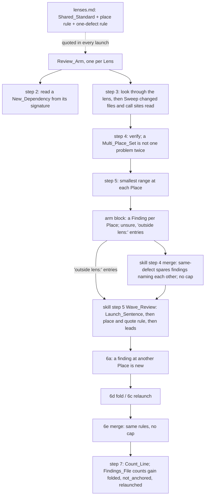

# Design Document

## Overview

The change is prompt text in three files, the cap's removal and three JSON keys in the skill, a limit and a report line in the benchmark, and the documentation and evals that describe them. The Shared_Standard in `lenses.md` gains the anchoring rule and the one-defect rule, so every Review_Arm receives them once through its launch. The Review_Arm's procedure gains a first-line read of a New_Dependency in step 2, a bounded Sweep in step 3, a carve-out in step 4's "no problem twice" and the Launch_Sentence's bar files in step 4's bar, a plain smallest-range rule in step 5 in place of the 1f0f3ef two-place sentence, and an `outside lens:` prefix for the `unsure` entries the skill hands on. The Review_Skill's `same-defect` collapse spares findings that name each other, the Cap is removed from both merges, with its count, step 5 adds two bullets after the Launch_Sentence (the place rule and quote rule, and the arms' leads), step 6a sorts a finding at another Place as new, and the final Findings_File gains `counts.folded`, `counts.not_anchored` and `counts.relaunched`. The ReviewBench_Adapter loses its Findings_Limit, its repair prompt gains the three keys and loses `removed_by_cap`, and the Benchmark_Report loses its cap line. The Wave_Reviewer's definition does not change. Everything is written on top of the `review-skips-no-cost-departures` and `review-documentation-lens` specs, whose words this design quotes as they leave them.

## Architecture

Key decision, the dividing test is whether a Place needs its own edit. A Place wrong on its own, a stub, an interface that lacks the operation, a copy of a wrong return, gets a Finding wherever it is, touched or not; a Defect that an edit at either of two Places alone would fix gets its Finding where the pull request made the change that caused it, or at both when it changed both, naming the other (Requirements 1.1 to 1.5). It gives AY2526S2 a comment on `DeleteNoteCommand.java:35` and on `Model.java:175`, CrabTrap one comment on the new fetch at `AuditTrail.tsx:113` and none on the correct guard at `api.go:1046`, NCATSTranslator one on the changed `gtopdb.py:145` naming the rig file, and figlet one in each of six workflows, which is how the golden sets anchor in 59 of 66 two-file entries. The trade-off is that the arm must judge which kind a Defect is, and where one store fix cures all call sites, as investigation D read apilix's lost debounced save, the call sites get no Finding and those three golden highs stay lost. Rejected: one Finding on each side whenever both sides are code, which puts a comment on code that is not wrong (the CrabTrap guard); and 1f0f3ef's one Finding where the fix goes, preferring a touched file, which lost AY2526S2 G0 and 13 other named golden entries.

Key decision, the place rule and the one-defect rule live in the Shared_Standard, stated once. Every arm gets them in its launch, the same text in every Lens, and step 5 of the Review_Arm keeps only how to choose a line range (Requirements 1.9, 2.4). The trade-off is a longer standard, which the `security-lens` and `documentation-lens` eval prompts quote verbatim and must be rebuilt to match. Rejected: keeping the rule in step 5 of `review-arm.md`, where it sat after 1f0f3ef, because the rule says what a Finding is, which is the standard's job, and the author asked for it there.

Key decision, the arm marks an Outside_Lens_Lead with the prefix `outside lens:`. The skill then quotes exactly those entries to the Wave_Review without judging free text, as the skips spec's `departure not reported:` prefix lets it count departures (Requirements 8.1, 8.5). The trade-off is one more fixed form in the arm block's `unsure`, which only the Review_Skill reads. Rejected: the main session deciding which `unsure` entries name a problem outside a Lens, a judgement the skill avoids everywhere else.

Key decision, the merge spares findings that name each other rather than collapsing only overlapping ranges. Under `same-defect`, two candidates that name each other's file and line are a Multi_Place_Set and are never collapsed; everything else collapses as today (Requirements 6.1, 6.2). The trade-off is that the exemption rests on the messages naming each other, which Requirement 1.6 requires; two Findings of one set in one file that fail to name each other can still collapse. Rejected: collapsing only overlapping ranges, which would stop the merge removing two lenses' Findings of one Defect at nearby lines, a behaviour the cap and the reader both rely on today.

Key decision, the Wave_Review's new instructions go in the skill's launch, after the Launch_Sentence, never in `wave-reviewer.md`. `implement-spec`, `readable-code` and `tighten-tests` launch the same agent and must not inherit a review-only rule, and the skips spec records the Launch_Sentence word for word so that this change can add after it (Requirements 7.6, 10.2). The trade-off is a longer launch prompt. Rejected: a new paragraph in the Wave_Reviewer's Standard keyed to the Launch_Sentence, as the skips spec did for departures, because the place rule needs no change in how the reviewer judges, only in how it reports.

Key decision, there is no Cap. Every Finding the cap cut had passed its arm's verification and the merge's head check, so the cap dropped true findings for being low severity, never wrong ones; per-Place Findings plus the Sweep add Findings exactly on the largest pull requests, where the old Cap of 40 cut on apilix and Codebase-Conversion, and two of ReviewBench's 219 golden sets hold 43 true positives each (Requirements 6.4 to 6.7). The ReviewBench_Adapter's Findings_Limit of 40 goes with it, or the benchmark would still cut what the skill keeps, and the Owner accepts that scores will not compare with chunks 1 to 3. The trade-off is a long list, and a long merged list quoted to the Wave_Review, on a very large pull request; a cap can come back if that cost shows. Rejected: a Cap of 80, which still cuts verified findings on the largest pull requests and needs the adapter raised to match.

Key decision, the Sweep is a step of procedure in the arm, bounded by the change. It searches the other changed files and the call sites of a changed function or action the arm already read in step 2, and nothing wider (Requirement 4). The trade-off is more reading per arm and so a little more cost per review. Rejected: a repository-wide search, whose cost grows with the repository, and a sweep in the merge, which would create Findings no arm verified.

Key decision, the reviewer's share is three keys in `counts`, read from what step 7 already counts. `folded`, `not_anchored` and `relaunched` give the Count_Line's numbers and lenses, and `not_anchored` equals the `not anchored` entries of the skips spec's Not_Reported_List, since both come from step 6d (Requirement 9). The ReviewBench_Adapter's repair prompt, `FINDINGS_SHAPE` in `benchmarks/reviewbench/agent/agent.py`, gains the three keys and loses `removed_by_cap`, since this change edits that file for the Findings_Limit anyway (Requirement 9.5). The trade-off is that the Benchmark_Report's Review health section does not yet read the three keys; that stays a follow-up.

## Components and Interfaces

### Shared_Standard, `plugins/ponderly/skills/review/lenses.md`

Neither sibling spec changes the opening paragraph. Its first sentence says the skill sends "the three sentences of this paragraph from "Across every lens" to its end"; that becomes "the sentences of this paragraph from "Across every lens" to its end", since the standard grows.

After the paragraph's last sentence, "A pre-existing problem in a touched file counts when it is verifiable.", the paragraph gains, word for word:

> A finding sits where a change is needed. When a defect needs its own edit at several places, because each is wrong on its own, such as a stub and the interface it lacks or one mistake copied into several places, write one finding at each place you verified at head, in whatever file it is, touched or not, and one at each copy in the same file. When an edit at either of two places alone would fix the defect, such as a new call into a handler whose guard does not serve that call, or code and a document, configuration or manifest that now disagree, write one finding at the place the pull request changed, or one at each when it changed both, and when it changed neither side's lines, as when it only removed code, on the lines next to the removal. Each such finding names the file and line of the others, or of the other place when there is one finding, and never describes another place's defect as a sentence in place of a finding of its own; a place you suspect but have not verified at head is no finding and goes under unsure. A message describes one defect and no aside restating a claim you did not verify: a second defect, even on the same lines, is a finding of its own.

| Operation | Behaviour | Requirements |
|---|---|---|
| Append the place rule | The first four sentences above | 1.1–1.8 |
| Append the one-defect rule | The last sentence above | 2.1–2.4 |
| De-enumerate the count | "the three sentences" becomes "the sentences" | 1.9 |

### Review_Arm, `plugins/ponderly/agents/review-arm.md`

| Step | Old words | New words | Requirements |
|---|---|---|---|
| 2, Read at head | ends "Read the files they import or call, and the callers of what they change, wherever a claim needs them." | adds after it: "When the change makes code depend on a function or endpoint it did not depend on before, read that function from its signature, every guard and early return before the branch the change uses, and work out under which configuration each fires; a test that always sets up what the guard checks does not show the guard is met in production." | 5.1–5.4 |
| 3, Look through the lens | ends "report what you verify there at the place the standard says.", the documentation-lens spec's search sentence as this change words it | adds after it, at the step's end: "When a defect comes from a pattern, such as a copied helper, a repeated line or a step missing at a call site, search the other changed files, and the call sites of a changed function or action that you read in step 2, for the same pattern before writing your block; report each copy you verify at head as the standard says, and search no further." | 4.1–4.5 |
| 4, Verify | "and no problem twice." | "and no problem twice at the same place: the findings of one defect at several places, each naming the others, are not the same problem twice." | 3.1, 3.2 |
| 4, Verify, the bar | "what its `CLAUDE.md`, its contributing guide and the code around the change already do" | "what its `CLAUDE.md`, `AGENTS.md`, files under `.claude/rules/` and contributing guide say and the code around the change already does", the same files the Launch_Sentence names, so an arm and the Wave_Reviewer judge against one bar | 10.5 |
| 5, Anchor | the whole step after its first sentence's range rule, from "When the problem is a disagreement between two places" to "never one finding on each side." | removed; the step becomes: "Give each finding the smallest range of lines at head that holds the problem at its place: one line when one line holds it, the first and last line of the block when it spans several, never one finding per line of a multi-line problem. The standard says at which places a defect gets a finding." | 1.9 |
| Arm block, `unsure` | "Under `unsure` go anything you could not settle and anything you noticed outside your lens or outside the touched files, or `nothing`." | "Under `unsure` go anything you could not settle, and each problem you noticed outside your lens as one entry that begins `outside lens:` and names its file and line, or `nothing`." | 8.1, 8.5 |

The description and the Second pass section are unchanged; a second-pass arm anchors a Wave_Reviewer finding at its Place under the same standard.

### Review_Skill, `plugins/ponderly/skills/review/SKILL.md`

| Where | Old words | New words | Requirements |
|---|---|---|---|
| Frontmatter description | "keeps at most 80" (as task 3.1 left it) | the phrase removed with its joining words, so the description lists the merge steps without a limit | 6.4 |
| Terms, shared standard | "the three sentences of that file's opening paragraph" | "the sentences of that file's opening paragraph" | 1.9 |
| Step 2, no-diff JSON | "every count 0, `removed_by_cap` and `departures_not_reported` included," (as the skips spec leaves it) | "every count 0, `departures_not_reported`, `folded` and `not_anchored` included, `failed_arms` and `relaunched` `[]`," | 6.5, 9.3 |
| Step 4.3, `same-defect` | "two candidates in the same file become one only when they name the same defect and the same fix;" | "two candidates in the same file become one only when they name the same defect and the same fix, and never when each names the other's file and line, since those are one defect at several places;" | 6.1–6.3 |
| Step 4.5 | "5. **Cap** at 80, dropping from the lowest severity." (as task 3.1 left it) | removed; the steps before it keep their numbers | 6.4 |
| Step 4, counts paragraph | "**removed by the cap** is the number the cap of 80 dropped, counted apart;" and "plus removed by the cap" | both removed, so the candidates are the merged list plus removed by the merge | 6.4, 6.5 |
| Step 4, JSON example | `"removed_by_cap": 0, ` | removed | 6.5 |
| Step 5, launch bullets | after the Launch_Sentence bullet, which stays word for word | two new bullets, below | 7.1–7.4, 8.1–8.5 |
| Step 6a, Sort | after "Any other reviewer finding is **new**." | adds: "A reviewer finding whose quote, found in its file at head, lies outside the lines of every merged finding in that file is new, even when its problem names a finding of the merged list at another place of the same defect, unless it says that finding is wrong, which makes it a contradiction." | 7.5 |
| Step 6e | "from normalising to the cap of 80", "and what its cap drops", "and **removed by the cap** the number the cap of 80 dropped, each" and "by the cap and by the review" (as task 3.1 left them) | "from normalising to ordering", the cap clause removed, "each" kept for removed by the merge alone, and "and by the review" | 6.4, 6.5 |
| Step 7, Count_Line | "`cut by the cap <n>` with removed by the cap, and" | removed | 6.5 |
| Step 7, `--json` | any naming of `removed_by_cap` | removed | 6.5 |
| Step 7, `--json` | in the final counts, after "`departures_not_reported` the count line's number, 0 when the wave review did not return or did not run;" (as the skips spec leaves it) | adds: "`folded` and `not_anchored` the count line's numbers and `relaunched` its lenses as a list, 0, 0 and `[]` when the wave review held, did not return or did not run, and `relaunched` `[]` when the count line says relaunched none;" | 9.1–9.4 |

The Launch_Sentence, as the skips spec leaves it, stays word for word: "These changes are a pull request reviewed for the review skill: judge style, structure, comments and tests against the repository's own bar, what its CLAUDE.md, AGENTS.md, .claude/rules/ files and contributing guide say and the code around the change already does, and list a team-rule departure with no concrete cost in this change under unsure, not as a finding, unless it also departs from that bar."

The two bullets that follow it in step 5:

- the sentence, verbatim, "Apart from the departures the sentence above lists under unsure, report a problem at each place that needs its own edit, and, when an edit at either of two places alone would fix it, at the place the pull request changed, at each when it changed both, or on the lines next to the removal when it changed neither: one entry per place, each with its own quote and naming the others, never other places listed inside one entry; such a set is not a duplicate, in this list or in yours. A problem you can tie to a file and an exact quote at head is a finding at the severity it deserves, with any doubt stated in its problem together with what would settle it, a file to read or a case to run; a doubtful problem with no way to settle it, or one you cannot quote, goes under unsure.";
- the arms' leads: each `unsure` entry beginning `outside lens:` in the arm blocks the merge took, quoted with its arm's lens, under the words "Leads the arms noticed outside their lens and did not settle: verify each against the code at the head and report those it bears out.", or the words "No leads." when there is none.

The paragraph after the bullets, "Nothing more, and never the diff.", is unchanged. A Reviewer_Finding from a lead is sorted, folded, relaunched and settled by step 6 like any other (Requirement 8.3).

### Benchmark, `benchmarks/reviewbench/`

| File | Change | Requirements |
|---|---|---|
| `agent/findings.py` | `MAX_FINDINGS` and the `over_limit` reason removed; `validate` returns every finding that passes its file and line checks, ordered high, medium, low with input order kept inside a severity; its docstring drops "and at most 40 of them" and `over_limit` | 6.6 |
| `agent/agent.py` | `FINDINGS_SHAPE`'s counts drop `"removed_by_cap": integer, ` and add `"folded": integer, "not_anchored": integer, "relaunched": [string]`, only when `"pass"` is `"final"`, as `departures_not_reported` is; the `dropped_<reason>` log line follows `validate`'s reasons unchanged | 9.5 |
| `report.py` | The Review health line "Mean findings removed by the cap of 40" and its `removed_by_cap` mean removed; the section's opening paragraph drops "the cap of 40 and" and the two sentences on the cap's count; a review file with or without `removed_by_cap` is read alike | 6.7 |
| `checks/test_reviewbench_findings.py` | The two `ValidateLimit` tests that assert the forty limit become one: forty-one valid findings are all kept, high first; no other assertion on `over_limit` remains; the seeded property test `test_at_most_forty_in_severity_order_with_the_lowest_dropped_first` becomes `test_every_valid_finding_is_kept_in_severity_order`, asserting `len(kept) == len(valid)` and severity order; `LIMIT = 40` is removed and `ValidateLimit` is renamed `ValidateKeepsEveryFinding` | 6.6, 11.8 |
| `README.md` | The Review health sentence "the mean number of findings removed by the merge, by the cap and by the wave review" drops "by the cap and", reading "by the merge and by the wave review" | 9.5 |
| `checks/test_reviewbench_report.py` | The three tests on the cap's mean become one: a review file recording `removed_by_cap` is readable and the section prints no cap line | 6.7, 11.8 |

### Documentation, `docs/reference.md`

| Entry | Change | Requirements |
|---|---|---|
| `review`, What it does | "and keeps at most 40" is removed, and one sentence says no merge drops a verified finding for its severity or the list's length; the `same-defect` sentence adds that two findings naming each other are never merged; one sentence says a defect gets a finding at each place that needs its own edit, or at the changed place when either edit would fix it; the wave-review sentences add the place and quote rule and that each arm's outside-lens notes are passed to it as leads | 11.1 |
| `review`, What it writes | "the cap of 40" is removed from the count line's description; the `--json` sentence names the `folded`, `not_anchored` and `relaunched` counts | 11.1 |
| `review-arm`, opening paragraph | adds that it puts a finding at each place a defect needs its own edit, sweeps the changed files for copies and reads a newly called function from its signature | 11.1 |
| `review-arm`, What it returns | adds that an outside-lens note under `unsure` begins `outside lens:` | 11.1 |

The README names the review skill only in its diagram, which does not describe anchoring, the merge, the Cap or the launch, so it is unchanged unless the read at implementation finds otherwise.

### Evals

| Case | Change | Requirements |
|---|---|---|
| `evals/agents/review-arm/security-lens` | Prompt re-quotes the Shared_Standard from `lenses.md` as this change leaves it; graders unchanged | 11.2 |
| `evals/agents/review-arm/documentation-lens` | Built by the documentation-lens spec, which already expects the finding on the changed lines of `clamp/cli.py` naming the README example (`names-the-readme-example.md`, `names-the-new-option.md`). Its prompt re-quotes the Shared_Standard; graders, description and expected outcome unchanged. This is the code-and-untouched-document case of Requirement 11.4 | 11.2, 11.3, 11.4 |
| `evals/agents/review-arm/finding-at-each-own-edit-place` | New, correctness lens, `shop` fixture. A `files/` overlay commits `shop/commands.py` whose `delete_product` returns a success message and touches nothing; the scaffold leaves uncommitted a `shop/db.py` that adds `save_product` persistence and no way to delete. Graders: the arm was launched, `^lens: correctness`, `file: shop/commands\.py`, `file: shop/db\.py`, and a finding on each file whose message names the other file | 1.1, 1.6, 11.4 |
| `evals/agents/review-arm/finding-in-each-copy` | New, correctness lens, `calc` fixture. The scaffold leaves uncommitted two new strategy modules, each returning `{"success": True}` after a check whose result it ignores. Graders: the arm was launched, a finding in each module's file, and a finding on each module whose message names the other module | 1.1, 1.7, 11.4 |
| `evals/agents/review-arm/reads-a-new-dependency-whole` | New, reliability lens, `shop` fixture. A `files/` overlay commits a handler whose first lines return an error when a configured store is `None`, with its tests always setting the store; the scaffold leaves uncommitted a new caller of that handler. Graders: the arm was launched, a finding on the new caller's file, and the guard's condition (`price_log is None`) or its line (`shop/history.py:7`) in the block | 1.2, 5.1–5.3, 11.4 |
| `evals/skills/review/keeps-an-outside-lens-lead` | New, `shop` fixture, planting a defect at the edge of two lenses, a swallowed error that makes a function return a wrong total. Graders: the final list has a finding on the planted file and line | 8.1–8.3, 11.5 |
| `evals/skills/review/finding-in-each-of-three-files` | New, `shop` fixture, planting the same unclosed-connection pattern in three changed files, and a second copy in one of them, so two findings share a file and name each other. Graders: one regex per file for a final-list line on it whose message names the connection or its close, and one for two such lines in the file holding two copies, each on its own copy's lines | 1.1, 1.5, 4.2, 6.1, 11.5 |

Each new case follows the `security-lens` or `finds-planted-defects` layout: `case.yaml`, `prompt.md` with description, tags, allowed tools and expected outcome, `scaffold.sh` calling `evals/fixtures/setup.sh <tree> <branch> wrappers` before copying `files/`, and `graders/`. Each skill case keeps its answer key in a `README.md` beside it, outside the fixture tree.

## Data Models

| Field | Where | Type | Constraint |
|---|---|---|---|
| `unsure` entry `outside lens: <file>:<line>: <problem>` | arm block | string | prefix exact, so the Review_Skill can pick it out |
| Cap | Review_Skill steps 4 and 6e | none | removed; no `removed_by_cap` in the Findings_File |
| Findings_Limit | `benchmarks/reviewbench/agent/findings.py` | none | removed with `over_limit`; `validate` returns every finding that passes its checks, ordered high, medium, low |
| `FINDINGS_SHAPE` counts | `benchmarks/reviewbench/agent/agent.py` | string | names `folded`, `not_anchored` and `relaunched`, not `removed_by_cap` |
| `counts.folded` | final Findings_File | integer ≥ 0 | the Count_Line's folded; 0 when the Wave_Review held, did not return or did not run |
| `counts.not_anchored` | final Findings_File | integer ≥ 0 | the Count_Line's not anchored; equals the `not_reported` entries with reason `not anchored` |
| `counts.relaunched` | final Findings_File | list of lens names | the lenses relaunched in step 6c; `[]` when none |
| new counts in the interim Findings_File | step 4 | absent | written only in the final file, as `departures_not_reported` is |

## Correctness Properties

### Property 1: Every Own_Edit_Place has its Finding

*For any* Defect a Review_Arm verifies at two or more Own_Edit_Places, its block holds one Finding at each of them, in whatever file each is.

**Validates: Requirements 1.1, 1.5, 4.2**

### Property 2: An Either_Side_Defect sits on the Changed_Side

*For any* Either_Side_Defect, the Review_Arm's Findings for it are exactly at the Places the pull request changed.

**Validates: Requirements 1.2, 1.3, 1.4**

### Property 3: A set names itself

*For any* Multi_Place_Set, each Finding names the file and line of every other, and no Finding describes another Own_Edit_Place's Defect in place of that Place's Finding.

**Validates: Requirements 1.6, 1.7**

### Property 4: Nothing collapses a set

*For any* Multi_Place_Set an arm returns, under `same-defect`, every Finding of it that passes the head check reaches the Final_List, and a Reviewer_Finding at a Place the merged list lacks is sorted as new.

**Validates: Requirements 3.1, 6.1, 7.5**

### Property 5: One Defect per Finding

*For any* Finding, its message describes one Defect and no claim the arm did not verify.

**Validates: Requirements 2.1, 2.2, 2.3**

### Property 6: Every lead reaches the Wave_Review

*For any* review whose Wave_Review is launched, its prompt quotes every `outside lens:` entry of the arm blocks the merge took, and no other `unsure` entry.

**Validates: Requirements 8.1, 8.4, 8.5**

### Property 7: The counts agree

*For any* final Findings_File, `counts.folded`, `counts.not_anchored` and `counts.relaunched` equal the Count_Line's, and `counts.not_anchored` equals the number of `not_reported` entries with reason `not anchored`.

**Validates: Requirements 9.1, 9.2, 9.3**

### Property 8: What others share is unchanged

*For any* launch of the Wave_Reviewer, its definition reads as the skips spec leaves it, and the Launch_Sentence reads word for word as that spec records it.

**Validates: Requirements 7.6, 10.1, 10.2, 10.4**

## Error Handling

| Condition | Category | Behaviour | Requirement |
|---|---|---|---|
| The arm suspects a Place it cannot verify at head | UNVERIFIED_PLACE | No Finding there; listed under `unsure` | 1.8 |
| The Sweep finds a copy it cannot verify | UNVERIFIED_COPY | No Finding; the arm may list it under `unsure` | 4.3 |
| A Place is in a deleted file | DELETED | No Finding in the deleted file, as step 2 already says; the problem is reported where it lands at head | 1.1 |
| Two Findings of one set in one file do not name each other | UNNAMED_SET | `same-defect` may collapse them; Requirement 1.6 makes this a defect of the arm's output | 6.1 |
| The merge holds many Findings | LONG_LIST | All are kept and quoted to the Wave_Review; nothing is cut | 6.4 |
| A review file from an earlier run records `removed_by_cap` | OLD_FILE | The Benchmark_Report reads it as readable and ignores the key | 6.7 |
| No arm returned an `outside lens:` entry | NO_LEADS | The launch says "No leads." | 8.4 |
| An arm failed and was dropped | FAILED_ARM | Its leads are not quoted, since the merge took none of its entries | 8.1 |
| The Wave_Reviewer quotes a problem whose doubt has no way to settle it | UNSETTLED | It goes under `unsure`, and so to `not_reported` as an `unsettled lead` under the skips spec | 7.4 |
| The Wave_Review held, did not return or did not run | NO_REVIEW | `counts.folded` 0, `counts.not_anchored` 0, `counts.relaunched` `[]` | 9.3 |
| The ReviewBench_Adapter repairs a malformed Findings_File | REPAIR | Its `FINDINGS_SHAPE` names the three keys, so a repaired file keeps them; the Review health section reading them stays a follow-up | 9.5 |
| A sibling spec's tasks are not all ticked at implementation | NOT_READY | Stop before the first task and name the unfinished spec | 10.3 |

## Testing Strategy

Properties 1 and 3 are proved by the `finding-at-each-own-edit-place` and `finding-in-each-copy` arm cases and by the `finding-in-each-of-three-files` skill case; Property 2 by the rebuilt `documentation-lens` case for a document and by `reads-a-new-dependency-whole` for a call into a guard, whose grader checks the finding sits on the new caller. Property 4 is proved by the three-file skill case, whose three findings must survive the merge, and by reading step 4.3 and step 6a. Property 5 has no reliable fixture and is proved by reading the standard. Property 6 is proved by reading step 5 against the arm block's `unsure` rule; the `keeps-an-outside-lens-lead` case proves the outcome, a planted edge-of-lens defect in the final list, but can pass because an arm reported it directly, so it does not prove the route. Property 7 is proved by reading step 7 against step 6d, since no review eval writes `--json`. Property 8 is proved by `git diff` showing no change to `wave-reviewer.md` from this spec's tasks and the Launch_Sentence unchanged. The Findings_Limit's removal is proved by a `checks/test_reviewbench_findings.py` test that more than forty valid findings are all kept, and the cap line's removal by `checks/test_reviewbench_report.py`. `make validate` runs the free checks. No eval case runs until the Owner asks; each is then run by hand, one at a time, with `make eval-agent-review-arm` or `make eval-skill-review` and its case. No ReviewBench chunk runs for this change; the measure, chunk 2 again or figlet at Test_Set index 7 or CrabTrap at index 8, is the Owner's choice afterwards, and its scores need not compare with earlier chunks.
