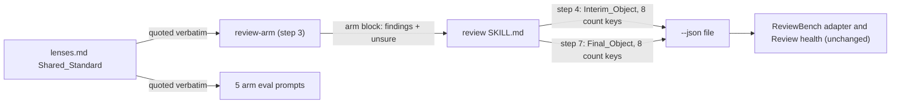

# Design Document

## Overview

Two prompt edits and two eval cases. The Shared_Standard in `lenses.md` ties the Per_Copy_Rule to a Defect and sends a Change_Remark to `unsure` as an entry beginning `change remark:`, step 3 of `review-arm.md` starts its copy search from a Defect, and step 7 of `SKILL.md` lists each arm's change remarks after the count line and under `not_reported`, never as findings. The Interim_Object's JSON shape in `SKILL.md` step 4 gains the four Final_Counts at their zero values, and the final write in step 7 and the early stop in step 2 name all eight entries of `counts`, so a session that edits the interim file and a session that writes afresh produce the same keys. Each edit is proved by one eval case that is written and scaffolded but not run; the five arm prompts that quote the Shared_Standard are rebuilt from the file.

## Architecture

Key decision, a Change_Remark goes under `unsure`, never into findings (Requirements 1.2, 1.5). The Shared_Standard already says "a finding sits where a change is needed", and no lens names scope or process as a problem; the Owner chose this over one finding at one place because ReviewBench's judge marked every such finding false and the one remaining finding would carry the same cost on every pull request that mixes formatting with a change. The trade-off: the remark reaches the Reviewer once, as a line after the count line and a `not_reported` entry, never as a scored finding.

Rejected alternative, one finding for the remark at the first reformatted file. Simpler for the Reviewer, but it keeps a finding the benchmark's judge calls false, and the arm would still have to pick a file to anchor a remark that belongs to no line.

Key decision, the Interim_Object carries the Final_Counts at zero from the first write (Requirements 2.1, 2.2). The three chunk 4 reviews that lost the counts edited the interim file's numbers in place; with the four keys already present, that edit keeps them, and the final write's list of eight required keys covers the session that writes afresh. The trade-off: the Interim_Object now shows `folded 0` and `relaunched []` before the wave review, which is true at that point and matches the early-stop object step 2 already writes.

Rejected alternative, tell step 7 to write the object afresh and never edit the interim file. A prompt cannot stop a session choosing the Edit tool, and the counts' names in two places are what make either path correct.

## Components and Interfaces

### Shared_Standard (`plugins/ponderly/skills/review/lenses.md`)

The paragraph every arm receives. One sentence changes and one is added after "a place you suspect but have not verified at head is no finding and goes under unsure", so the two things that go under unsure sit together and "the defect" in the either-of-two-places sentence keeps its antecedent.

| Operation | Input | Output | Requirements |
|-----------|-------|--------|--------------|
| Per_Copy_Rule sentence | "When a defect needs its own edit at several places ..." | the same sentence, with "a defect, a place where the code or text at the head does the wrong thing and an edit there would fix it," making its subject explicit | 1.1, 1.4, 1.6 |
| Change_Remark sentence, new, after the suspected-place sentence | | "A judgement about the change as a whole, such as that it reformats or reorders files beyond its purpose, mixes two purposes or is too large, names no line an edit would fix: it is not a finding and goes under unsure in one entry beginning `change remark:` that says what it is about, however many files it concerns." | 1.2, 1.5 |

### Review_Arm step 3 (`plugins/ponderly/agents/review-arm.md`)

The copy search. Its opening clause "When a defect comes from a pattern" gains "that you have verified at one place" and a closing clause: "a remark about the change as a whole starts no search and is one `unsure` entry beginning `change remark:`, as the standard says."

| Operation | Input | Output | Requirements |
|-----------|-------|--------|--------------|
| copy search | a verified Defect | one finding per copy verified at head | 1.3, 1.4 |
| Change_Remark | a judgement with no line to fix | one `unsure` entry beginning `change remark:`, no search | 1.3, 1.5 |

### Review_Skill (`plugins/ponderly/skills/review/SKILL.md`)

| Operation | Input | Output | Requirements |
|-----------|-------|--------|--------------|
| step 4 Interim_Object | the first merge | the JSON block with `counts` holding the eight entries, the Final_Counts at `0`, `0`, `0` and `[]`, and the sentence after it naming them as the final pass's counts, kept at those values until step 7 | 2.1 |
| step 7 Final_Object | the final list and count line | the paragraph names the eight entries of `counts` as required, "whether the object is written afresh or the interim file is edited", and keeps its existing values for each | 2.2, 2.3 |
| step 2 early stop | an empty changed-file list | unchanged in meaning; its sentence lists the eight entries by name rather than "every count 0" plus three names | 2.4 |
| step 1 `--json` path | the word after `--json` | made absolute against the working directory; accepted when outside the repository root, or under it when `git check-ignore -q <path>` succeeds; otherwise the skill says the path must be outside the repository or ignored by it, naming both, and stops. The preamble's "only when that path is outside the repository" and the Stops entry gain "or ignored by it" | 4.1, 4.2, 4.3 |
| step 7 change remarks | each arm's `unsure` entries beginning `change remark:` | the reply ends with one line per entry after the count line, each as `change remark: <text>`; the `--json` paragraph gains a `not_reported` bullet listing each with its text as `problem`, `file` and `quote` `null`, and `reason` `change remark`, never in `findings` | 1.7 |

### ReviewBench adapter (`benchmarks/reviewbench/agent/agent.py`)

Only the `FINDINGS_SHAPE` string changes: the clause "these four only when `pass` is `final`" goes, since the interim object now carries the four Final_Counts at zero, and `"change remark"` joins the `reason` alternatives of `not_reported`. No code path of the adapter changes (Requirement 2.5).

### Documentation (`docs/reference.md`)

The `review-arm` entry's sentence on copies gains "for a defect it verified; a remark about the change as a whole goes under unsure".

### Eval cases

| Case | Kind | Fixture | Expects | Requirements |
|------|------|---------|---------|--------------|
| `one-note-for-a-change-remark` | Arm_Eval_Case, correctness lens | calc on branch `calc-strategies`, with the two strategy modules of `finding-in-each-copy` (the `_both_numbers` result ignored in each) and formatting-only edits overlaid on `calc/ops.py`, `calc/__init__.py` and `tests/test_ops.py` (import order, blank lines, quote style, no behaviour change) | a finding on each strategy file; no finding whose file is one of the three reformatted files; the arm launched with the correctness lens | 3.3 |
| `writes-the-final-counts` | Review_Eval_Case | shop on branch `shop-orders` with the planted defect of `keeps-an-outside-lens-lead`; the scaffold appends `review.json` to `.git/info/exclude` after setup, so git ignores it without a tracked change; prompt `/ponderly:review --json review.json` | `review.json` at the workspace root exists; its text matches `"pass": "final"`; its text matches each of the eight count keys by name; the wave reviewer launched once. The eval sandbox denies every write outside the workspace, Write tool and shell alike, which is why the path is inside the repository and ignored (Requirement 4) | 3.4, 4.1 |

The review case needs the Write tool, which the review skill uses for `--json`: its `allowed_tools` adds `Write`, and the Makefile's `eval-skill-review` target grants `Write` beside `Bash`. The other review cases list their own `allowed_tools` without it, so they are unchanged.

### The standard's opening sentence

Step 1 of `SKILL.md` and the self-describing sentence of `lenses.md` name the shared standard as the paragraph from "Across every lens" to its end, and that phrase occurs twice on the line, the first time inside the file's sentence about itself; two executors quoted the wrong start. Both phrases become `from "Across every lens, a finding worth reporting"`, so the session and anyone rebuilding a prompt start at the standard's first sentence (Requirement 3.2).

### Rebuilt prompts

`evals/agents/review-arm/{security-lens,documentation-lens,finding-at-each-own-edit-place,finding-in-each-copy,reads-a-new-dependency-whole}/prompt.md` quote the Shared_Standard verbatim and are re-quoted from the file after the edit (Requirement 3.2).

## Data Models

The `counts` object of the Findings_File, both passes:

| Field | Type | Interim value | Final value | Requirements |
|-------|------|---------------|-------------|--------------|
| `candidates` | integer | first merge's count | step 6e's count | existing |
| `removed_by_merge` | integer | first merge's count | summed count | existing |
| `removed_by_review` | integer | 0 | step 6's count | existing |
| `failed_arms` | list of lens names | first pass's | both passes' | existing |
| `departures_not_reported` | integer | 0 | the count line's number | 2.1, 2.2, 2.3 |
| `folded` | integer | 0 | the count line's number | 2.1, 2.2, 2.3 |
| `not_anchored` | integer | 0 | the count line's number | 2.1, 2.2, 2.3 |
| `relaunched` | list of lens names | `[]` | the count line's lenses | 2.1, 2.2, 2.3 |

No other field of the Findings_File changes. A `not_reported` entry for a change remark has `file` and `quote` `null`, the entry's text after `change remark:` as `problem`, and `reason` `change remark` (Requirements 1.7, 2.5).

## Correctness Properties

### Property 1: A copy finding has a defect behind it

*For any* arm block, every finding whose message names another file's finding as a copy points at a line that does the wrong thing on its own; a judgement about the change as a whole appears at most once, under `unsure` as an entry beginning `change remark:`, and the review's reply and `not_reported` list carry it once each, its findings never.

**Validates: Requirements 1.1, 1.2, 1.3, 1.5, 1.7**

### Property 2: Every final review file holds the eight counts

*For any* review run with `--json` that writes a Final_Object, whichever way the session writes it, `counts` holds the eight entries, with the Final_Counts at their zero values whenever the wave review held, did not return or did not run.

**Validates: Requirements 2.1, 2.2, 2.3, 2.4**

## Error Handling

| Condition | Category | Behavior | Requirements |
|-----------|----------|----------|--------------|
| An arm cannot tell whether a repeated pattern is a Defect or a Change_Remark | UNVERIFIED | No finding; one `unsure` entry naming the pattern and what would settle it | 1.2, 1.5 |
| An arm writes a change remark without the `change remark:` prefix | UNPREFIXED | It stays in the arm's block as a plain `unsure` entry and reaches no list; the standard and step 3 both give the prefix so this is the arm's error, not the skill's | 1.7 |
| The session edits the interim file in place at step 7 | WRITE_PATH | The eight keys are already present, so the edit fills the Final_Counts and the shape holds | 2.1, 2.2 |
| The review stops at step 2 with no changed files | EARLY_STOP | The object written holds the eight keys at zero and `[]` | 2.4 |
| The `--json` path lies under the repository root and git does not ignore it | REFUSED_PATH | Say the path must be outside the repository or ignored by it, naming both, and stop; nothing is written | 4.2 |
| The wave review held, did not return or did not run | NO_FOLD | `folded` 0, `not_anchored` 0 and `relaunched` `[]`; `departures_not_reported` the count line's number when the wave review returned and 0 when it did not | 2.3 |

## Testing Strategy

- The two eval cases above implement Properties 1 and 2 as example tests; both are written and scaffolded, and run only when the Owner asks, one case at a time, since each is a paid model call (Requirement 3.5).
- The error rows are covered by the cases' graders: the arm case's "no finding on a reformatted file" grader for the first row, and the review case's eight key graders for the second and fourth; the early stop keeps its existing `clean-diff` case, whose graders check the reply, not the file.
- `make validate` runs the free checks, including the plugin validations that parse every `case.yaml` and grader.
- The ReviewBench measure of both fixes is a rerun of chunk 1 (PRs 0 to 4), chosen by the Owner afterwards; no run is in the tasks.
