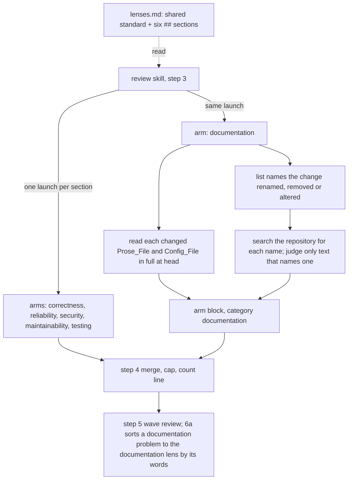

# Design Document

## Overview

The change is one new `##` section in the Lenses_File, a narrowed maintainability section beside it, and the documentation and eval that describe them. The Review_Skill already launches one Review_Arm per `##` section, merges any number of arm blocks, sorts a wave-review finding to a Lens by the Lenses_File's words and counts failed arms by name, so the sixth arm needs no change to `SKILL.md` or to the `review-arm` agent; a read of both confirms nothing names five Lenses. The Documentation_Lens reads every changed Prose_File and Config_File in full, and finds Stale_Documentation by searching the repository for the names the change renamed, removed or altered. The Maintainability_Lens gives up the `documentation` category and keeps only a missing public docstring and a comment that describes the algorithm. A new Arm_Eval_Case shows the arm finding a README example left on a renamed option.

## Architecture

Key decision, a lens, not a new agent or a new skill step. The Lenses_File says a section added is an arm added, and the arm agent takes its lens from the launch, so the Documentation_Lens is one section and inherits the launch, the arm block's shape, the merge, the cap of 40, the failed-arm handling and the count line (Requirements 1.1, 3.1, 3.2). The trade-off is that the arm runs with the same agent, model and effort as the others, so it cannot be tuned cheaper for prose; rejected: a separate `doc-arm` agent, which would repeat the arm's procedure and need its own merge rules.

Key decision, the arm runs on every review, including a code-only change. A change that renames an option or a function without touching its README is the case where documentation goes stale, and a conditional launch would need the main session to judge file types (Requirement 1.5). The trade-off is about one arm's cost added to every review; since the budget rule allows a second pass only when remaining is at least spent, a larger spent stops a second pass slightly more often (Requirement 3.3).

Key decision, the stale-documentation search is bounded by the change's names. The arm lists each symbol, option, command, path or file the change renamed, removed or altered, searches the repository for each, and judges only the text that names one; it never reads every Prose_File in the repository (Requirement 1.5). The trade-off is that stale text that describes changed behaviour without naming anything the change touched is missed; reading a repository's whole documentation on every review would cost more than the arm's first pass.

Key decision, each boundary is named on both sides. A stale comment or docstring on code that is right is the Documentation_Lens's and code that does not do what its docstring says is the correctness lens's; user-facing wording, interface labels and help strings included, is the Documentation_Lens's, not the Maintainability_Lens's; so no two arms report the same sentence (Requirements 1.4, 1.12, 2.4). The trade-off is a sentence more in three other lenses.

Key decision, the arm searches as far as its lens says. The `review-arm` agent's sweep covers the files the pull request touches; a lens that names a wider search, as the Documentation_Lens does for Stale_Documentation, extends it, and what the arm verifies there is reported like any other finding (Requirement 3.5). Where the finding is anchored is the arm's anchoring rule's, so the eval case expects it on the changed lines that name the README line (Requirement 4.2).

Key decision, maintainability gives up `documentation`. Two lenses carrying one category would each report the same stale sentence, and the merge's same-defect collapse would have to catch them; with one owner, a stale or contradicting text is the Documentation_Lens's, and the Maintainability_Lens keeps the two documentation problems that are about code structure, a public contract missing its docstring and a comment that describes the algorithm instead of the intent, filed under `maintainability` (Requirements 2.1, 2.2, 2.3). The trade-off is that a missing docstring's findings move from category `documentation` to `maintainability`, which changes the category split a benchmark reports for them.

Key decision, CI breakage stays with reliability. The reliability lens already owns "dependency, build and CI changes that break or weaken the pipeline", a workflow step running a script the change renamed among them; the Documentation_Lens takes a Config_File's comments, names and descriptions only where they contradict the commands or code they name, and the reliability lens names that boundary too (Requirement 1.9). The trade-off is a boundary the arms must read; each lens names it, as the others name theirs.

## Components and Interfaces

### Lenses_File, `plugins/ponderly/skills/review/lenses.md`

The Documentation_Lens, a new section after `maintainability` and before `testing`, in the shape of the others:

> ## documentation
>
> This lens looks at the text a reader acts on: every Markdown file, template, help text, changelog, documentation page, workflow or configuration file the change touches, read in full at head, and the documentation elsewhere that the change makes untrue. In those files it looks for text that contradicts the code or the commands it describes, broken markup such as unmatched tags, bad links and malformed front matter, examples that would not run as written, and typos, wrong terms and unprofessional wording in user-facing text, interface labels and help strings included. For documentation the change makes stale, list each symbol, option, command, path or file the change renames, removes or alters, search the repository for each name, and judge only the text, comments and docstrings included, that names one of them; a comment or docstring that no longer matches code that is right is this lens's, and code that does not do what its docstring says is the correctness lens's. Do that search even when the change touches none of those files, and do not read every documentation file in the repository. It carries the category `documentation`. A true positive quotes the sentence and says what it contradicts at head or what a reader does wrong because of it; an example that would not run as written, text that tells a reader to do the wrong thing, markup that hides content, and a broken link in a quickstart or install path are medium, any other broken link and a typo or wrong term are low, and only text whose instructions lose data or break a user's setup is high. A false positive is a style preference or a rewording with no reader cost. A change to a workflow or configuration file that breaks or weakens the build or CI, such as a step that runs a script the change renamed, belongs to the reliability lens; this lens takes such a file's comments, names and descriptions only where they contradict the commands or code they name.

The Maintainability_Lens's documentation clause, old: "comments, docstrings, README and API docs that are stale, misleading, missing where a public contract needs them, or that describe the algorithm instead of the intent;"

New: "a public contract that is missing its docstring, and a comment or docstring that describes the algorithm instead of the intent;"

Its categories sentence, old: "It carries the categories `maintainability`, `documentation`, `api-architecture` and `accessibility`, the readability and usability side of a review."; new: "It carries the categories `maintainability`, `api-architecture` and `accessibility`, the readability and usability side of a review."

Its true-positive sentence drops "the stale sentence" from what a finding points at, and its small-finding clause, old: "names a concrete inconsistency, a typo in a public name or a reader-facing confusion, and is then low severity."; new: "names a concrete inconsistency or a typo in a public name, and is then low severity." Its interface clause, old: "through missing accessibility, hard-coded text that defeats internationalisation, or unprofessional wording."; new: "through missing accessibility or hard-coded text that defeats internationalisation." Its last sentence, old: "Anything that changes behaviour belongs to the correctness, reliability or security lens."; new: "Anything that changes behaviour belongs to the correctness, reliability or security lens, and stale, misleading or contradicting text to the documentation lens."

The correctness lens's last sentence is followed by a new one: "A comment or docstring that is stale while the code is right belongs to the documentation lens."

The reliability lens's last sentence, old: "A wrong result on the happy path belongs to the correctness lens and an exploitable failure to the security lens."; new: "A wrong result on the happy path belongs to the correctness lens, an exploitable failure to the security lens, and a configuration file's comment or description that no longer matches what it runs to the documentation lens."

The opening paragraph and the Shared_Standard are unchanged.

| Operation | Behaviour | Requirements |
|---|---|---|
| Add the `documentation` section | The text above, word for word | 1.1–1.11, 3.4 |
| Narrow the `maintainability` section | The six replacements above | 2.1, 2.2, 2.3, 2.4 |
| Name the boundary in `correctness` and `reliability` | The sentence added and the sentence replaced above | 1.4, 1.9 |

### Review_Skill and `review-arm` agent

| Operation | Behaviour | Requirements |
|---|---|---|
| Let a Lens widen the arm's search | `review-arm.md` step 3 gains, after "and a reviewer who sees the problem says so.", the sentence "When the lens tells you to search beyond the touched files, as the documentation lens does for text the change makes untrue, search as far as the lens says and report what you verify there like any other finding." | 3.5 |
| Name no benchmark in the arm | `review-arm.md`'s run paragraph names no benchmark; its text is the one under "Changes after the wave 1 review" | 3.4 |
| Read `SKILL.md` and `plugins/ponderly/agents/review-arm.md` for a count or list of Lenses | None today: the launch is per `##` section, the merge per arm block, step 6a sorts by the Lenses_File's words, and the arm's category list already holds `documentation`; the task records the read and changes nothing unless it finds one | 3.1, 3.2 |

### Documentation, `docs/reference.md`

| Entry | Change | Requirements |
|---|---|---|
| `review`, What it does | "correctness, reliability, security, maintainability and testing" becomes the six, with documentation; one sentence says the documentation arm reads each changed prose and configuration file and searches for documentation naming what the change renamed, removed or altered | 4.1 |

### Evals

| Case | Change | Requirements |
|---|---|---|
| `evals/agents/review-arm/documentation-lens` | New, in the `security-lens` layout: the `clamp` fixture with a `files/` overlay committing `clamp/cli.py`, an argparse command line with `--high`, and a README example `python3 -m clamp.cli 150 --high 120`; the scaffold leaves uncommitted a `clamp/cli.py` that renames `--high` to `--max` and no README change; the prompt quotes the Shared_Standard and the Documentation_Lens verbatim; graders: the arm was launched, `^lens: documentation`, a finding with `file: clamp/cli.py` whose message names `README.md`, and `--max` in the block | 4.2, 4.4 |
| `evals/agents/review-arm/security-lens` | Unchanged by this task, since it quotes the Shared_Standard and the security Lens, neither of which changes here; rebuilt from the Lenses_File once the anchoring change in flight lands in the Shared_Standard | 4.3 |

### Measure, chosen by the Owner afterwards

Two ReviewBench measures, neither part of the tasks: a single rerun of the `scotthamilton77/agents-config` pull request, Test_Set index 10, with `make prs PRS="10"`, as the targeted check of the templates case; and the rerun of a whole chunk as the real measure of recall gained against findings added (Requirement 4.5).

## Data Models

| Field | Where | Type | Constraint |
|---|---|---|---|
| `## documentation` | Lenses_File | section heading | the arm block's `lens:` line reads `documentation` |
| `category` | Documentation_Lens findings | string | `documentation` only |
| `category` | Maintainability_Lens findings | string | `maintainability`, `api-architecture` or `accessibility` |
| `severity` | Documentation_Lens findings | string | medium, low or high as the lens text gives |

## Correctness Properties

### Property 1: One owner for a stale sentence

*For any* review, a finding with category `documentation` comes from the Documentation_Lens's arm, and no Maintainability_Lens finding carries it.

**Validates: Requirements 1.6, 2.2**

### Property 2: The search is bounded by the change's names

*For any* review, every Documentation_Lens finding outside the changed files is on text that names a symbol, option, command, path or file the change renamed, removed or altered.

**Validates: Requirements 1.5**

### Property 3: The skill is unchanged

*For any* number of `##` sections in the Lenses_File, the Review_Skill launches one arm per section and merges, caps and counts them with no step naming a count.

**Validates: Requirements 3.1, 3.2**

## Error Handling

| Condition | Category | Behaviour | Requirement |
|---|---|---|---|
| The change touches no Prose_File or Config_File | CODE_ONLY | The arm still runs the name search; with nothing found it returns `findings: []` | 1.5, 1.11 |
| The change renames nothing and touches no documentation | NOTHING_TO_READ | `findings: []`, as every Lens with nothing to report | 1.11 |
| The documentation arm fails twice | AGENT_FAILURE | As for any arm: dropped, named as failed in the count line | 3.2 |
| A workflow change breaks CI | BOUNDARY | The reliability arm's; the documentation arm reports only text contradicting the commands named | 1.9 |
| The budget's spent grows by one arm | BUDGET | The budget rule stops a second pass slightly more often; no rule changes | 3.3 |

## Testing Strategy

Property 1 is proved by reading the two sections: only the Documentation_Lens names `documentation`, and the arm takes its category from its lens. Property 2 is proved by the `documentation-lens` case, whose finding names the README the change did not touch and the renamed option, and by the lens text. Property 3 is proved by the read of `SKILL.md` and `review-arm.md` recorded in the task. `make validate` runs the free checks. No eval case runs until the Owner asks; the `documentation-lens` case is written and its scaffold built, and run by hand with `make eval-agent-review-arm` and its case when the Owner says so. The ReviewBench measures are the Owner's choice afterwards.

## Changes after the wave 0 review

The Owner approved these, recorded here word for word.

- Documentation_Lens, old: "a comment or docstring that contradicts its code is this lens's"; new: "a comment or docstring that no longer matches code that is right is this lens's, and code that does not do what its docstring says is the correctness lens's".
- Documentation_Lens, old: "and typos and wrong terms in user-facing text."; new: "and typos, wrong terms and unprofessional wording in user-facing text, interface labels and help strings included."
- Documentation_Lens, old: "and a broken link or an example that would not run in a quickstart or install path are medium, a typo or wrong term is low,"; new: "and a broken link in a quickstart or install path are medium, any other broken link and a typo or wrong term are low,".
- Documentation_Lens, old: "Do that search even when the change touches no documentation file,"; new: "Do that search even when the change touches none of those files,".
- Documentation_Lens, old: "A change to a workflow or configuration file that breaks or weakens the build or CI belongs to the reliability lens; this lens takes such a file's text only where it contradicts the commands or code it names."; new: "A change to a workflow or configuration file that breaks or weakens the build or CI, such as a step that runs a script the change renamed, belongs to the reliability lens; this lens takes such a file's comments, names and descriptions only where they contradict the commands or code they name."
- Correctness lens, added at its end: "A comment or docstring that is stale while the code is right belongs to the documentation lens."
- Reliability lens, old: "A wrong result on the happy path belongs to the correctness lens and an exploitable failure to the security lens."; new: "A wrong result on the happy path belongs to the correctness lens, an exploitable failure to the security lens, and a configuration file's comment or description that no longer matches what it runs to the documentation lens."
- Maintainability_Lens, old: "through missing accessibility, hard-coded text that defeats internationalisation, or unprofessional wording."; new: "through missing accessibility or hard-coded text that defeats internationalisation."
- Maintainability_Lens, old: "names a concrete inconsistency, a typo in a public name or a reader-facing confusion, and is then low severity."; new: "names a concrete inconsistency or a typo in a public name, and is then low severity."
- `review-arm.md` step 3, added after "and a reviewer who sees the problem says so.": "When the lens tells you to search beyond the touched files, as the documentation lens does for text the change makes untrue, search as far as the lens says and report what you verify there like any other finding." The anchoring change in flight also edits step 3 and builds on this sentence.
- `review-arm.md`, old: "In the benchmark image the repository's dependencies are not installed, so this works only…"; new: "Where the repository's dependencies are not installed, this works only for code that imports nothing beyond the standard library; when the code cannot be run that way, settle the candidate by reading, as the procedure says."
- The `documentation-lens` case expects its finding on the changed lines of `clamp/cli.py`, naming the `README.md` example and `--max`, which both today's anchoring rule and the anchoring change in flight give.

## Changes after the wave 1 review

The Owner approved these, recorded here word for word: the arm runs no code at all and settles every candidate by reading (Requirement 3.6). An approach that ran code in a copy of the head outside the repository was built and then withdrawn, since most projects' code cannot run without installed dependencies, which a review must not install; the files it touched are back to their HEAD text.

- `review-arm.md`, the read-only paragraph, old: "You read; you change nothing. Do not edit, write, create or delete a file, commit, stage, stash or check out, or run anything else that changes the working tree, and leave no scratch file. `Bash` is for `git diff`, `git show`, `git status`, reading, and a check that leaves no file behind, not even bytecode or a cache, so that `git status` afterwards shows what it showed before. A validator that only reads qualifies; `python3 -m py_compile` does not, because it writes a `.pyc` under `__pycache__/`, so parse a Python file in memory instead, with `python3 -c 'import ast, sys; ast.parse(open(sys.argv[1]).read())' <path>`. Nothing that writes, and not the test suite. When a language server is available, the LSP tool can find definitions, references, hover types and symbols for the code the diff touches, and writes nothing; do not rely on it being present, since it returns an error where no server is configured, and read on without it."; new: "You read; you change nothing. Do not edit, write, create or delete a file, commit, stage, stash or check out, or run anything else that changes the working tree, and leave no scratch file. `Bash` is for `git diff`, `git show`, `git status` and reading, so that `git status` afterwards shows what it showed before. Run no code of the repository or the change: not a function, an example, a script or a test file, and not the test suite. When a language server is available, the LSP tool can find definitions, references, hover types and symbols for the code the diff touches, and writes nothing; do not rely on it being present, since it returns an error where no server is configured, and read on without it." It names no interpreter and no validator: the arm runs no Python at all.
- `review-arm.md`, the run paragraph, old: "One kind of run is allowed, because a result you saw beats one you reasoned out: when a candidate hinges on what the code computes and that code can be exercised on its own, a pure function, a parser, a comparison, run it once on the input you claim triggers the problem, and quote what it returned in the message. Start the interpreter from a scratch directory outside the repository, with bytecode writing off (`python3 -B -I`, or the equivalent for the language), with the file read from head or its code pasted in, and nothing else: never the test suite, never an install, never code that reaches the network, a database or the filesystem, and never anything that changes what `git status` shows. In the benchmark image the repository's dependencies are not installed, so this works only for code that imports nothing beyond the standard library; when the code cannot be run that way, settle the candidate by reading, as the procedure says."; new: "Settle every candidate by reading: trace the input that triggers it through the code at head, and quote the lines that show what happens. When only running the code would settle it, do not report it; say under `unsure` what a run would show." This also replaces the wave 0 rewording of its benchmark sentence, so the arm names no benchmark (Requirement 3.4).
- Correctness lens, old: ", and when the code can be run on its own, runs it on that input and quotes the result;"; new: ".".
- Reliability lens, old: "; when a failure path can be run on its own, the finding runs it and quotes what happened."; new: ".".
- Security lens, old: "; when the code that builds the sink's input can be run on its own, the finding runs it on a crafted input and quotes the string that reaches the sink."; new: ".".
- Documentation_Lens, old: ", and when an example can be run on its own, runs it and quotes the result;"; new: ";". The section quoted under Components is the text after this change.
- The `security-lens` and `documentation-lens` prompts quote their lens again word for word after these removals; the Shared_Standard they quote is unchanged, so task 3.2 still waits for the anchoring change.
- `review-arm.md`'s frontmatter, `SKILL.md`'s opening, the `review-arm` entry of `docs/reference.md`, the disclosure of `plugins/ponderly/README.md` and `docs/reference.md`, and `llms.txt` are at their HEAD text.
- After the review of this change: in the run paragraph, old: "When only running the code would settle it, do not report it; say under `unsure` what a run would show."; new: "When only running the code would settle it, do not report it; say under `unsure` what run would settle it and what result would make it a finding."
- Documentation_Lens, old: "A true positive quotes the sentence, says what it contradicts at head or what a reader does wrong because of it;"; new: "A true positive quotes the sentence and says what it contradicts at head or what a reader does wrong because of it;" The Components quote and the `documentation-lens` prompt carry the same text.
