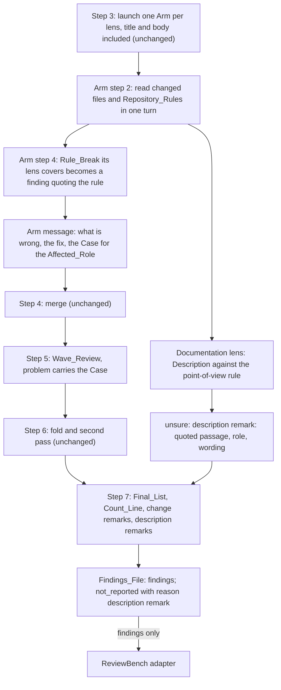

# Design Document

## Overview

The change is prompt text in four files and one line of the ReviewBench adapter. The `review-arm` agent gains a sentence in its step 2 that has it read the Repository_Rules in the turn it already reads the changed files, a sentence in step 4 that makes each Rule_Break its lens covers a finding quoting the broken sentence, a rewritten first message rule that puts the Case after the fix, and two clauses in its arm-block notes: the `low` severity names a Rule_Break with no other cost, and `unsure` names the `description remark:` entry. The documentation lens in `lenses.md` gains the Description check, returned as `description remark:` entries under `unsure`, the way change remarks are returned today. The `wave-reviewer`'s review-skill paragraph gains the rule-implied severity and a sentence that has its `problem` carry the Case in a launch for the review skill. The review skill's step 7 shows the Description_Remarks after the change remarks and writes them to `not_reported`. How a Team_Rules departure is weighed, the merge, the fold, the second pass and the counts stay as they are.

## Architecture

Key decision, the Repository_Rules are read in the Arm's step 2, not in a new step. Step 2 already reads every changed file whole at the head; adding the rule files to the same reading adds input but no turn, and each turn of an Arm re-reads its whole context, so a new step would cost more than the files themselves (Requirements 1.1, 5.2). The Arm reads only those not already in its context, since Claude Code may load a repository's `CLAUDE.md` and `.claude/rules/` files into a session by itself; whether a sub-agent gets them is unverified and is checked in the plugin-dir trial. The trade-off is that every Arm reads the same files, six times per review; the rejected alternative, quoting the rule files in each launch prompt, would make step 3 read them and would put their text in the launch, which the skill keeps to the review's inputs.

Key decision, only the Arm's step 4 gains the Rule_Break rule, and the Team_Rules weighing is not touched. Today step 4 makes the repository's own bar the bar, and the wave reviewer already reports a departure from the Repository_Bar with no Concrete_Cost as a nit; what is missing is the explicit check of each written sentence. The new sentence sits after the bar sentence and before "Where the repository is silent", which is left word for word, so a Team_Rules departure is still a finding only with a Concrete_Cost (Requirements 1.2, 1.4). A rule file whose front matter names `paths:` applies only to changed files those patterns match, as Claude Code itself applies it (Requirement 1.3). The trade-off is more `low` findings on repositories with long rule files, each of which the ReviewBench judge may call false when the benchmark's golden comments do not hold it; that score cost is the Owner's to accept.

Key decision, a Rule_Break takes the severity of its cost, `low` without one, or what the rule itself implies, and nothing else ranks it. The Final_List's order stays high, medium, low (Requirements 2.1 to 2.3). The Arm's `low` note and the wave reviewer's nit sentence each gain a clause naming the rule-implied severity; no new ordering step is written.

Key decision, the Case replaces "why it matters" in the message, after the fix. The Arm's message rule today is what is wrong, why it matters, what would fix it, in at most 120 words. The new rule is what is wrong, what would fix it, and why it matters as the Affected_Role, naming the role and what they want to stay true, with the cap raised to 150 words: in the ReviewBench runs since 1 November the median message was 64 words and 9 in 10 were under 95, so the Case, some 15 to 25 words once it takes the place of today's "why it matters", would push about 1 in 10 past 120 and force those findings, the long cross-file ones, to thin their trace or their Case (Requirement 3.1). The trade-off is about 30 more words on that tenth of findings, a fraction of a cent per review. The roles are read for the reviewed code: the user when the problem changes what the built thing does for the people who use it, the operator when it changes how it runs, deploys or fails in service, the owner when it is a risk, a cost or a burden on whoever maintains it; no role when no one feels it (Requirement 3.3). The wave reviewer's rule sits in its review-skill paragraph, before that paragraph's last sentence, so only a launch for the review skill changes and its `problem` may run to three sentences there (Requirements 3.2, 3.4). The rejected alternative, a new verbatim launch sentence in step 5, would edit a sentence list that other changes quote.

Key decision, the documentation Arm writes the Description_Remarks as `unsure` entries. Every Arm already receives the title and body; the documentation lens already reads the text a reader acts on. A remark has no file at the head, so as a finding the merge's head check would drop it; as `description remark: "<passage>": <role>: <suggested wording>` under `unsure`, it travels the path the change remarks take today (Requirements 4.1 to 4.5, 5.1). Kept out of `findings`, it cannot move the benchmark score. The rejected alternatives: the wave reviewer, whose launch text and Opus output cost more and which the sibling branches are editing; a seventh lens, about $0.41 more per review.

Key decision, the sibling branches' sentences are not touched. The edits sit in step 2 and step 4 of `review-arm.md`, its Messages and arm-block notes, its description line; the Standard's review-skill paragraph of `wave-reviewer.md`; and step 7 of the review skill. None of these is the `effort:` line, step 1 or 3 of either agent, step 3 of the skill, or the wave reviewer's step 4 or `records:` section (Requirement 6.1).

## Components and Interfaces

### `plugins/claude/ponderly/agents/review-arm.md`

- Front matter `description`: "a message that says what is wrong, why it matters and what would fix it" becomes "a message that says what is wrong, what would fix it and why it matters to the person it lands on".
- Step 2, appended: "In the same turn, read those of the repository's `CLAUDE.md`, `AGENTS.md`, files under `.claude/rules/` and contributing guide that exist and are not already in your context; a rule file whose front matter lists `paths:` governs only the changed files those patterns match."
- Step 4, after the sentence that ends "not how this repository does.": "A change that does otherwise than a sentence of those files says, where your lens covers what the sentence governs, is a finding whose message quotes that sentence, at the severity its cost gives, or `low` when it shows none unless the sentence itself implies a graver one."
- Messages, first bullet: "Each `message` says what is wrong, then what would fix it, then, from the point of view of the person who will live with it, how they meet the problem, what the fix changes for them and what of their experience suffers most if nothing changes: the user when it changes what the built thing does for the people who use it, the operator when it changes how it runs, deploys or fails in service, the owner when it is a risk, a cost or a burden on whoever maintains it, naming that role, in at most 150 words, on one line. When it is small, as with a typo in a private name, say what is wrong and the fix, and name the owner who maintains it in a few words."
- Arm-block template: the line `message: <what is wrong, why it matters, what would fix it>` becomes `message: <what is wrong, what would fix it, then the case for the user, operator or owner>`, so the shape the arm copies has the same order as its message rule.
- Arm-block notes: `low` "for a small concrete problem, such as an inconsistency with a local convention, a break of a repository rule with no other cost, or a typo in a public name"; `unsure` adds "a suggestion on the title or body as one entry that begins `description remark:`, when your lens asks for it".

### `plugins/claude/ponderly/skills/review/lenses.md`, documentation lens

Before the sentence that begins "It carries the category `documentation`": "It also reads the pull request's title and body, when they are given, against what the repository's `CLAUDE.md`, `AGENTS.md`, files under `.claude/rules/`, contributing guide and pull request template, such as `.github/pull_request_template.md` or a file under `.gitlab/merge_request_templates/`, say a title or body should be and, where they say nothing, against the team rule 'Lay out a problem, an explanation or a decision as the person it changes will live it', the repository's word prevailing where the two disagree: for each passage that departs from that bar, write one `unsure` entry `description remark: \"<exact passage>\": <the repository rule it breaks, or the role>: <wording that meets it>`, never a finding; a passage that describes only a mechanism gets one even when another passage gives the role's view, as a suggestion to lead with that view; a passage already meeting it gets none, and a title and body not given get no entry at all, not even one saying so."

### `plugins/claude/ponderly/agents/wave-reviewer.md`, Standard

- The sentence "A change that does otherwise than those files say or the code around it does, with no concrete cost, is a `nit`." gains ", unless the sentence of those files it breaks implies a graver severity" before its full stop.
- Before "Every launch without that sentence keeps the paragraph above as it stands.": "In a launch with that sentence, write each `problem` as what is wrong, what would fix it and, from the point of view of the user, operator or owner who will live with it, naming that role, how they meet the problem, what the fix changes for them and what of their experience suffers most if nothing changes, or, when it is small, what is wrong and the fix with the owner named in a few words, since the review skill makes it a finding's message."
- In the Findings template, the line `problem: <one sentence>` becomes `problem: <one sentence; in a launch for the review skill, up to three: what is wrong, the fix, and from the point of view of the user, operator or owner it lands on, how they meet the problem, what the fix changes for them and what suffers most if nothing changes>`, so the template carries the length the Standard asks for. No sibling branch changes that line.

### `plugins/claude/ponderly/skills/review/SKILL.md`, step 7

| Operation | Behaviour | Requirements |
|---|---|---|
| Session reply | After the change remark lines, one line per `unsure` entry beginning `description remark:` in the last of each arm's blocks that the merges took, as `description remark: <its text after the prefix>` | 4.4 |
| `not_reported` | A new bullet: each such entry with `file` `null`, `quote` the passage, `problem` the rule or role and wording, `reason` `description remark`; split after the prefix at the first `": `; when the entry holds no passage between straight quote marks followed by `": `, `null` as the quote and its whole text after the prefix as the problem | 4.5 |
| JSON reply | "the path, the count line and the change remark lines alone" also names the description remark lines; `not_reported` with no wave review holds the change and description remarks | 4.4, 4.5 |
| Line breaks | The reply sentence that prints one finding per line gains "with any line break in a message or remark written as a space", so a finding or remark from any agent stays one line in the session reply; the JSON file holds each as a string and needs nothing | 3.1, 3.2, 4.4 |
| No description | After the description remark sentence: "When the title and body were both \"none given\", skip every `description remark:` entry, here and in `not_reported`.", so a stray note from an arm never reaches the reply or the file | 4.3 |
| Change remarks | In the session-reply sentence and the `not_reported` bullet for `change remark:` entries, "in the arm blocks the merges took, once per arm" becomes "in the last of each arm's blocks that the merges took", so an arm relaunched in the second pass gives its remarks once, as its second-pass list replaces its first-pass findings | 4.4 |

### `benchmarks/reviewbench/agent/agent.py`

The schema string's `reason` list gains `"description remark"`, so the adapter's prompt describes the file the skill now writes. Its scoring reads `findings` only and is unchanged.

### `docs/reference.md`

The `review` entry names the Repository_Rules check, the Case, and the description remark lines and `not_reported` reason; the `review-arm` entry names the rule reading and the message order, what is wrong, the fix, then the case for the user, operator or owner; the `wave-reviewer` entry names the rule-implied severity and the Case in a review-skill launch (Requirement 6.2).

## Data Models

`description remark` entry under an arm block's `unsure`: `description remark: "<exact passage of the title or body>": <the repository rule it breaks | user | operator | owner>: <suggested wording>`. One per passage; none when the Description is "none given".

`not_reported` entry for it: `{"file": null, "quote": "<passage>", "problem": "<rule or role>: <suggested wording>", "reason": "description remark"}`, or `{"file": null, "quote": null, "problem": "<its whole text after the prefix>", "reason": "description remark"}` when the entry holds no straight-quoted passage followed by `": `.

Message: one line, at most 150 words, in the order wrong, fix, Case; the Case names one role. The wave reviewer's `problem` in a review-skill launch: at most three sentences in the same order, as its Findings template says.

## Correctness Properties

### Property 1: A remark is never a finding

*For any* review, no Description_Remark appears in the Final_List or the Findings_File's `findings`, and every one in the last of each arm's blocks that the merges took appears once after the Count_Line and once in `not_reported`.

**Validates: Requirements 4.4, 4.5**

### Property 2: No Description, no remark

*For any* review whose Description is "none given", no `description remark:` line and no `not_reported` entry with reason `description remark` is written.

**Validates: Requirement 4.3**

### Property 3: The Team_Rules weighing is unchanged

*For any* change that departs from a Team_Rules sentence with no Concrete_Cost and that does not break a Repository_Rules sentence or the code around it, the Final_List holds no finding for it and `departures not reported` counts it as it does today.

**Validates: Requirement 1.4**

### Property 4: Launch and turn counts are unchanged

*For any* review, the Arms launched, the Wave_Review and the second-pass relaunches are the same in number as before this change.

**Validates: Requirements 5.1, 5.2**

## Error Handling

| Condition | Category | Behaviour | Requirement |
|---|---|---|---|
| The repository has no Repository_Rules files | Absent input | The Arm judges by the code around the change, as today | 1.5 |
| A rule file's `paths:` match no changed file | Scope | The Arm checks no changed file against it | 1.3 |
| A rule file and the code around the change disagree | Conflict | The written sentence is the Rule_Break; a change that follows the code but breaks the sentence is still a finding, its message naming both | 1.2 |
| A small problem | Short Case | What is wrong, the fix, the owner named in a few words | 3.3 |
| Title and body "none given" | Absent input | No Description_Remark; step 7 skips any `description remark:` entry an arm writes anyway | 4.3 |
| A passage holds `": ` | Parse | The quote ends at the first `": ` after the opening quote mark; the rest is the problem | 4.5 |
| A remark has curly quotes or no `": ` | Parse | `quote` `null`, the whole text after the prefix as the problem | 4.5 |
| An arm is relaunched in the second pass, or fails | Duplicate | Its change and description remarks come from the last of its blocks the merges took, and none from an arm the merges took none of | 4.4 |
| The documentation Arm fails twice | Failed arm | Its remarks are lost with its findings, and the lens is named as failed, as today | 4.4 |

## Testing Strategy

The plugin is prompt text, so the behaviour is proved by eval cases run by hand with the Owner's say-so, and by one headless trial with `claude --plugin-dir plugins/claude/ponderly` that first confirms the session loaded this worktree's copy. `make validate` runs the free checks, which test the ReviewBench report code and touch no changed sentence.

- Property 1 and 2 and Requirement 4.1: a new `review-arm` case, `remarks-on-the-description`, on the documentation lens with a body that describes a mechanism, graded for a `description remark:` entry under `unsure` and no finding on the body; a grader on the existing `documentation-lens` case that its "none given" title and body give no remark, if that case gives none.
- Requirement 4.3 and Property 2: a new `review-arm` case, `no-remark-without-a-description`, the `documentation-lens` fixture with title and body both "none given", graded for no `description remark:` line.
- Requirement 1.2: a new `review-arm` case, `reports-a-repository-rule-break`, on the maintainability lens, with a `.claude/rules/` file whose sentence the change breaks at no cost, graded for a `low` finding that quotes the sentence.
- Requirement 3.1: a grader on the existing `names-the-missing-test` case that its finding's message names the user, operator or owner.
- Property 3: the existing `judges-by-the-repository-bar` wave-reviewer case, unchanged, still expects its `departure not reported:` entry.
- Property 4: the trial's transcript shows six Arm launches and one Wave_Review.

Expected cost, at the list prices measured on 12 November (Sonnet output about $10 per million tokens, input $2, cache write $2.50, cache read $0.10; Opus output about $20): the Case adds about 25 words, some 35 tokens, per finding, and the raised cap about 30 more on 1 finding in 10, so under $0.01 per review over fifteen Arm findings and under $0.005 on the Wave_Review; the Description_Remarks add a few hundred tokens of output and thinking on one Arm, under $0.01. The rule files are the larger part and depend on the repository: each Arm writes them to its cache once and re-reads them on each later turn, about $4.50 per million tokens of rule text per Arm over a twenty-turn launch, so 3,000 tokens of rule files cost about $0.08 per review over six Arms, and none at all when Claude Code already loaded them or the repository has none. Against a review of about $3.70 (six Arms and one Wave_Review), that is 2 to 3 percent on a repository with rule files.
