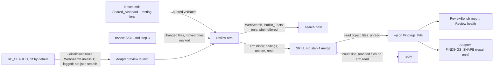

# Design Document

## Overview

Prompt edits in three files, a small extension of the review file and the report, a search switch for headless runs recorded in `run.json` and both report headers, and four eval cases. The Shared_Standard gains one sentence making a Moved_File touched in every line. The Review_Skill marks each moved file in the changed-file list it sends the arms, so a rename is visible where the arm plans its reads. The Review_Arm reads every Touched_File whole, a Moved_File included, ends its block with a `read:` list, and, where a web search tool is offered, settles a Third_Party_Claim with a query of Public_Facts only; its `tools:` gain `WebSearch`. The testing lens gains a behaviour-first method in its own text. The Review_Skill merges the arms' Read_Lists into a `read` object, counts the touched files no arm read, prints that on the count line and writes it as `files_unread`; the Adapter's shape string and Review_Health learn the two new fields. No argument is added to the skill.

## Architecture

Key decision, a moved file is touched in every line, for every review, with no argument (Requirement 1). The standard already counts a verifiable pre-existing problem in a touched file and step 3 of the arm already looks in the unchanged code of touched files; the 29 unopened files on agents-config were moved files the arms passed over, not files the standard excluded. The Owner's view is that moving a file touches all its lines. So the fix is to say that once in the standard, mark moved files in the list the arm receives, and make the arm account for what it read. The trade-off: a pull request that moves many files costs each of the six arms a read of each one; the Owner accepted that, since the largest reviews ran under twelve minutes.

Rejected alternative, a `--scope change|file` argument. Under the standard as it stands, `change` and `file` would differ only on moved files, so the argument would name a distinction the Owner does not hold, and a `file` that also opened every line of a file with a one-line change is what the standard already does.

Key decision, the Read_List is part of the arm block and the unread count part of the review file (Requirement 2). What an arm read is the review's input as the findings are its output; with it, a miss like agents-config's shows in the count line and Review health without reading transcripts. The arm reports it rather than the skill inferring it from tool calls, because the skill sees only the arm's final text. The trade-off: the block grows by one list, and an arm could misreport what it read; the list is evidence for the Owner, not a gate, so a wrong list costs a misleading count, not a finding.

Key decision, search is named as a capability and bounded by its query (Requirement 3). The arm's text says "a web search tool" and the Claude Code host binds `WebSearch` through the agent's `tools:`; a host without one takes the unverified path. Claude Code's `WebSearch` runs through the model API host the ReviewBench manifest already declares, so the leaderboard's egress is unchanged. The leak surface is the query, so the rule bounds it to Public_Facts; and the arm never opens the pull request or its repository anywhere, since locally the real pull request's discussion fed the golden set. `WebFetch` stays out because a fetch can reach any URL, the pull request's included. The trade-off: the query rule is prompt-enforced, and the search case can only check the queries an arm chose to send.

Key decision, whether a search runs is decided where the session runs, not by the skill (Requirements 3.9 to 3.12). By hand, the arm keeps `WebSearch` and Claude Code's default permission mode asks the user on its first use; a background sub-agent's request surfaces in the main session naming the agent, and a refusal reaches the arm as an error it treats as unverified. Headless, the adapter runs with permission prompts bypassed, so `RB_SEARCH`, off by default, decides: unless it is `1`, `WebSearch` joins `ScheduleWakeup` in `--disallowedTools`, which removes the tool even from an agent whose `tools:` lists it, as tested on 2026-11-02. The trade-off: a user who already allowed web search, or runs in a mode that skips prompts, gets searches without being asked.

Rejected alternative, a `--search` flag on the skill telling the arms whether to search. It would hold only because the prompt says so, while the host's own switches already decide it deterministically in both settings.

Rejected alternative, a search tool of our own. It would need its own egress host on the leaderboard and its own leak controls, for nothing `WebSearch` does not give; it waits until a framework without search needs one.

Key decision, the behaviour-first method lives in the testing lens's text (Requirement 4). The arm's procedure is lens-neutral: its step 3 takes "each kind of problem the lens names", and the documentation lens already directs its own search beyond touched files. Putting the method in the lens keeps the arm's steps unchanged and reaches the arm through the quoted lens, as every lens does. The trade-off: the testing lens's paragraph grows by two sentences, and the existing arm eval prompts that quote other lenses are untouched by it.

## Components and Interfaces

### Shared_Standard (`plugins/ponderly/skills/review/lenses.md`)

| Operation | Change | Requirements |
|-----------|--------|--------------|
| moved-file sentence | After "A pre-existing problem in a touched file counts when it is verifiable.", add "A file the pull request moved or renamed is touched in every line, so a problem on any of its lines is a finding at that line." | 1.1, 1.6 |
| testing lens | Add, after its first sentence: "Before reading the tests, the arm lists each behaviour the change introduces or alters, finds the test that would fail if that behaviour broke, and reports each behaviour with none at the behaviour's own place in the code, though the edit it needs goes in a test." Change its true-positive sentence to: "A true positive names the behaviour, the place it lives and the test that would cover it, or the test that is wrong and how, in the project's own test framework and style." Its false-positive sentence stays. | 4.1, 4.2, 4.3, 4.5 |

### Review_Skill (`plugins/ponderly/skills/review/SKILL.md`)

| Operation | Change | Requirements |
|-----------|--------|--------------|
| step 2 changed files | Each changed file whose `git diff --name-status -M <base> <head>` (or `-M <base>` for the working tree) status is `R100` is recorded as moved with its old path | 1.2 |
| step 3 launch | The changed-files bullet becomes "the changed files, one per line, each moved file followed by `(moved from <old path>, unchanged)`" | 1.2 |
| step 4 block shape | The arm-block test gains "then a `read:` list"; a block without it is malformed and the arm failed, relaunched once as today | 2.2 |
| step 4 interim object | Gains `"read": {}` holding each taken arm's Read_List under its lens name, and `"files_unread": 0` as the ninth entry of `counts` | 2.4 |
| step 6 second pass | A relaunched arm's Read_List joins its first-pass list under its lens name, the union of the two | 2.4 |
| step 7 count line | After the `relaunched` clause, `touched files no arm read <n>`: the Touched_Files, a file absent at the head excluded, that no taken arm's Read_List names with `whole` | 2.3, 2.7 |
| step 7 final object | `read` as merged; `files_unread` the count line's number; the nine entries of `counts` required whether written afresh or edited | 2.4 |
| step 2 early stop | Writes `read` `{}` and `files_unread` 0 beside the other counts | 2.4 |

### Review_Arm (`plugins/ponderly/agents/review-arm.md`)

| Operation | Change | Requirements |
|-----------|--------|--------------|
| frontmatter | `tools: Read, Glob, Grep, Bash, LSP, WebSearch` | 3.6 |
| step 1 gather | A file marked moved shows in a per-path diff as wholly added, or not at all when its new path is untracked; read it whole in step 2 all the same | 1.2 |
| step 2 read | "Read every changed file whole", gains "a moved file included, since the standard counts its every line" | 1.2, 1.5 |
| step 3 look | Unchanged in substance; "in the unchanged code of the files the pull request touches" gains "a moved file's every line included" | 1.3 |
| step 4 verify | New sentences: when a candidate rests on what a tool, library or service outside the repository does and the repository cannot settle it, use a web search tool if one is available; a query names only that tool and the behaviour in question, never a line of the repository's code, a file name from it, the repository's name or the pull request; never open the pull request, its repository or its discussion on any host, and use no GitHub tool; a settled claim is verified, and its copies get findings as the standard says; with no search tool, when a search is refused or fails, or when search does not settle it, one `unsure` entry says the claim is unverified and the finding is not reported | 3.1, 3.2, 3.3, 3.4, 3.5, 3.7 |
| arm block | Gains `read:` after `unsure:`, one entry per file as `<path>: whole` or `<path>: <start>-<end>[, <start>-<end>...]`, `read: []` when nothing; the paragraph after the block defines it | 2.1 |

### Adapter (`benchmarks/reviewbench/agent/agent.py`)

Only `FINDINGS_SHAPE` changes: `"files_unread": integer` joins `counts`, and `"read": {lens: [string]}` joins the object's fields (Requirement 2.5). The review launch also reads `RB_SEARCH`: unless it is `1`, `WebSearch` joins `ScheduleWakeup` after `--disallowedTools`; the repair launch is unchanged. `run.sh` of both harnesses passes `RB_SEARCH` into the image (Requirements 3.10, 3.11). The adapter also logs `search on` or `search off` after the model line, from the same test that sets its disallowed tools, and both harnesses write `search` into `run.json`, and the ReviewBench harness's `collect` compares it, counting a missing field as off (Requirement 3.13).

### Review_Health (`benchmarks/reviewbench/report.py`)

One line, `recorded_total_line("Touched files no arm read", readable, "files_unread")`, after the departures line; the section's opening paragraph names the new count among those older files lack. `files_unread` does not join `COUNT_FIELDS`, so older review files stay readable (Requirement 2.6). Both reports show search in their header: ReviewBench as `- Search: on` or `off` after the Effort line, Martian at the end of its Image settings line, on only for a true `search` (Requirement 3.14).

### Documentation

| File | Change | Requirements |
|------|--------|--------------|
| `docs/reference.md` | The `review` entry: moved files counted as touched, the count line's new entry, `read` and `files_unread` in the JSON; the `review-arm` entry: reads moved files whole, settles third-party claims with web search when offered, the query rule, the `read:` list, the testing lens's method | 5.7 |
| `plugins/ponderly/README.md`, `llms.txt` | The same in their review and review-arm lines | 5.7 |
| `benchmarks/reviewbench/README.md` | `files_unread` in Review health; search runs through the declared API host | 3.8, 5.7 |
| `benchmarks/reviewbench/README.md`, `benchmarks/martian/README.md`, `docs/reference.md`, `plugins/ponderly/README.md`, `llms.txt` | `RB_SEARCH` in the recorded variables, `0` by default; the arms cannot search headless unless it is `1`; by hand a search is the host's permission decision, asked on first use in the default mode; a refused or failed search is unverified | 3.9, 3.11, 3.12 |

## Data Models

The arm block's new field:

| Field | Type | Values | Requirements |
|-------|------|--------|--------------|
| `read` | list of strings | `<repository-relative path>: whole`, or `<path>: <start>-<end>` with further ranges after `, `; `[]` when nothing was read | 2.1 |

The Findings_File's new fields, both passes:

| Field | Type | Interim | Final | Requirements |
|-------|------|---------|-------|--------------|
| `read` | object, lens name to list of strings | each taken arm's Read_List | first and second pass united per lens | 2.4, 2.7 |
| `counts.files_unread` | integer | 0 | Touched_Files, absent-at-head excluded, named `whole` by no taken arm | 2.3, 2.4 |

A path in a Read_List is normalised as step 4 normalises a finding's file before it is compared with the changed-file list. A failed arm's Read_List is not taken.

## Correctness Properties

### Property 1: Every touched line is in scope

*For any* pull request, a verifiable problem on any line of a Touched_File, a Moved_File included, is a finding at that line when the lens names its kind.

**Validates: Requirements 1.1, 1.2, 1.3**

### Property 2: The unread count is what the read lists leave out

*For any* review, `files_unread` equals the number of Touched_Files present at the head that no taken arm's Read_List names as read whole.

**Validates: Requirements 2.3, 2.4, 2.7**

### Property 3: No search query carries the repository

*For any* search query a Review_Arm sends, the query holds no line of the repository's code, no file name from it, not the repository's name and not the pull request.

**Validates: Requirements 3.4, 3.5**

### Property 4: A settled claim reaches every copy

*For any* defect a Review_Arm establishes by settling a Third_Party_Claim, each copy it verifies at the head carries its own finding.

**Validates: Requirements 3.1, 3.3**

## Error Handling

| Condition | Category | Behavior | Requirements |
|-----------|----------|----------|--------------|
| An arm block has no `read:` list | MALFORMED | The arm failed; relaunched once; dropped on a second failure, its lens named failed | 2.2 |
| A Read_List names a file outside the change | EXTRA_READ | Kept in `read`, left out of `files_unread` | 2.7 |
| A Touched_File is absent at the head | DELETED | Left out of the Touched_Files counted; no finding anchored to it | 1.5, 2.3 |
| No web search tool is offered | NO_SEARCH | The claim goes under `unsure` as unverified, once; no finding rests on it | 3.2 |
| A search does not settle the claim | UNSETTLED | As NO_SEARCH | 3.2 |
| A search is refused by the host or fails | REFUSED | As NO_SEARCH | 3.12 |
| An older review file lacks `files_unread` | OLD_FILE | Readable; the health line says how many files record the count | 2.6 |

## Testing Strategy

Four eval cases, written and scaffolded but not run until the Owner asks (Requirement 5.8), each a paid model call:

- `evals/agents/review-arm/reads-a-moved-file-whole/` (Property 1, Requirement 5.1): the calc fixture on a branch whose change moves a module that already holds a verifiable defect, unchanged, to a new path, and edits one other file; the prompt quotes the Shared_Standard and the correctness lens and lists the moved file with its `(moved from …, unchanged)` mark. Graders: the arm launched; a finding whose file is the moved path at the defect's line; the block's `read:` names the moved path with `whole`.
- `evals/agents/review-arm-search/settles-a-third-party-claim/` (Properties 3 and 4, Requirement 5.2): a fixture whose change adds two GitHub Actions workflow files that each set both `branches` and `branches-ignore` on the same `push` event, which GitHub rejects, with the correctness lens; the case grants `WebSearch`. Graders: a finding on each workflow file; no `WebSearch` input in the trace holds the fixture's file names or repository name. No grader requires a search, since an arm that already knows the rule need not search; the query grader holds whatever the arm sends. Its own eval target, `eval-agent-review-arm-search`, grants `WebSearch`, so the search runs; a refused search would leave no finding, as requirement 3.12 says.
- `evals/agents/review-arm/names-the-missing-test/` (Requirement 5.3): the calc fixture with a change that adds a new operation with no test and changes an existing one whose test already covers the change, with the testing lens. Graders: a finding at the new operation naming a test for it; no finding at the changed operation that its existing test covers.
- `evals/skills/review/counts-the-files-no-arm-read/` (Property 2, Requirement 5.4): the shop fixture with a moved file and an edited one, `git check-ignore`'d `review.json` as in `writes-the-final-counts`, prompt `/ponderly:review --json review.json`. Graders on the file: `"read": *\{\s*"[a-z]+": *\[`, `"files_unread":`; on the reply: `touched files no arm read`.

The six existing arm prompts that quote the Shared_Standard are re-quoted byte-equal from the file after the edit (Requirement 5.5). No existing grader parses the arm block's full shape, so none needs the `read:` field (Requirement 5.6), which a task confirms by reading each grader. `make validate` runs the free checks, including the plugin validations that parse every case and grader; the report's new health line gets one unit test beside its siblings in `checks/test_reviewbench_report.py`. Further adapter checks prove `RB_SEARCH` in the launch's disallowed tools and in `adapter.log`, and each report module checks its search header both ways. The ReviewBench measure is a chunk 3 rerun on the subscription token, outside the tasks.
