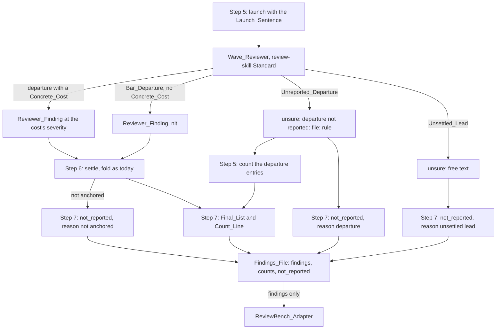

# Design Document

## Overview

The change is three edits of prompt text and two of the skill's output. The Launch_Sentence in step 5 of the Review_Skill widens its list of what the Repository_Bar holds to the repository's `AGENTS.md` and `.claude/rules/` files and changes its last clause, so that a team-rule departure with no Concrete_Cost is listed under `unsure` rather than reported. The Wave_Reviewer's review-skill paragraph in its Standard gains the same list, the matching rule and the entry shape `departure not reported: <file>: "<quote>": <problem>`, and its Findings section's nit clause names the Bar_Departures the Standard keeps as nits. The Review_Skill counts those `unsure` entries when the Wave_Review returns, reports the count in the Count_Line and the Findings_File, and writes every `unsure` entry of the Wave_Review, departure or Unsettled_Lead, and every reviewer finding the fold could not anchor, to a Not_Reported_List beside `findings`, which the ReviewBench_Adapter does not read. The fold, the second pass, the merge and the cap are unchanged, so every Reviewer_Finding the reviewer still returns, a nit included, reaches the Final_List as it does today.

## Architecture

Key decision, the cost-free departure is left out where it is made, not filtered at the fold. In chunk 3 the reviewer's nits held six findings the judge called real and two it called false, and the two false ones were exactly the Team_Rules departures with no Concrete_Cost that the Launch_Sentence asked for. Dropping every nit at the fold would lose the six to remove the two; asking the reviewer not to report the two loses neither (Requirements 1.1, 1.3, 2.4). The trade-off is that the rule now depends on the reviewer telling a Team_Rules departure from a Bar_Departure; a wrong call in one direction puts a cost-free opinion back in the list as a nit, as today, and in the other moves a small real problem to `unsure`, where the count shows it.

Key decision, the left-out departures go under `unsure` with a fixed prefix, not in a new line of the Findings shape. The Findings shape is shared by `implement-spec`, `readable-code` and `tighten-tests`, which read it without knowing of this rule; an `unsure` entry is already part of that shape and already read by a person as "noticed, not reported". The prefix lets the Review_Skill count them without parsing anything new (Requirements 1.2, 2.1, 3.2). The trade-off is that `unsure` now holds two kinds of entry in a review-skill launch, and a reader of the reviewer's raw Findings must know the prefix; the rejected alternative, a `departures:` count line, would change a shape three other skills read.

Key decision, a Bar_Departure with no Concrete_Cost stays a nit. A change that does otherwise than the code around it is the departure the Repository_Bar exists to catch, and in chunk 3 such a nit, fully qualified names in a file that imports each class by name, was judged real (Requirement 1.3). The trade-off is that the line between the two now rests on which files the Wave_Reviewer reads, so the Repository_Bar names them: `CLAUDE.md`, `AGENTS.md`, the files under `.claude/rules/`, the contributing guide and the code around the change. In chunk 3 a nit citing a repository's `.claude/rules/rust.md` rule against `type_complexity` was judged real; with the rule files in the bar it stays a nit.

Key decision, what the review leaves out is written to the Findings_File's `not_reported` list, not to `findings`, and not only counted. The Owner assesses whether the rule hides real problems from the run folder, where the ReviewBench_Adapter copies the Findings_File as `review.json`; a count alone cannot be assessed and a transcript is not kept on every run. The list is a sibling of `findings`, so the adapter, which reads `findings` only, scores exactly what it scores today (Requirements 2.4, 2.5, 2.6). The trade-off is that an Unsettled_Lead is free text in the Wave_Reviewer's shape, so its file and quote are `null` when it gives none; the Wave_Reviewer's shape is not changed to force them, since `implement-spec` and the others read it. A reviewer finding the fold could not anchor, because its file is absent at the head or its quote is not in it, also goes to the list with reason `not anchored`, carrying the reviewer's file, quote and problem as returned, since it is a reviewer finding that never reached the Final_List; the Count_Line's `not anchored` count stays as it is.

Key decision, the old and new clauses are recorded word for word here. Another change in flight edits the same Launch_Sentence by adding sentences after it; recording exactly which words this change replaces, the bar list and the last clause, lets that change rebase on this one by text (Requirement 3.3).

## Components and Interfaces

### Launch_Sentence, `plugins/ponderly/skills/review/SKILL.md` step 5

Old clause, the sentence's last: "and report a team-rule departure the repository also shows, or one with no concrete cost in this change, as a nit."

New clause: "and list a team-rule departure with no concrete cost in this change under unsure, not as a finding, unless it also departs from that bar."

Old bar list: "what its CLAUDE.md, its contributing guide and the code around the change already do,"

New bar list: "what its CLAUDE.md, AGENTS.md, .claude/rules/ files and contributing guide say and the code around the change already does,"

The words before the bar list, "These changes are a pull request reviewed for the review skill: judge style, structure, comments and tests against the repository's own bar,", are unchanged.

The whole new sentence: "These changes are a pull request reviewed for the review skill: judge style, structure, comments and tests against the repository's own bar, what its CLAUDE.md, AGENTS.md, .claude/rules/ files and contributing guide say and the code around the change already does, and list a team-rule departure with no concrete cost in this change under unsure, not as a finding, unless it also departs from that bar."

### Wave_Reviewer Standard, `plugins/ponderly/agents/wave-reviewer.md`

Old sentence of the review-skill paragraph on what to read: "Before judging any of those four, read the repository's `CLAUDE.md`, its contributing guide and the code around the change, and note what they already do."

New: "Before judging any of those four, read those of the repository's `CLAUDE.md`, `AGENTS.md`, files under `.claude/rules/` and contributing guide that exist, and the code around the change, and note what they say and already do."

Old sentences of the review-skill paragraph on departures: "A team-rule departure with no concrete cost in this change is a `nit`, whether or not the repository also shows it in one of those three." and "When the repository has no `CLAUDE.md`, no contributing guide and no code around the change, judge by the team rules alone and still report a departure with no concrete cost as a `nit`."

New sentences in their places: "A team-rule departure with no concrete cost in this change is not a finding unless the change also does otherwise than those files say or the code around it does: list each such departure under `unsure` as `departure not reported: <file>: "<exact quote>": <the problem, naming the team rule>`. A change that does otherwise than those files say or the code around it does, with no concrete cost, is a `nit`." and "When the repository has none of those files and no code around the change, there is no bar to depart from, so list every team-rule departure with no concrete cost under `unsure` the same way."

The paragraph's first sentence, its concrete-cost definition, its severity sentence for a departure with a cost and its last sentence are unchanged.

### Wave_Reviewer Findings section

Old clause: "`nit` is for wording alone, and in a launch for the review skill also for the team-rule departures the Standard calls nits."

New clause: "`nit` is for wording alone, and in a launch for the review skill also for the departures from the repository's bar the Standard calls nits."

### Review_Skill counts, steps 5 and 7

| Operation | Behaviour | Requirements |
|---|---|---|
| Step 5, read the Findings | A new paragraph after the verdict paragraph: when the Findings have a `verdict` line, the departures not reported are the `unsure` entries that begin `departure not reported:`; otherwise there is no such count | 2.1, 2.3 |
| Step 7, Count_Line | After the fold facts, `departures not reported <n>` when the Wave_Review returned Findings, holds or findings | 2.1, 2.3 |
| Step 7, Findings_File | `counts.departures_not_reported`, the same number, 0 when the Wave_Review did not return or did not run | 2.2, 2.3 |
| Step 7, Not_Reported_List | `not_reported` beside `findings`: one entry per `departure not reported:` entry, its file, quote and problem from the entry and reason `team-rule departure without cost`; one entry per other `unsure` entry except `nothing`, its file and quote when it names them and `null` otherwise, its text as the problem, and reason `unsettled lead`; one entry per reviewer finding step 6d counts as not anchored, its file, quote and problem as the reviewer returned them and reason `not anchored`; an empty list when the Wave_Review did not return or did not run; never an entry in `findings` | 2.4, 2.5, 2.6 |
| Step 4, interim Findings_File | Gains `not_reported: []`, so both files have one shape | 2.5 |
| Steps 6 and 6d | Unchanged: every Reviewer_Finding is settled, folded or relaunched, a nit folding as low | 2.4 |

### Changes after the wave 0 review, `plugins/ponderly/skills/review/SKILL.md`

The author chose these four after the wave 0 review; each is recorded word for word so a change rebased on this text can find it (Requirements 2.4, 2.5, 3.3).

Step 5, moved: the paragraph that begins "When the Findings have a `verdict` line, the **departures not reported** are" moves, unchanged, to directly before the paragraph that begins "Its Findings' `verdict` line decides what follows.", so a reader following that paragraph's jumps has already read it. The step's bullets do not change.

Step 6c, first bullet, old: "- the reviewer's Findings block, quoted whole;"

New: "- the reviewer's Findings block, quoted whole, with the sentence, verbatim, "Leave alone every unsure entry of these Findings that begins `departure not reported:`; it is not a finding, so neither anchor it nor keep it.";"

Step 7, a new bullet after the `not anchored` bullet: "- each new reviewer finding step 6d gave to a relaunched arm that returned a second-pass list, when that list does not hold it at its file on lines that hold its quote, with its file, quote and problem as the reviewer returned them, and `reason` `dropped by relaunched arm`."

Step 7, a new sentence after the bullets and before the sentence that begins "`not_reported` is `[]`": "To read a departure entry, take the text after `departure not reported: ` and split it at its first `: "` and its last `": `: the file is before the first, the quote between the two, and the problem after the last."

Key decision, a reviewer finding a relaunched arm leaves out is kept with its own reason. Before this change such a finding reached neither `findings` nor `not_reported`, so the Owner could not see it from the run folder; the trade-off is one more comparison for the session, of each finding it handed to an arm against that arm's second-pass list.

### Documentation, `docs/reference.md`

| Entry | Change | Requirements |
|---|---|---|
| `review`, wave review paragraph | Says the reviewer leaves out a team-rule departure with no concrete cost and the skill counts it | 4.1 |
| `review`, What it writes | Names the count of departures not reported in the Count_Line and the `not_reported` list in the JSON file | 4.1 |
| `wave-reviewer`, What the prompt carries | Names the bar's files, `AGENTS.md` and `.claude/rules/` among them; replaces "reports a team-rule departure with no concrete cost in the change as a `nit`" with leaving it out under `unsure`, and a departure from the repository's own bar with no cost as a `nit` | 4.1 |

### Evals

| Case | Change | Requirements |
|---|---|---|
| `evals/agents/wave-reviewer/judges-by-the-repository-bar` | Prompt gives the new Launch_Sentence; description and expected outcome say no divider-comment finding at any severity and a `departure not reported:` entry; grader `no-divider-finding-above-nit` becomes `no-divider-finding`, matching any severity; a grader `lists-the-departure` matches `departure not reported:`; the floor-division and verdict graders stay | 4.2 |
| `evals/agents/wave-reviewer/reports-a-bar-departure-as-nit` | New: a calc fixture whose committed modules annotate every parameter and return, and an uncommitted `calc/stats.py` with a correct `mean` and no annotations; launched with the new Launch_Sentence; graders: the sub-agent was launched, a finding on the missing annotations at severity nit, no finding above nit | 1.3, 4.3 |

No other eval case quotes a changed clause (Requirement 4.4).

## Data Models

| Field | Where | Type | Constraint |
|---|---|---|---|
| `unsure` entry `departure not reported: <file>: "<exact quote>": <problem>` | Wave_Reviewer Findings, review-skill launch only | string | one per Unreported_Departure; prefix exact, so the Review_Skill can count it |
| `not_reported` | Findings_File, beside `findings` | list of objects | empty in the interim file; never read by the ReviewBench_Adapter |
| `not_reported[].file` | Findings_File | string or null | the path the entry names, null when it names none |
| `not_reported[].quote` | Findings_File | string or null | exact text the entry quotes, null when it quotes none |
| `not_reported[].problem` | Findings_File | string | the entry's problem, or its whole text for an Unsettled_Lead |
| `not_reported[].reason` | Findings_File | string | `team-rule departure without cost`, `unsettled lead`, `not anchored` or `dropped by relaunched arm` |
| `departures not reported <n>` | Count_Line | integer n ≥ 0 | present when the Wave_Review returned Findings |
| `counts.departures_not_reported` | final Findings_File | integer ≥ 0 | 0 when the Wave_Review did not return or did not run; absent from the interim file, which is written before the Wave_Review |

## Correctness Properties

### Property 1: No cost-free team-rule departure in the findings

*For any* review-skill Wave_Review, no Reviewer_Finding is a Team_Rules departure with no Concrete_Cost that does not also depart from the Repository_Bar.

**Validates: Requirements 1.1, 1.5**

### Property 2: Every left-out departure is counted

*For any* review whose Wave_Review returns Findings, `departures not reported` equals the number of its `unsure` entries that begin `departure not reported:`.

**Validates: Requirements 1.2, 2.1, 2.2**

### Property 3: Other launches unchanged

*For any* Spec_Wave_Review, the Wave_Reviewer's Standard and Findings read as before this change.

**Validates: Requirements 1.6, 3.2**

### Property 4: What is left out is kept, and kept out of the score

*For any* final Findings_File, `not_reported` has one entry per `unsure` entry of the Wave_Review other than `nothing`, one per reviewer finding counted as not anchored and one per new reviewer finding a relaunched arm's returned second-pass list leaves out, and no entry of `not_reported` is in `findings`.

**Validates: Requirements 2.4, 2.5, 2.6**

## Error Handling

| Condition | Category | Behaviour | Requirement |
|---|---|---|---|
| The Wave_Review did not return or did not run | NO_REVIEW | No `departures not reported` in the Count_Line; `counts.departures_not_reported` is 0 | 2.3 |
| The Wave_Review holds with departure entries under `unsure` | HOLDS | The Final_List is the merged list; the Count_Line still gives the count | 2.1 |
| The repository has no `CLAUDE.md`, contributing guide or code around the change | NO_BAR | Every cost-free Team_Rules departure is listed under `unsure` | 1.5 |
| An `unsure` entry names no file or quote | FREE_TEXT | Its `not_reported` entry has `null` file and quote and its text as the problem | 2.4 |
| The ReviewBench_Adapter repairs a malformed Findings_File | REPAIR | Its repair prompt gives the adapter's `FINDINGS_SHAPE` in `benchmarks/reviewbench/agent/agent.py`, which, at the Owner's request after the work, holds `"departures_not_reported": integer, only when "pass" is "final"` in `counts` and a `not_reported` list of entries with `file` and `quote` (string or null), `problem` and one of the four reasons, and the prompt asks to keep "its findings and its not_reported list"; `findings` and the score are unaffected | 2.6 |
| A departure has a Concrete_Cost | COST | Reported at the cost's severity, folded as today | 1.4, 2.4 |

## Testing Strategy

Property 1 is proved by the two wave-reviewer cases: `judges-by-the-repository-bar` for a Team_Rules departure the repository shares, and `reports-a-bar-departure-as-nit` for the boundary, a Bar_Departure that stays a nit. Properties 2 and 4 have no eval case: no fixture makes the Review_Skill's wave review return departure entries reliably without the whole skill run, and no review eval case writes `--json`, so they are proved by reading step 7 against step 5 and by the count lines and the `review.json` files of the next ReviewBench run the Owner chooses. Property 3 is proved by reading: the edits touch only the review-skill paragraph and the review-skill half of the nit clause, and the `finds-the-contradiction` and `passes-a-clean-diff` cases, which launch without the Launch_Sentence, stay as they are. `make validate` runs the free checks. No eval case runs until the Owner asks; each is run by hand, one at a time, with `make eval-agent-wave-reviewer` and its case.
