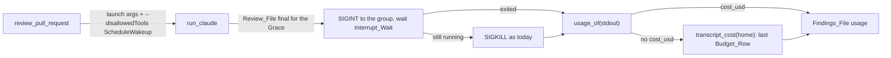

# Design Document

## Overview

Three small changes to `benchmarks/reviewbench/agent/agent.py` and the harness around it. The Review_Session's launch arguments gain `--disallowedTools ScheduleWakeup`, so the session cannot schedule the timer that kept it alive. `run_claude` gains an Interrupt_Wait: once the Review_File has been final for the Grace, it sends `SIGINT` to the process group, keeps reading stdout for up to the wait, and only then sends the `SIGKILL` it sends today. And a new `transcript_cost` reads the session account's newest Transcript for its last Budget_Row when the stdout holds no Result_JSON, so a killed session still records its spend. `run.sh` passes the new variable into the image, the README lists it beside the Grace, and five checks in `checks/test_reviewbench_agent.py` prove the paths against the existing Claude Code stub.

## Architecture

Key decision, the wakeup tool is disallowed at launch rather than discouraged in the skill (Requirement 1). The tool is Claude Code's own, offered to every session, and the review skill never names it; the five lingering sessions reached for it on Claude Code's own advice to "schedule a long fallback" while background agents run. A launch flag removes it from every review session whatever the skill says, and the eight sessions that waited on the notification path alone exited on their own, so nothing is lost. The trade-off: the flag is specific to Claude Code's tool name and will need changing if the tool is renamed; the README says what it is for.

Rejected alternative, a sentence in the review skill saying not to schedule a wakeup. It would change the skill the plugin ships to every user for a harness problem, and a prompt cannot stop a session choosing a tool it is offered.

Key decision, the interrupt comes before the kill and the session's exit on it counts as a grace end, not an error (Requirement 2). A session that exits on `SIGINT` may print its Result_JSON on the way out, and if it does the cost is read as today. Its exit code after an interrupt is whatever Claude Code or the stub returns and is not read as a failure: the Review_File was already final, which is what the adapter goes on to read, as it does after today's kill. The trade-off: a lingering session now costs up to the Interrupt_Wait more wall time, 20 seconds by default, before the kill.

Rejected alternative, `SIGTERM` instead of `SIGINT`. Claude Code handles Ctrl-C, which is `SIGINT`, as its interactive stop; `SIGTERM`'s handling in print mode is not documented. The kill still follows either way.

Key decision, the cost is recovered from the Transcript's last Budget_Row, not from summing tokens (Requirement 3). Claude Code writes a `budget_usd` attachment row with its running `used` value before each request, and the last one is the spend the result would have reported; Mcp-Docker's read $3.99 and wirechat's $6.79 today. Summing token counts across the main and sub-agent transcripts needs the per-model prices, which the adapter does not hold. The trade-off: the last Budget_Row precedes the session's final request, so the recovered cost misses that one request's output, a few cents; the Adapter_Log says the cost came from the transcript so the reader knows.

Rejected alternative, the Result_JSON printed by the interrupt. It is the first thing tried, but today's probe never ran on a lingering session, so whether Claude Code prints a result on `SIGINT` in print mode is unknown; the Transcript path does not depend on it.

## Components and Interfaces

### Review launch (`review_pull_request`)

| Operation | Input | Output | Requirements |
|-----------|-------|--------|--------------|
| build `review_arguments` | the settings | today's list with `"--disallowedTools", "ScheduleWakeup"` inserted after `"--permission-mode", "bypassPermissions"`; `repair_arguments` unchanged | 1.1, 1.2, 1.3 |
| read the Interrupt_Wait | `RB_INTERRUPT_WAIT_SECONDS` | `float`, 20 when unset or empty, passed to `run_claude` for the review session only | 2.5, 2.6 |
| log the grace end | `ended` from `run_claude` | today's line `ended claude N s after the review file turned final`, followed on the same line by `; it exited on the interrupt` when `ended` is `"interrupted"` or `; it ignored the interrupt and was killed` when `ended` is `"final"` | 2.3, 2.4 |
| recover the cost | `usage` without `cost_usd` and the home `claude_home(env)` | `usage["cost_usd"]` set from `transcript_cost` when it returns a number, with the log line `cost 3.99 read from the transcript's last budget line`; otherwise the log line `no cost in the result and none in a transcript` and `cost_usd` left absent | 3.1, 3.3, 3.4, 3.6, 3.7 |

### `run_claude`

Gains a keyword argument `interrupt_wait_seconds=None`. Its loop is unchanged until the Grace elapses; then:

| Step | Behaviour | Requirements |
|------|-----------|--------------|
| interrupt | `os.killpg(process.pid, signal.SIGINT)`, with the same `ProcessLookupError` and `PermissionError` handling as the kill | 2.1 |
| wait | poll `process.poll()` every `POLL_SECONDS` until it exits or `interrupt_wait_seconds` elapses; the reader thread keeps collecting stdout throughout | 2.2 |
| exited | `ended = "interrupted"`; stdout joined and returned; the exit code returned as it is | 2.3 |
| still running | the `SIGKILL`, the reader join and the stdout close exactly as today; `ended = "final"` | 2.4 |
| `interrupt_wait_seconds` of `None` or `0` | no interrupt: the kill at once, as today, which is also the repair session's path and the time-limit path | 2.6 |

The time-limit path (`ended = "timeout"`) is untouched: it kills at once.

### `transcript_cost(home)`

| Input | Output | Requirements |
|-------|--------|--------------|
| the session account's home, or `None` | the `used` value of the last Budget_Row of the newest `.jsonl` directly under any `<home>/.claude/projects/<project>/` directory, as a `float`; `None` when the home is `None`, the directory is absent, no `.jsonl` is found, no row is a Budget_Row, or the last Budget_Row's `used` is not a number | 3.1, 3.2, 3.4, 3.5 |

Rows that do not parse as JSON are skipped. Sub-agent transcripts sit in a sub-directory of the project directory, not directly under it, so the newest file directly under the project directory is the main session's.

### Harness and docs

| File | Change | Requirements |
|------|--------|--------------|
| `benchmarks/reviewbench/run.sh` | `-e RB_INTERRUPT_WAIT_SECONDS` added to the variables passed into the image | 2.5 |
| `benchmarks/reviewbench/Makefile` | the header comment's list of variables that reach the adapter names `RB_INTERRUPT_WAIT_SECONDS` | 2.5 |
| `benchmarks/reviewbench/README.md` | the variables list gains `RB_INTERRUPT_WAIT_SECONDS` under `RB_FINAL_GRACE_SECONDS`; the evidence paragraph says the session runs without Claude Code's wakeup tool and why, that a session lingering past the grace gets an interrupt and the wait before the kill, and that a cost missing from the result is read from the transcript's last budget line | 2.5, 4.2 |

## Data Models

The `usage` object of the Findings_File is unchanged in shape:

| Field | Type | Source after this change | Requirements |
|-------|------|--------------------------|--------------|
| `cost_usd` | number, optional | the Result_JSON's `total_cost_usd`; else the last Budget_Row's `used`; else absent | 3.1, 3.4, 3.6 |
| `time_in_ms` | integer | the larger of the Result_JSON's `duration_ms` and the adapter's clock, as today | existing |
| `total_tokens` | integer, optional | the Result_JSON, as today; absent when there is none | existing |

A Budget_Row, as Claude Code writes it: `{"type": "attachment", "attachment": {"type": "budget_usd", "used": 3.98, "total": 12, "remaining": 8.01}, "timestamp": "..."}`; only `type`, `attachment.type` and `attachment.used` are read.

The `ended` value of `run_claude`: `None` (exited on its own), `"timeout"`, `"final"` (killed after the Grace, the interrupt ignored or not sent) and the new `"interrupted"` (exited on the interrupt after the Grace).

## Correctness Properties

### Property 1: The review session is never offered the wakeup tool

*For any* review launch, the arguments hold `--disallowedTools ScheduleWakeup`, and the repair launch holds no `--disallowedTools`.

**Validates: Requirements 1.1, 1.2**

### Property 2: A grace end always tries the interrupt before the kill

*For any* Review_Session still running once the Review_File has been final for the Grace, the first signal it receives is `SIGINT`, and `SIGKILL` follows only after the Interrupt_Wait with the session still running.

**Validates: Requirements 2.1, 2.2, 2.3, 2.4**

### Property 3: A session's cost is recorded whenever a source holds it

*For any* Review_Session whose Result_JSON carries a cost, or whose Transcript holds a Budget_Row, the Findings_File's `cost_usd` is that cost, the Result_JSON's first; and `cost_usd` is absent only when neither source has one.

**Validates: Requirements 3.1, 3.4, 3.6**

## Error Handling

| Condition | Category | Behavior | Requirements |
|-----------|----------|----------|--------------|
| The session ignores `SIGINT` | LINGER | `SIGKILL` after the Interrupt_Wait; Adapter_Log says the interrupt was ignored; cost recovered from the Transcript when it has a Budget_Row | 2.4, 3.1 |
| The session exits on `SIGINT` with a non-zero code | GRACE_EXIT | Treated as a grace end, not a failure; the Review_File is read as after a kill | 2.3 |
| The session exits between the grace check and the interrupt | RACE | `ended` is `None`, as today for the kill | existing |
| No Transcript, no Budget_Row or a non-numeric `used` | NO_COST | `cost_usd` absent; Adapter_Log says no cost could be recovered | 3.4 |
| A Transcript row that is not JSON | BAD_ROW | Skipped; the rest of the file is read | 3.5 |
| `RB_INTERRUPT_WAIT_SECONDS` unset or empty | DEFAULT | 20 seconds | 2.5 |

## Testing Strategy

Five checks in `checks/test_reviewbench_agent.py`, one per path, against the stub Claude Code already there, with `RB_FINAL_GRACE_SECONDS=1`, `RB_TIMEOUT_SECONDS=8` and `RB_INTERRUPT_WAIT_SECONDS=2` where the stub sleeps, so each stays inside the 30-second adapter wait:

- Property 1: the `unparseable` plan makes two calls; the first call's argv holds the pair and the second's does not.
- Property 2, exit on the interrupt: a new stub action `final_then_result_on_interrupt` installs a `SIGINT` handler that prints `RESULT` and exits 0, then sleeps; the findings file's `cost_usd` is 0.5 and the Adapter_Log line says it exited on the interrupt.
- Property 2, interrupt ignored: a new stub action `final_then_sleep_ignoring_interrupt` sets `SIGINT` to ignore, writes a transcript under its `HOME` with two Budget_Rows (`used` 1.5 then 3.99) and a row that is not JSON, then sleeps; the adapter returns 0 after at least the wait, the log says the interrupt was ignored, and `cost_usd` is 3.99.
- Property 3, no Budget_Row: a new stub action `final_then_sleep_without_budget` writes a transcript with no Budget_Row and sleeps ignoring `SIGINT`; `cost_usd` is absent and the log says no cost could be recovered.
- Property 3, recovered cost: covered by the ignored-interrupt check above, which also proves the bad row is skipped (Error Handling BAD_ROW).

The existing grace checks keep passing: the `final_then_sleep` stub prints its result before sleeping, exits on `SIGINT` with Python's `KeyboardInterrupt`, and its cost 0.5 is read from stdout; the line `ended claude N s after the review file turned final` is still logged. No image is built and no benchmark runs in this task.
