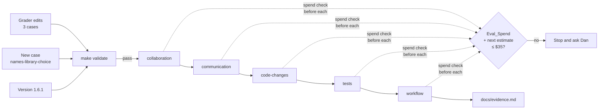

# Design Document

## Overview

Three existing cases get one Judge_Grader each, written in the shape of `evals/rules/code-changes/one-job-functions/graders/one-job-per-function.md`: a sentence saying what the graded text is, then a PASS paragraph and a FAIL paragraph. The regex graders those judges make redundant are deleted. One new communication case, `names-library-choice-by-what-visitors-see`, offers a `requests` or `httpx` choice and is graded by a judge plus regex graders for the options and for leaving the code alone. After `make validate` passes, the five Rule_Targets run one at a time with `--ablation with-without --runs 3`, and their tables replace the old ones in `docs/evidence.md` under headings dated 2026-11-03 and plugin 1.6.1.

## Architecture

### Key decisions

**Each judge reads Claude's last message, the default focus, and its bar names the case's own facts.** The judges grade what the author reads, so they need no `focus`. A bar that names the uploader's dropped file, the subscriber's cut-off subject or the visitor's slow gallery is harder to pass by vague wording than a bar that says "in the reader's terms". Requirements 1.1, 1.2, 2.1 and 3.2. The trade-off is that a bar this specific must be rewritten if the case's fixture changes. Rejected: one shared generic bar for all four cases, because a judge with no case facts passes any message that mentions a person.

**A judge's FAIL bar names the copy-the-README failure and the mechanism-only failure.** Requirements 1.5 and 3.3. The trade-off is a longer bar; the gain is that a message which pastes the README table, or which lists async support and HTTP/2, fails by the bar's own words rather than by the judge's taste.

**Delete, not narrow, each regex that a judge now decides.** Requirement 1.3. These are the deletions:

- `lays-out-before-asking/uploader-before-the-options.md`: the word "uploader" before the list is the proxy the judge replaces.
- `lays-out-before-asking/recommends-in-prose.md`: the judge requires a recommendation with its reason, which the word "recommend" on a non-list line only stands in for.
- `user-effect-before-mechanism/user-before-mechanism.md`: a subscriber word before the test name is the proxy.
- `user-effect-before-mechanism/does-not-open-with-mechanism.md`: the judge fails a message that names the test or a file before what subscribers see, which covers opening with one.

The trade-off is fewer graders per case, so one judge verdict moves that case's score more. Rejected: keeping them alongside the judge, because a proxy that disagrees with the judge would pull the score towards the proxy.

**Keep each regex that measures something no judge decides.** Requirement 1.4. These stay: `offers-3`, `offers-5` and `offers-10` (options on separate lines, which the collaboration rule asks for where the question tool is absent); `names-the-test` and `no-narration` in `user-effect-before-mechanism`; and all six graders of `one-open-decision-at-a-time` (options on lines, the second and third decisions held back, the count named, one question), none of which its judge decides. Requirement 2.3 therefore deletes nothing.

**The new case reuses the `calc` fixture with a `files/` overlay, as `lays-out-before-asking` does.** Its README, a `gallery/thumbs.py` holding the current `requests` loop and a `tests/test_thumbs.py` for it replace or join the fixture before `setup.sh` commits, so a change to either is visible in `git` and to a regex on the file. Requirements 3.1 and 3.4. The trade-off is that the case carries the `calc` package it does not use. Rejected: a new fixture tree, because one README and two small files do not justify a tree.

**"No file changed" is graded by a regex on `gallery/thumbs.py`, not by `tool_used`.** A `tool_used` on Edit or Write with `max: 0` would also fail a harmless scratch file, and `file_exists` cannot see a scaffold-made file. The regex pins the whole of `gallery/thumbs.py`, byte for byte, as `load-orders-left-alone` pins `calc/orders.py`. Requirement 3.4. The trade-off is that an edit to another file goes unseen; the request is about this file.

**One invocation per Rule_Target at `--runs 3`, in the order collaboration, communication, code-changes, tests, workflow.** `evals/README.md` lets a mixed target confirm at 3 in one invocation, so no per-case `--case` runs are needed (Requirement 5.2's condition does not arise). The cheapest targets go first, so a stall or an overrun shows early, and workflow, the dearest at about $5.40 last time, runs last. Each invocation gets `EVAL_MAX_COST_USD=12` and runs in the background, never two at once, as the stalls in the with-plugin arm showed. Requirements 5.1, 5.3 and 5.5. The trade-off is wall-clock time, about 30 to 40 minutes in all. Rejected: running at 2 then each `llm` case at 3, because it makes eight invocations and splits each target's table, which the evidence page needs whole.

**The spend check happens before each invocation.** The next target's estimate is its last cost scaled by its new case count, plus about $0.15 per run of each `llm` case for the three judge calls. Requirements 5.5 and 5.6.

**The Evidence_Page keeps its shape: one section per rule with the command, the table and a note on whether the comparison is clean.** The "rules have changed since" list and the 0.17.0 rename paragraph are removed, `tests` moves out of Not measured, and a paragraph says which cases have a judge. The results section opens by calling the tables an adherence check, a measure of whether Claude follows the rules with the plugin loaded, with one sentence saying why they are not a benchmark: plain Claude was never told to behave this way, and the graders encode the rules' own preferences, so the plugin wins by construction. It points to the ReviewBench and Martian results as the evidence with an outside answer key. Requirements 6.1 to 6.9.

## Components and Interfaces

| Component | Responsibility | Operation | Requirements |
| --- | --- | --- | --- |
| `lays-out-before-asking/graders/lays-out-in-uploader-terms.md` | Judge the ceilings laid out as the uploader lives them | PASS/FAIL on last message | 1.1, 1.5 |
| `user-effect-before-mechanism/graders/subscribers-see-it-first.md` | Judge what subscribers see said before the test or a file | PASS/FAIL on last message | 1.2, 1.5 |
| `one-open-decision-at-a-time/graders/lays-out-backoff-as-customers-live-it.md` | Judge the backoff decision laid out as uploads in a burst | PASS/FAIL on last message | 2.1, 1.5 |
| `names-library-choice-by-what-visitors-see/` | The new case: prompt, `case.yaml`, `scaffold.sh`, `files/README.md`, `files/gallery/thumbs.py`, `files/tests/test_thumbs.py` | Builds the workspace | 3.1, 3.5 |
| its `graders/lays-out-as-visitors-see-it.md` | Judge the options as what a gallery visitor sees | PASS/FAIL on last message | 3.2, 3.3 |
| its `graders/offers-requests.md`, `offers-httpx.md` | Each option on its own line | regex on last message | 3.4 |
| its `graders/thumbs-left-alone.md` | `gallery/thumbs.py` is unchanged, byte for byte | regex on file | 3.4 |
| Four deleted graders | Proxies a judge now decides | deleted | 1.3 |
| `plugins/ponderly/.claude-plugin/plugin.json` | Plugin version | 1.6.0 to 1.6.1 | 7.1 |
| `docs/evidence.md` | The new tables and notes | rewritten results section | 6.1–6.6, 7.2 |

## Data Models

The new case's README states, for a gallery page of 40 thumbnails:

| Field | `requests` (now) | `httpx` |
| --- | --- | --- |
| How thumbnails load | one after another | all at once |
| Time until a visitor sees the full gallery | about 4 seconds | under 1 second |
| What a visitor sees while it loads | thumbnails filling in row by row | the grid appearing together |
| Cost to the project | none | one new dependency, `thumbs.py` rewritten, its tests rewritten |

Who waits: a photographer's client opening the gallery link after a shoot. The README states the open decision and that it has not been made, and the prompt is "Help me decide which HTTP client the gallery should use". `max_turns: 8`, `allowed_tools: [Read, Glob, Grep]`, tags `[rule, communication]`, so it runs under `eval-rule-communication`, which already grants Bash, Write and Edit and runs the scaffold.

## Correctness Properties

### Property 1: A judge passes only reader-terms layouts

*For any* final message in the four judged cases, the judge passes it only if every option is described as what the case's named person sees, waits through or takes on, and a recommendation with its reason comes before the question.

**Validates: Requirements 1.1, 1.2, 2.1, 3.2**

### Property 2: A copied or mechanism-only message fails

*For any* final message that only repeats the README's table or prompt, or describes the options only by technical features, the judge fails it.

**Validates: Requirements 1.5, 3.3**

### Property 3: Every published table is whole and current

*For any* Rule_Target, the Evidence_Page shows exactly one table, printed by a complete Ablation_Run on this branch's rules at 3 runs per arm.

**Validates: Requirements 5.1, 5.4, 6.1, 6.2**

### Property 4: Spend never passes the ceiling unasked

*For any* point in the run sequence, Eval_Spend plus the next invocation's estimate stays at or below $35, or Dan has been asked.

**Validates: Requirements 5.5, 5.6**

## Error Handling

| Condition | Category | Behaviour | Requirement |
| --- | --- | --- | --- |
| `make validate` fails | Check | Fix the cause, rerun, no eval until it passes | 4.2 |
| A run hits 300 s with one api_retry and little cost | API stall | Rerun that target alone; keep only the complete table | 5.4 |
| A table comes back partial (cost ceiling) | Ceiling | Rerun with a higher `EVAL_MAX_COST_USD` | 5.3, 5.4 |
| Next estimate takes spend past $35 | Budget | Stop, report spend and what is left, ask Dan | 5.6 |
| A judge's verdict reads wrong against the trace | Grader | Report it to Dan with the trace; do not edit the bar mid-run | 1.1–3.3 |
| The new case's scaffold fails | Fixture | Run it by hand as `evals/README.md` says, fix, revalidate | 3.1 |

## Testing Strategy

The properties are proved by the evals themselves, not by new unit tests, since the `no-regex-checks-on-prompts` practice keeps prompt behaviour in evals. Before the full run, each new or changed judged case runs once with the plugin (`--runs 1 --case <name>`, about $0.30 each) and its last message and verdict are read, to confirm the bar passes a good layout and fails a mechanism-only one (Properties 1 and 2). Those trial runs count towards Eval_Spend. `make validate` covers frontmatter, tags and scaffolds (Requirement 4). The integration test is the five Ablation_Runs (Properties 3 and 4).
