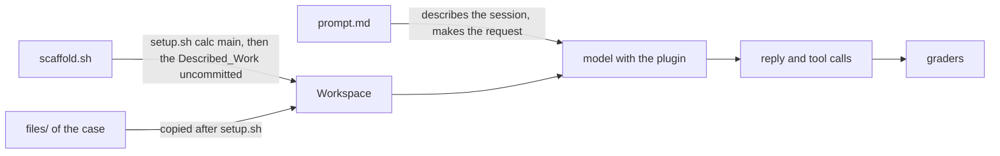

# Design Document

## Overview

Two existing cases get scaffolds that build the work their prompts describe, the way `no-offer-for-a-follow-up` already does. Two new cases under `evals/skills/switch-task/` start the `start-task` skill by hand: one after the substantial work that `offers-at-an-unrelated-request` describes, graded on the offer, and one after the short exchange that `no-offer-after-a-small-task` describes, graded on no offer and the skill starting. The limit of the two hand-off cases is recorded here and in `evals/README.md`. Nothing under the plugin's skills or hooks changes, and no case is run by a task but the Author's, task 5.1.

## Architecture

Every case has the same three parts, and this task changes or adds only those: the scaffold that builds the Workspace, the prompt that describes the session, and the graders that read the reply and the tool calls.

**Key decision: the scaffold builds the Described_Work, and the prompt stays as it is** (Requirements 1.1 to 1.4). `offers-at-an-unrelated-request` gains `subtract` in `calc/ops.py`, its test in `tests/test_ops.py`, and a `.ponderly/specs/subtract/` folder with its three files and every task ticked. `writes-the-compact-line` gains `.ponderly/specs/visit-counter/` with its three files, tasks unticked since `implement-spec` is the next step, and a design that states both carried decisions: count with `calc.ops.add`, and skip a repeated `event_id`. All of it is left uncommitted, because Ponderly commits nothing unless asked, and because the harness puts the git status into the session, so the changed files the prompt names show as changed. The trade-off is more fixture text to keep true. Rejected: rewording the prompts to describe only what the plain `calc` fixture holds, which would weaken `offers-at-an-unrelated-request` to a session with no spec run and leave `writes-the-compact-line` with no next step to name.

**Key decision: each case carries its own copy of the Described_Work** (Requirement 1.4). The two code changes are appended by the scaffold with the same lines `no-offer-for-a-follow-up` uses, and the spec folder lives in the case's own `files/`, copied after `setup.sh` so it stays uncommitted, as `evals/README.md` describes. The trade-off is that the `subtract` lines sit in three scaffolds and the `subtract` spec in two cases. Rejected: one shared overlay folder under `evals/fixtures/`, because `setup.sh` treats every folder there as a whole project it can build and commit, and an overlay is neither.

**Key decision: the skill started by hand is `start-task`, with a new task in the same package** (Requirements 2.1, 3.1). The prompt opens with `/ponderly:start-task add divide(a, b) to calc/ops.py, raising ZeroDivisionError for a zero divisor, with its test`, then a paragraph that describes the session. `start-task` is chosen because its opening needs no Bash, which the `switch-task` target does not grant, and because its first visible output, the route statement, names a route by a fixed word a regex can read. The task is in the same package, not unrelated work, so the offer can only come from the description's sentence about a skill started by hand, not from its sentence about an unrelated request. The trade-off is that criterion 4.9 was written with `readable-code` and `tighten-tests` in mind, and neither is the skill graded. Rejected: `readable-code`, whose first step runs git and so cannot start without Bash, which would leave the opposite case nothing to grade.

**Key decision: the two new cases reuse the session descriptions of two cases that already pass** (Requirements 2.1, 3.1). The offer case describes the same finished `subtract` spec run as `offers-at-an-unrelated-request`, adding that no switch message was shown; the opposite case describes the same one question answered from one file as `no-offer-after-a-small-task`. Both descriptions scored 1.00 in the recorded runs, so the only thing a new case varies is the start by hand. The trade-off is that the suite's idea of substantial work stays one example.

**Key decision: the offer case is expected to be the fragile one, and a failure that is the skill's is reported, not fixed** (Requirements 2.4, 5.3, 5.4). The typed command is expanded before the model runs, so the model meets `start-task`'s steps and the description's "Never offer it inside another skill's steps" together, and may start the skill with no offer. That is the behaviour criterion 4.9 asks about, so the case is the first sample run. A failure caused by the case, such as the session paragraph being read as part of the task, is corrected in the case. A failure where the model reads the prompt correctly and still makes no offer is the skill's, and the task stops with the trace.

**Key decision: a hand-off case cannot grade the full Switch_Message at an acceptable cost, and the two cases stay as they are** (Requirements 4.1 to 4.4). The Size_Hook reads the session's real size from the transcript, declines a `ponderly:switch-task` call under 150,000 tokens, or 110,000 when the one next step is `/ponderly:implement-spec`, and has no override. A sandbox session is around 20,000 tokens. A hand-off case would get the Switch_Message only by filling its session to the limit, with a scaffold that plants large files the prompt has the model read before the hand-off. The estimate for that, not measured, is $2 to $4 a run, against $0.62 recorded for the `lld` case, and above the $2 default ceiling. The Author judged that too much for what it adds. What covers each part instead:

- What the Size_Hook prints when it allows the call, the size as added context, is covered free by `checks/test_switch_size.py`.
- The Switch_Message, its `/compact` line and its next step are covered by `evals/skills/switch-task/writes-the-compact-line`, where the command is typed and the hook does not run.
- That a wired skill calls `ponderly:switch-task` with the right next step, and what the session says on a decline, are covered by the two hand-off cases.
- Not covered by any case or check: the sentence "This session holds about N tokens." that the Switch_Message carries after an allowed call. Only a real session at that size shows it.

`evals/README.md` gains this as one bullet under "What the sandbox allows", because a merged spec is not where a contributor looks. Rejected: a padded-session case, on cost; and an override in the hook for evals, because the hook is out of scope and an override would be a way to get a switch the hook exists to decline.

## Components and Interfaces

| Component | Change | Requirements |
|-----------|--------|--------------|
| `evals/skills/switch-task/offers-at-an-unrelated-request/scaffold.sh` and `files/.ponderly/specs/subtract/` | After `setup.sh calc main`, append `subtract` and its test, and copy the ticked spec in, uncommitted | 1.1, 1.3, 1.4 |
| `evals/skills/switch-task/writes-the-compact-line/scaffold.sh` and `files/.ponderly/specs/visit-counter/` | After `setup.sh calc main`, copy the unticked spec in, uncommitted | 1.2, 1.3, 1.4 |
| `evals/skills/switch-task/offers-at-a-skill-started-by-hand/` | New case: prompt, `case.yaml`, scaffold as the first row, `files/`, five graders | 2.1 to 2.4 |
| `evals/skills/switch-task/no-offer-at-a-skill-started-after-a-small-task/` | New case: prompt, `case.yaml`, scaffold with the plain `calc` fixture, two graders | 3.1 to 3.4 |
| `evals/README.md` | One bullet on what the hand-off cases grade and what covers the rest | 4.3 |
| `evals/skills/lld/switches-at-the-hand-off`, `evals/skills/bugfix/hands-off-to-pr`, the `switch-task` skill, the hooks, the merged spec | No change | 4.4, 5.1 |

Graders of the two new cases:

| Case | Grader | Type | Passes when | Requirements |
|------|--------|------|-------------|--------------|
| offer | `offers-the-switch` | `llm` | The reply offers the switch once and briefly before starting, asks whether to switch and does nothing further | 2.2, 2.4 |
| offer | `speaks-of-switching` | `regex` | The reply holds one of `switch-task`, `/compact`, `switch task`, `compact`, the pattern the no-offer cases reject | 2.2 |
| offer | `states-no-route` | `regex`, `not_contains` | The reply holds none of `Executor_Route`, `Spec_Route`, `Bug_Route` | 2.3, 2.4 |
| offer | `writes-no-file`, `edits-no-file` | `tool_used`, 0, `arm: both` | No Write and no Edit call | 2.3 |
| opposite | `makes-no-offer` | `regex`, `not_contains` | The reply holds none of `switch-task`, `/compact`, `switch task`, `compact`, the pattern the two existing no-offer cases use | 3.2, 3.4 |
| opposite | `states-the-route` | `regex` | The reply holds one of `Executor_Route`, `Spec_Route`, `Bug_Route` | 3.3 |

## Data Models

The frontmatter of each new `prompt.md`, in the shape of the existing `switch-task` cases:

| Field | Value | Notes |
|-------|-------|-------|
| `tags` | `[skill, switch-task]` | The `switch-task` target selects by tag and grants Write and Edit, no Bash |
| `allowed_tools` | `[Read, Glob, Grep, Write, Edit, Skill]` | As the sibling cases |
| `max_turns` | 10 | Room for `start-task` to read the code before its route statement (Requirement 3.3) |
| `description`, `expected_outcome` | Single-quoted | They hold `: `, which unquoted makes the harness skip the case |

The spec folders under `files/` each hold `requirements.md`, `design.md` and `tasks.md`, short, in the spec template's sections. No case runs `implement-spec` on them; they have to be true to the prompt, not buildable.

## Correctness Properties

### Property 1: A prompt's description is true of its Workspace

*For any* case under `evals/skills/switch-task/`, every path, function and decision its prompt names as earlier work exists in the Workspace its scaffold builds.

**Validates: Requirements 1.1, 1.2, 1.4, 2.1, 3.1**

### Property 2: The two new cases cannot both pass on one fixed habit

*For any* model that offers at every skill start, or at none, at least one of the two new cases fails.

**Validates: Requirements 2.2, 2.4, 3.2, 3.4**

### Property 3: The shipped behaviour is untouched

*For any* file under `plugins/claude/ponderly/skills/switch-task/`, `plugins/claude/ponderly/hooks/` or `.ponderly/specs/compact-at-task-switch/`, and the two hand-off cases, the branch's diff from its merge base with `origin/main` is empty.

**Validates: Requirements 1.3, 4.4, 5.1**

## Error Handling

| Condition | Category | Behaviour | Requirements |
|-----------|----------|-----------|--------------|
| A scaffold fails, such as the `sed` on the test import matching nothing | Case defect | The scaffold exits non-zero under `set -euo pipefail`; run it by hand in an empty directory as `evals/README.md` shows, and fix it | 1.1, 5.2 |
| A new case's frontmatter or a grader is invalid | Case defect | `make validate` fails on `checks/test_eval_cases.py` or `checks/test_frontmatter_yaml.py`; fix before any Paid_Run | 5.2 |
| The sample run of the offer case fails because the session paragraph was read as part of the task | Case defect | Correct the prompt, then one more sample | 5.4 |
| The sample run of the offer case fails with the prompt read correctly and no offer made | Skill behaviour | Stop; report the trace to the Author; change nothing in the skill | 2.4, 5.4 |
| The opposite case fails because the route statement came with an offer | Skill behaviour | Stop and report, as above | 3.4, 5.4 |

## Testing Strategy

- **Free, run by the tasks:** each changed or new scaffold is run by hand in an empty directory with the minimal environment `evals/README.md` gives, and the Workspace is checked against the prompt, which is Property 1. `make validate` covers the tags, graders, scaffolds and frontmatter. `git diff --stat $(git merge-base origin/main HEAD)` over the paths of Property 3 shows nothing. No new check file: a check that reads a prompt to prove a case is not how this repository proves behaviour.
- **Paid, run only with the Author's yes:** one sample run of `offers-at-a-skill-started-by-hand` first, as the case most likely to fail; then one of `no-offer-at-a-skill-started-after-a-small-task`; then the `switch-task` target to confirm, at three runs. The target selects eight cases, the seven here and `lld/switches-at-the-hand-off`, which carries the tag; the scores and the cost are recorded under task 5.1. Property 2 is shown by both new cases passing in the same confirming run.
- **Not tested:** the size sentence of the Switch_Message after an allowed call, as the last key decision records.
